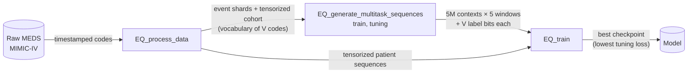
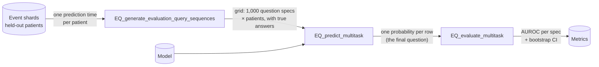

# How EveryQuery works

[EveryQuery](https://github.com/payalchandak/EveryQuery) (EQ) trains one model that answers any question of the form

> **Given the patient's record up to now, will code X occur inside this time window?**

for any code and any window. This page describes the multitask model (`ConditionalMultitaskARModel`)
as pinned in [`pyproject.toml`](pyproject.toml), and the retrieval we add to it (configuration #2,
in blue below). Without the blue parts it is EveryQuery as is (configuration #1).

## The model

```mermaid
flowchart LR
    P[["Patient record<br/>(before the prediction time)"]]
    WS[["Window specs<br/>5 windows"]]
    CS[["Conditioning<br/>codes + answers"]]
    CE["Code embedding<br/>table"]
    WB["Window-token<br/>builder"]
    CB["Condition / answer<br/>tokens"]
    ST["Stream<br/>assembly"]
    LL["Transformer<br/>(causal Llama)"]
    RO["Readout<br/>(tied code table)"]
    LO["Loss"]

    P -->|"last ≤ 256 codes + hours<br/>B × S ids"| CE
    CE -->|"patient tokens<br/>B × S × 384"| ST
    WS -->|"start + end of each window<br/>B × 5"| WB
    WB -->|"W0 … W4<br/>B × 5 × 384"| ST
    CS -->|"C0..C3 codes, A0..A3 yes/no<br/>B × 4"| CB
    CB -->|"C, A tokens<br/>B × 8 × 384"| ST
    ST -->|"[patient | K passage tokens | W0 C0 A0 … W4]<br/>B × (S + K + 13) × 384, time positions<br/>(#1: no passage tokens)"| LL
    LL -->|"hidden state at each W<br/>B × 5 × 384"| RO
    RO -->|"one logit per code<br/>B × 5 × V"| LO
    LB[["Labels<br/>B × 5 × V bits"]] -->|"did each code occur<br/>in each window"| LO

    PB["Transformer over the<br/>patient tokens<br/>(same weights)"]
    QP["Query<br/>projection"]
    FS["FAISS<br/>search"]
    DB[("Textbook passages<br/>one key each")]
    MT["Passage-token<br/>builder"]

    CE -->|"patient tokens<br/>B × S × 384"| PB
    PB -->|"hidden state at the<br/>last patient event<br/>B × 384"| QP
    QP -->|"query<br/>B × 1024"| FS
    DB -->|"125,847 keys<br/>1024-d"| FS
    FS -->|"keys of the top K<br/>+ scores s_k"| MT
    MT -->|"one token per passage<br/>B × K × 384"| ST

    classDef retrieval fill:#e7ecfd,stroke:#3b5bdb,color:#1d1d1f
    class PB,QP,FS,DB,MT retrieval
```

Shapes use the defaults: hidden width 384, 5 windows, `S` ≤ 256 patient codes, `V` codes in the
vocabulary, `K` retrieved passages. With retrieval the stream is
`[patient | K passage tokens | W0 C0 A0 … W4]`, `B × (S + K + 13) × 384`.

### Components

| Component | What it is | What it does |
|---|---|---|
| **Patient record** | The patient's last ≤ 256 codes before the prediction time (diagnoses, labs as value bins, medications, …) and the hour each happened. | The evidence the model reasons from. |
| **Window specs** | 5 windows per example. Each has a **start**: the prediction time, a delay ("in 10 days"), or the next occurrence of a code ("at the next admission"); and an **end**: a number of days after the start (1–1,826) or the next occurrence of a code ("at discharge"). | Say which period each question is about. |
| **Conditioning codes + answers** | For windows 0–3, one code drawn uniformly at random from the vocabulary (C*i*) and whether it occurred in that window (A*i*, mostly "no"). | Let later questions be conditional on earlier outcomes. |
| **Code embedding table** | One learned 384-d vector per code (`V × 384`). | Turns patient codes into vectors; the same table also embeds C*i* and the start/end codes, and scores the outputs (readout). |
| **Window-token builder** | For each window: start part (a small network on the delay in years, *or* the start code's vector + a "start" marker) + end part (a small network on the duration, *or* the end code's vector + a "bound" marker) + a token-type vector + a window-number vector. | Encodes "which period" as one token, W*i*. |
| **Condition / answer tokens** | C*i* = the conditioning code's vector; A*i* = a learned "yes" or "no" vector; each plus type and window-number vectors. | Feed earlier outcomes forward. |
| **Stream assembly** | Concatenates `[patient tokens | W0 C0 A0 | W1 C1 A1 | … | W4]` (with retrieval: the K passage tokens go between the patient tokens and W0). Positions are clock time in hours (rotary): patient tokens at their own hour, passage and question tokens at the hour of the last patient event. | One sequence for the transformer. |
| **Transformer (causal Llama)** | The main network: a standard decoder-only transformer, 12 layers, width 384, 6 heads, feed-forward 1,536. Causal: each token sees only tokens before it. | Builds a summary at each W*i* of the patient and of the questions and answers before it. W*i* never sees its own C*i*/A*i*. |
| **Readout (tied code table)** | The hidden state at W*i* times the code embedding table, plus a per-code bias (starts at −3, as most codes are rare). | One logit per code: P(code occurs in window *i*) = sigmoid(logit). |
| **Labels** | For every window, one bit per code: did it occur in that window. | Training targets. |
| **Loss** | Binary cross-entropy over every (window, code). | See below. |

### Retrieval components (#2, blue)

| Component | What it is | What it does |
|---|---|---|
| **Transformer over the patient tokens** | The same Llama, run on the patient tokens alone first (a second pass per batch). Causal, so the result equals the patient part of the full pass. | Gives a summary of the patient before any question: the hidden state at the last patient event. |
| **Query projection** | A learned linear layer, 384 → 1,024. | Turns that summary into a search query in the passages' key space. |
| **Textbook passages** | 125,847 medical-textbook passages, each with a 1,024-d key: its Qwen3-Embedding vector, precomputed and frozen. The search index is built by [`encode_docs.py`](encode_docs.py). | What can be looked up; the key is also what a passage contributes. |
| **FAISS search** | Inner-product nearest-neighbour search over the keys, on an L40S GPU. | Returns the top K passages for each patient and their scores `s_k = query · key_k / √1024`. |
| **Passage-token builder** | `token_k = linear(key_k) + s_k · u`: the key projected 1,024 → 384 (learned), plus the score times a learned 384-d vector `u`, plus a "passage" token type. | One token per passage. The score term is how the query gets a gradient: nothing flows back through the search itself. |

The window tokens then attend to the patient tokens and to every passage token; attention decides
which passages matter. Readout, labels and loss are unchanged.

## Training

### Data

- **Context**: one (patient, prediction time), drawn at random across the training split
  (`min_prediction_times_per_subject` = 50 sets eligibility); 5,000,000 contexts, plus a tuning set
  for validation.
- **Windows**: 5 per context, drawn by the label generator. Start: the prediction time (40%), a
  delay of 1–180 days (40%), or the next occurrence of a code (20%). End: 1–1,826 days after the
  start (log-uniform), or the next occurrence of a code (50%).
- **Labels**: for every window, every code in the vocabulary is labelled 1 if it occurs in the
  window, else 0. Stored as packed bits (`V` bits per window).

### One training step

1. Take a batch of 96 contexts.
2. Build the stream for each (patient tokens, window tokens, condition/answer tokens) and run the
   transformer once.
3. Read out `5 × V` logits per context and compare to the `5 × V` labels.

### Loss

Binary cross-entropy over every window *i* and code *c*, averaged over all valid (window, code)
pairs (padding windows and the padding code excluded):

$$
\mathcal{L} = \frac{1}{|\mathcal{V}|} \sum_{(b, i, c) \in \mathcal{V}} -\Big[\, y_{bic} \log \sigma(z_{bic}) + (1 - y_{bic}) \log\big(1 - \sigma(z_{bic})\big) \Big]
$$

$z_{bic}$ = logit of code $c$ at window $i$ of context $b$; $y_{bic}$ = its label; $\sigma$ = sigmoid.

| Setting | Default |
|---|---|
| Optimizer | AdamW, learning rate 2e-4, weight decay 0.05, betas (0.9, 0.98) |
| Schedule | cosine with 5% warmup |
| Batch / epochs | 96 contexts, 1 epoch over the 5M contexts |
| Precision / clipping | bf16, gradient norm 1.0 |
| Validation | every 5% of the epoch on 100 tuning batches; keep the checkpoint with the lowest tuning loss; early stopping |

## Evaluation

1. **Grid**: 1,000 question specifications are drawn once (seeded) and asked at one prediction time
   for every held-out patient. A specification is a sequence of 1–3 questions (code + window); the
   earlier ones are conditioning questions answered with the truth, the **last one is scored**.
   Example: "did the record end within 30 days? (no) → will the patient die within 1 year?".
2. **Predict**: the same stream as in training, built from the row's questions; the model reads out
   only the logit of the scored code at the last window. One probability per row.
3. **Evaluate**: rows are grouped by specification; each specification gets an AUROC with a
   1,000-resample bootstrap confidence interval. Specifications are scored separately (not pooled),
   since base rates differ enormously between questions.

Training and evaluation use the same model pass: training reads out all `V` codes at every window,
evaluation reads out one code at the last window.

## What changes with retrieval

| | #1 Patient only | #2 Retrieval + patient |
|---|---|---|
| Stream | `[patient | W0 C0 A0 … W4]` | `[patient | K passage tokens | W0 C0 A0 … W4]` |
| Passes per batch | one | two: the patient tokens alone (for the query), then the full stream |
| New trained parameters | – | query projection, key projection, `u` (~0.8M) |
| Loss | binary cross-entropy over every (window, code) | the same |
| Evaluation | grid → predict → AUROC per spec | the same; retrieval runs for every row as in training |
| Settings | – | K (passages) |
