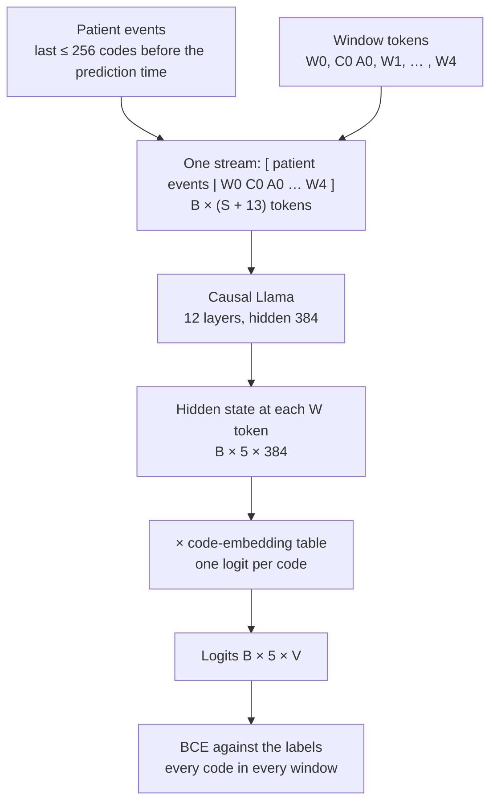
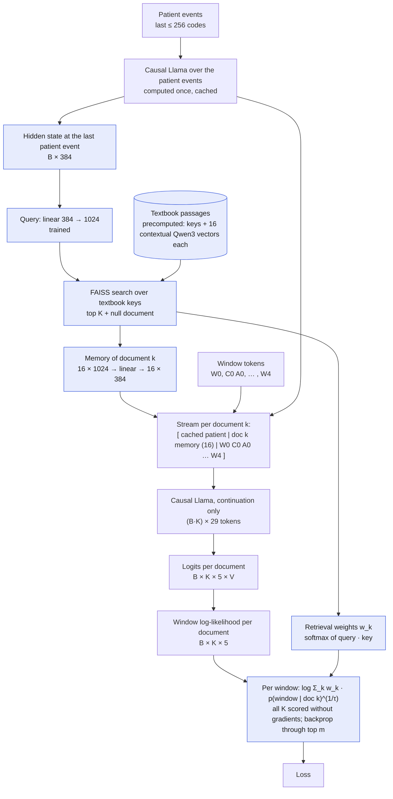

# EveryQuery with retrieval

Retrieval-augmented [EveryQuery](https://github.com/payalchandak/EveryQuery) on MIMIC-IV with the
medical-textbook corpus. Two configurations: **#1 patient only** (EveryQuery as is) and **#2
retrieval + patient**. Details in [`design.md`](design.md).

| File | What it does |
|---|---|
| [`design.md`](design.md) | the design, for review |
| [`run.sh`](run.sh) | one step: `preprocess`, `labels DRAW`, `eval_grid`, `encode_docs`, `train CONFIG SIZE LR DRAW` |
| [`submit.sh`](submit.sh) | submits `data`, `docs`, `pilot` or `stage0` to SLURM; skips finished and queued work; refuses to train without data |
| [`encode_docs.py`](encode_docs.py) | document key index + contextual Qwen3 memory (M vectors per passage) |
| [`pyproject.toml`](pyproject.toml) | environment: EveryQuery pinned to `13d7df8`, torch 2.10, FAISS, datasets, simple-scaling-laws |

## EveryQuery today (#1)



## With the retriever (#2)



Blue boxes are added by retrieval; the rest is EveryQuery as above.

The backbone and the code readout are shared. #2 adds the query projection, the search, the memory
tokens and the per-window combination over documents ([`design.md`](design.md) §2 and §5).

## Status

| Piece | Status |
|---|---|
| Data: preprocessing, training labels (3 draws), evaluation grid (1,000 specs) | ready to run |
| Stage 0: patient-only configuration search (18 runs) | ready to run |
| Document encoding (keys index + memory) | ready to run |
| Retrieval + patient model (#2), per-window objective | next |
| K and τ sweep (Stage 1), paired analysis | after #2 is implemented |

## Running on the cluster

```bash
cd everyquery
uv sync                      # .venv: EveryQuery + torch 2.10 (CUDA 12) + FAISS

# Data (CPU): preprocess, then 3 training-label draws and the evaluation grid after it
./submit.sh data

# Retrieval memory (GPU, independent of the above); reads ../scaling_laws/data/retrieval_db
./submit.sh docs

# After the data jobs: one pilot run to time training, then Stage 0
./submit.sh pilot
./submit.sh stage0
```

Each training job trains, predicts on the evaluation grid and evaluates:

```
outputs/<CONFIG>_<SIZE>_lr<LR>/draw<DRAW>/
    checkpoints/                    best (by tuning loss) and last; kept
    loggers/lightning_logs/…/metrics.csv
    resolved_config.yaml
    predictions.parquet             one probability per grid row
    metrics*                        AUROC per query spec with bootstrap CIs
```

Paths can be overridden with `MEDS_DIR`, `RETRIEVAL_DB` and `N_TRAIN` (see [`run.sh`](run.sh)).
Logs go to CSV; W&B is off.
