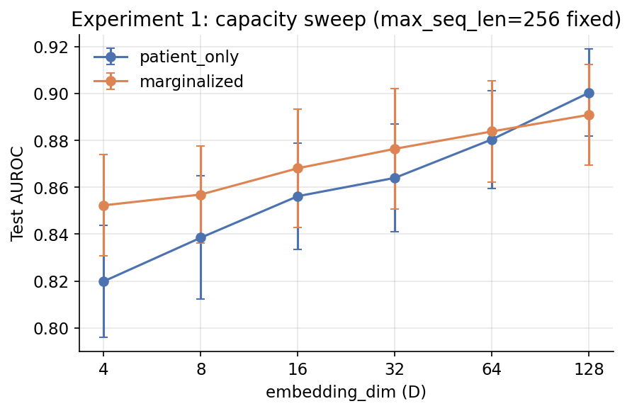
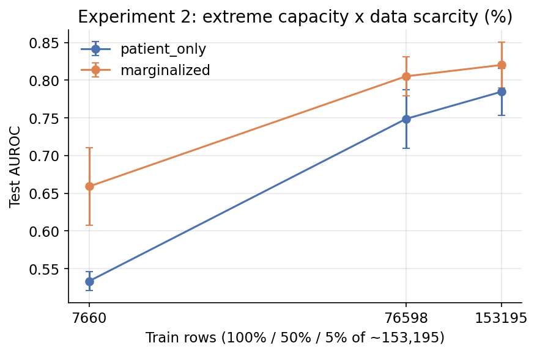
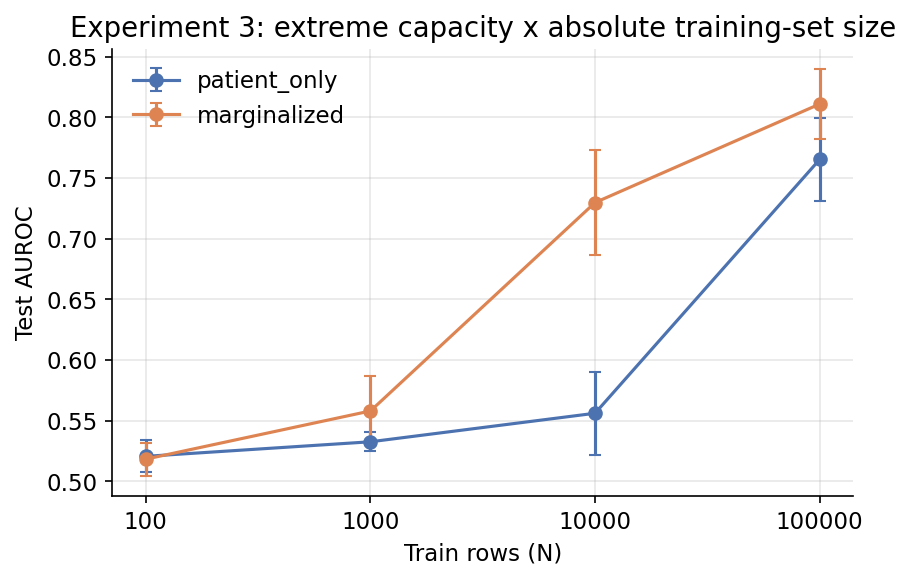
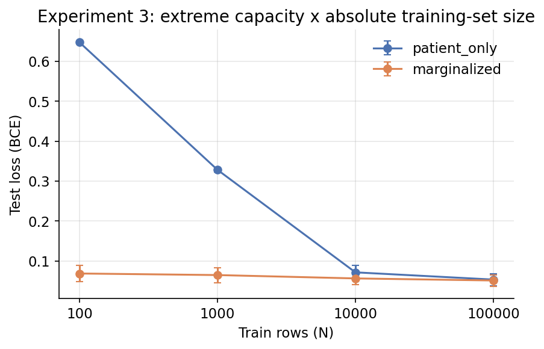
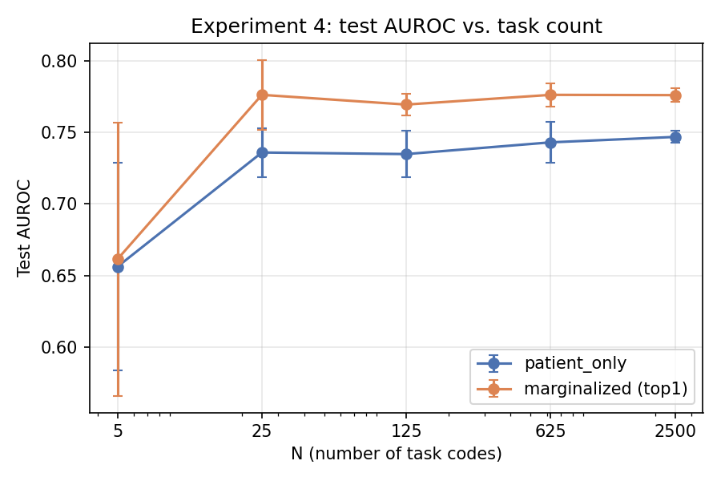
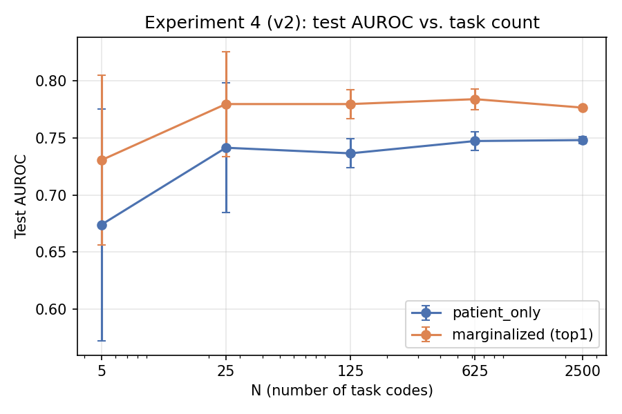
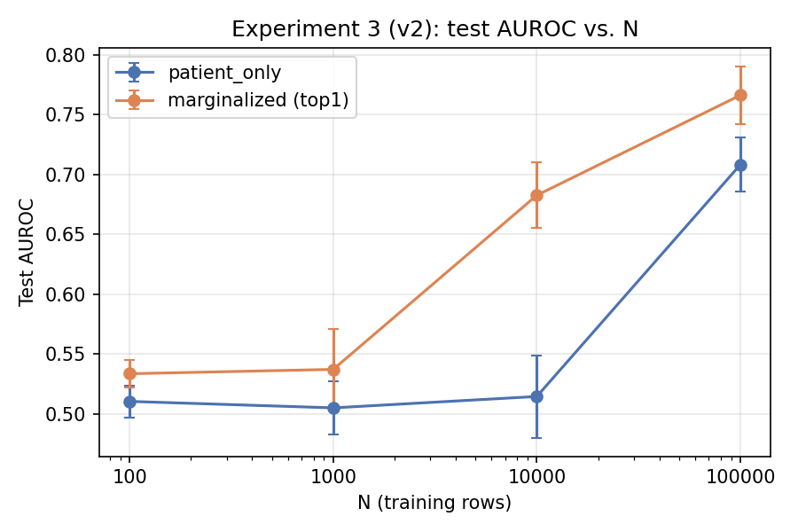
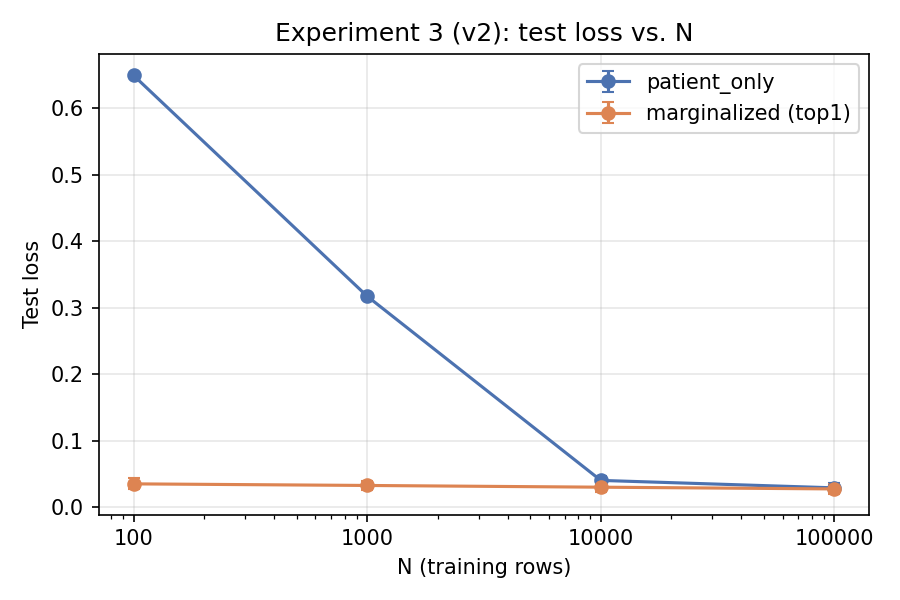

# Capacity and data-scale ablations (N=25 task codes, 30d)

Status: complete. Four experiments: (1) a clean 6-point capacity-only
sweep with context length held fixed, (2) an extreme capacity+context cut
crossed with 3 training-data levels (percentage-based), (3) the same
extreme capacity+context cut crossed with 4 absolute training-set sizes
(100/1,000/10,000/100,000 rows), with loss reported alongside AUROC, (4)
the same extreme capacity+context cut crossed with 5 task-count levels
(5/25/125/625/2,500 randomly-selected codes).

Scripts: `mimic_iv_sweep/scripts/sweep_{patient_only,marginalized_binary_learned_linear}_capacity_sweep_n25_30d_dim{4,8,16,32,64}.sh`
and matching `eval_test_*` scripts (experiment 1); `sweep_{patient_only,marginalized_binary_learned_linear}_extreme_starved_n25_30d{,_train50pct,_train5pct}.sh`
and matching `eval_test_*` scripts (experiment 2); `sweep_{patient_only,marginalized_binary_learned_linear}_extreme_starved_n25_30d_trainN{100,1000,10000,100000}.sh`
and matching `eval_test_*` scripts (experiment 3); `generate_labels_task_count_ablation_n5_2500_30d.sh` and
`sweep_{patient_only,marginalized_binary_learned_linear}_task_count_ablation_n5_2500_30d.sh`
and matching `eval_test_*` scripts (experiment 4). All in
`mimic_iv_sweep/scripts/`.

## Task

Multi-task binary classification on MIMIC-IV: N=25 randomly-sampled
diagnostic codes, predict whether each occurs within a 30-day window
after a prediction anchor time. 5 independent random draws. 3 training
epochs per run except where noted (100% training data unless noted).

## Shared model architecture

**Patient encoder** (`TimeDeltaRoPEPatientEncoder`): token embedding
(`nn.Embedding(vocab_size, D)`) → time-delta rotary self-attention
(position = cumulative log time gap between events, not sequence index) →
transformer blocks (self-attention + GELU feed-forward) → final LayerNorm.

**`patient_only`** (`fusion=passthrough`): masked-mean pool over the
sequence → `Linear(D, N_tasks)`. No retrieval; predictions come only from
the patient's own event history.

**`marginalized`**: query projector → retriever → fusion → head, then
marginalized over retrieved documents.

- Query projector: `sequence_mean_1024`, `in_dim=D` -- mean-pools the
  patient encoder's own hidden state, then a trainable `Linear(D, 1024)`.
- Retriever: `HFDatasetRetriever`, FAISS search over 125k passages from
  `MedRAG/textbooks`, pre-embedded with a frozen `Qwen3-Embedding-0.6B`
  model. Returns the top `K=4` documents per patient (not subsampled at
  any point in any experiment).
- Retrieval encoder: `TokenFeatureRetrievalEncoder`, a learned
  `nn.Embedding(151936, 64)` applied to retrieved-document tokens.
- Fusion: `PerDocCrossAttentionFusion`, 2 cross-attention layers,
  `d_model=256`, 8 heads, `ff_dim=512`, one 256-dim output per retrieved
  document.
- Head: `Linear(256, N_tasks)` applied per document.
- `marginalized_output_mode=binary`: each task's sigmoid probability is
  marginalized over the K=4 documents independently, weighted by softmax
  over the K documents' retrieval scores.

Tensorized cohort (all experiments): `/groups/mm6677_gp/zzw2102/data/MIMIC_MEDS_restored/processed`
(the original tensorized cohort was deleted ~2026-08-25; this is a
byte-for-byte snapshot restore).

Val: `val/auroc/mean`, computed once at the end of fit against the tuning
split, `retriever.k=4` for `marginalized`. Test: `test/auroc/mean`,
`eval_mode=test` scoring each checkpoint's `checkpoints/last.ckpt` against
the held-out split; for `marginalized`, test uses top-1-only retrieval
(`retriever.k=1, ablation_mode=none`) in experiments 2-4, and the trained
`k=4` marginalization in experiment 1 (noted per table).

---

## Experiment 1: clean capacity-only sweep

Encoder capacity is varied while `max_seq_len` is held fixed at 256
(full patient history) throughout -- unlike experiments 2-3, this
isolates parameter/representational capacity from context-length cutoff.
`ff_dim = 2 x embedding_dim` at every level (matches the convention used
everywhere else in this repo).

| `embedding_dim` (D) | `num_heads` | `num_layers` | `ff_dim` | `max_seq_len` |
| --- | --- | --- | --- | --- |
| 4 | 1 | 1 | 8 | 256 |
| 8 | 1 | 1 | 16 | 256 |
| 16 | 1 | 1 | 32 | 256 |
| 32 | 1 | 1 | 64 | 256 |
| 64 | 1 | 1 | 128 | 256 |
| 128 | 4 | 2 | 256 | 256 |

`marginalized` test-split numbers below use `retriever.k=4` (the trained
marginalization), not top-1.

### Summary

| D | patient_only (val) | patient_only (test) | marginalized (val, k=4) | marginalized (test, k=4) | Δ (test) | Draws won (test) |
| --- | --- | --- | --- | --- | --- | --- |
| 4 | 0.8372 ± 0.0294 | 0.8199 ± 0.0238 | 0.8597 ± 0.0287 | 0.8523 ± 0.0216 | +0.0324 | 5/5 |
| 8 | 0.8511 ± 0.0273 | 0.8385 ± 0.0263 | 0.8657 ± 0.0268 | 0.8569 ± 0.0207 | +0.0184 | 5/5 |
| 16 | 0.8666 ± 0.0265 | 0.8562 ± 0.0226 | 0.8747 ± 0.0299 | 0.8681 ± 0.0251 | +0.0119 | 5/5 |
| 32 | 0.8777 ± 0.0341 | 0.8640 ± 0.0230 | 0.8864 ± 0.0326 | 0.8764 ± 0.0256 | +0.0124 | 5/5 |
| 64 | 0.8907 ± 0.0281 | 0.8804 ± 0.0209 | 0.8886 ± 0.0192 | 0.8838 ± 0.0217 | +0.0034 | 4/5 |
| 128 | 0.9037 ± 0.0246 | 0.9003 ± 0.0186 | 0.8968 ± 0.0273 | 0.8909 ± 0.0216 | -0.0094 | 1/5 |

### Per draw, D=4

| Draw | patient_only (val) | patient_only (test) | marginalized (val) | marginalized (test) | Δ (test) |
| --- | --- | --- | --- | --- | --- |
| 1 | 0.8774 | 0.8450 | 0.8654 | 0.8663 | +0.0213 |
| 2 | 0.8307 | 0.8155 | 0.8507 | 0.8465 | +0.0310 |
| 3 | 0.8558 | 0.8382 | 0.8607 | 0.8614 | +0.0232 |
| 4 | 0.8324 | 0.8240 | 0.9056 | 0.8742 | +0.0502 |
| 5 | 0.7894 | 0.7771 | 0.8161 | 0.8131 | +0.0360 |

### Per draw, D=8

| Draw | patient_only (val) | patient_only (test) | marginalized (val) | marginalized (test) | Δ (test) |
| --- | --- | --- | --- | --- | --- |
| 1 | 0.8806 | 0.8565 | 0.8770 | 0.8597 | +0.0032 |
| 2 | 0.8503 | 0.8307 | 0.8622 | 0.8498 | +0.0191 |
| 3 | 0.8552 | 0.8569 | 0.8663 | 0.8765 | +0.0196 |
| 4 | 0.8688 | 0.8582 | 0.9030 | 0.8775 | +0.0193 |
| 5 | 0.8008 | 0.7901 | 0.8202 | 0.8212 | +0.0311 |

### Per draw, D=16

| Draw | patient_only (val) | patient_only (test) | marginalized (val) | marginalized (test) | Δ (test) |
| --- | --- | --- | --- | --- | --- |
| 1 | 0.8824 | 0.8678 | 0.8753 | 0.8782 | +0.0104 |
| 2 | 0.8666 | 0.8528 | 0.8618 | 0.8533 | +0.0005 |
| 3 | 0.8722 | 0.8748 | 0.8756 | 0.8816 | +0.0068 |
| 4 | 0.8946 | 0.8719 | 0.9264 | 0.8998 | +0.0279 |
| 5 | 0.8171 | 0.8137 | 0.8343 | 0.8275 | +0.0138 |

### Per draw, D=32

| Draw | patient_only (val) | patient_only (test) | marginalized (val) | marginalized (test) | Δ (test) |
| --- | --- | --- | --- | --- | --- |
| 1 | 0.9026 | 0.8670 | 0.8847 | 0.8763 | +0.0093 |
| 2 | 0.8635 | 0.8503 | 0.8822 | 0.8607 | +0.0104 |
| 3 | 0.8695 | 0.8800 | 0.8891 | 0.8927 | +0.0127 |
| 4 | 0.9261 | 0.8942 | 0.9393 | 0.9133 | +0.0191 |
| 5 | 0.8269 | 0.8283 | 0.8365 | 0.8390 | +0.0107 |

### Per draw, D=64

| Draw | patient_only (val) | patient_only (test) | marginalized (val) | marginalized (test) | Δ (test) |
| --- | --- | --- | --- | --- | --- |
| 1 | 0.8982 | 0.8854 | 0.8773 | 0.8901 | +0.0047 |
| 2 | 0.8721 | 0.8648 | 0.8840 | 0.8675 | +0.0027 |
| 3 | 0.8895 | 0.8955 | 0.8913 | 0.8922 | -0.0033 |
| 4 | 0.9385 | 0.9071 | 0.9235 | 0.9159 | +0.0088 |
| 5 | 0.8553 | 0.8494 | 0.8667 | 0.8532 | +0.0038 |

### Per draw, D=128 (full capacity)

| Draw | patient_only (val) | patient_only (test) | marginalized (val) | marginalized (test) | Δ (test) |
| --- | --- | --- | --- | --- | --- |
| 1 | 0.8923 | 0.9060 | 0.9020 | 0.8932 | -0.0128 |
| 2 | 0.9095 | 0.8997 | 0.8802 | 0.8782 | -0.0215 |
| 3 | 0.9030 | 0.9056 | 0.8947 | 0.8977 | -0.0079 |
| 4 | 0.9446 | 0.9237 | 0.9444 | 0.9252 | +0.0015 |
| 5 | 0.8691 | 0.8668 | 0.8628 | 0.8604 | -0.0064 |

---

## Experiment 2: extreme capacity+context cut x data scarcity (percentage-based)

Both `embedding_dim` and `max_seq_len` are cut together (bundled, unlike
experiment 1), crossed with 3 training-data levels.

| Param | Value |
| --- | --- |
| `encoder.embedding_dim` | 4 |
| `encoder.num_heads` | 1 |
| `encoder.num_layers` | 1 |
| `encoder.ff_dim` | 8 |
| `max_seq_len` | 8 |

Training-set size subsampled uniformly at random by row (fixed seed per
draw); `patient_only` and `marginalized` train on the identical
subsampled label file for a given (draw, fraction). Validation and test
splits are full-size at every data level.

| Train fraction | Approx. train rows (of ~153,195 full) |
| --- | --- |
| 100% | 153,195 |
| 50% | 76,598 |
| 5% | 7,660 |

`marginalized` test-split numbers below use top-1-only retrieval
(`retriever.k=1, ablation_mode=none`), not the trained k=4 marginalization.

### Summary

| Train fraction | patient_only (val) | patient_only (test) | marginalized (val, k=4) | marginalized (test, top1) | Δ (test) | Draws won (test) |
| --- | --- | --- | --- | --- | --- | --- |
| 100% | 0.7911 ± 0.0314 | 0.7846 ± 0.0312 | 0.8286 ± 0.0300 | 0.8201 ± 0.0301 | +0.0355 | 5/5 |
| 50% | 0.7506 ± 0.0333 | 0.7486 ± 0.0391 | 0.8051 ± 0.0221 | 0.8051 ± 0.0259 | +0.0564 | 5/5 |
| 5% | 0.5255 ± 0.0164 | 0.5334 ± 0.0123 | 0.6829 ± 0.0472 | 0.6590 ± 0.0513 | +0.1257 | 5/5 |

### Per draw, 100% data

| Draw | patient_only (val) | patient_only (test) | marginalized (val, k=4) | marginalized (test, top1) | Δ (val) | Δ (test) |
| --- | --- | --- | --- | --- | --- | --- |
| 1 | 0.8032 | 0.8138 | 0.8425 | 0.8519 | +0.0393 | +0.0381 |
| 2 | 0.8034 | 0.7716 | 0.8150 | 0.7897 | +0.0116 | +0.0181 |
| 3 | 0.7991 | 0.8080 | 0.8299 | 0.8361 | +0.0308 | +0.0281 |
| 4 | 0.8199 | 0.8002 | 0.8733 | 0.8445 | +0.0534 | +0.0443 |
| 5 | 0.7300 | 0.7294 | 0.7825 | 0.7784 | +0.0525 | +0.0490 |

### Per draw, 50% data

| Draw | patient_only (val) | patient_only (test) | marginalized (val, k=4) | marginalized (test, top1) | Δ (val) | Δ (test) |
| --- | --- | --- | --- | --- | --- | --- |
| 1 | 0.7729 | 0.7851 | 0.8198 | 0.8286 | +0.0469 | +0.0435 |
| 2 | 0.7302 | 0.7136 | 0.7893 | 0.7860 | +0.0591 | +0.0724 |
| 3 | 0.7636 | 0.7818 | 0.8061 | 0.8211 | +0.0425 | +0.0393 |
| 4 | 0.7896 | 0.7726 | 0.8366 | 0.8261 | +0.0470 | +0.0535 |
| 5 | 0.6965 | 0.6901 | 0.7738 | 0.7635 | +0.0773 | +0.0734 |

### Per draw, 5% data

| Draw | patient_only (val) | patient_only (test) | marginalized (val, k=4) | marginalized (test, top1) | Δ (val) | Δ (test) |
| --- | --- | --- | --- | --- | --- | --- |
| 1 | 0.5238 | 0.5422 | 0.7113 | 0.7080 | +0.1875 | +0.1658 |
| 2 | 0.5043 | 0.5287 | 0.6166 | 0.5832 | +0.1123 | +0.0545 |
| 3 | 0.5263 | 0.5421 | 0.6989 | 0.7069 | +0.1726 | +0.1648 |
| 4 | 0.5546 | 0.5428 | 0.7460 | 0.6839 | +0.1914 | +0.1411 |
| 5 | 0.5186 | 0.5111 | 0.6416 | 0.6132 | +0.1230 | +0.1021 |

---

## Experiment 3: extreme capacity x absolute training-set size (with loss)

Same capacity cut as Experiment 2 (`embedding_dim=4, num_heads=1,
num_layers=1, ff_dim=8, max_seq_len=8`), but the data axis is now exact
absolute training-row counts instead of percentages, and loss is reported
alongside AUROC. `train.parquet` is subsampled uniformly at random by row,
fixed seed per (level, draw), via `subsample_train_labels.py --n-rows`;
`patient_only` and `marginalized` train on the identical subsampled label
file per (draw, level).

| N (train rows) | `max_epochs` | `warmup_steps` |
| --- | --- | --- |
| 100 | 20 | 15 |
| 1,000 | 10 | 60 |
| 10,000 | 5 | 200 |
| 100,000 | 3 | 200 |

Epoch/warmup schedule is capped, not fully step-matched to the ~14,360
total optimizer steps of Experiment 1/2's full-data runs (which would need
~4,790 epochs at N=100) -- see the schedule table for exact per-level
values. `marginalized` test-split numbers use top-1-only retrieval
(`retriever.k=1, ablation_mode=none`), matching Experiment 2's convention.

### Summary

| N | patient_only (val AUROC) | patient_only (val loss) | patient_only (test AUROC) | patient_only (test loss) | marginalized (val AUROC) | marginalized (val loss) | marginalized (test AUROC) | marginalized (test loss) | Δ AUROC (test) | Draws won |
| --- | --- | --- | --- | --- | --- | --- | --- | --- | --- | --- |
| 100 | 0.5075 ± 0.0060 | 0.6474 ± 0.0015 | 0.5206 ± 0.0131 | 0.6476 ± 0.0015 | 0.5107 ± 0.0250 | 0.0685 ± 0.0205 | 0.5183 ± 0.0137 | 0.0685 ± 0.0203 | -0.0023 | 2/5 |
| 1,000 | 0.5115 ± 0.0118 | 0.3282 ± 0.0055 | 0.5326 ± 0.0078 | 0.3283 ± 0.0054 | 0.5358 ± 0.0283 | 0.0646 ± 0.0189 | 0.5580 ± 0.0284 | 0.0646 ± 0.0188 | +0.0254 | 4/5 |
| 10,000 | 0.5457 ± 0.0296 | 0.0713 ± 0.0180 | 0.5561 ± 0.0340 | 0.0714 ± 0.0178 | 0.7413 ± 0.0310 | 0.0562 ± 0.0159 | 0.7297 ± 0.0430 | 0.0562 ± 0.0158 | +0.1737 | 5/5 |
| 100,000 | 0.7709 ± 0.0334 | 0.0532 ± 0.0151 | 0.7652 ± 0.0343 | 0.0533 ± 0.0149 | 0.8182 ± 0.0283 | 0.0510 ± 0.0146 | 0.8109 ± 0.0286 | 0.0510 ± 0.0145 | +0.0457 | 5/5 |

### Per draw, N=100

| Draw | patient_only (val AUROC) | patient_only (val loss) | patient_only (test AUROC) | patient_only (test loss) | marginalized (val AUROC) | marginalized (val loss) | marginalized (test AUROC) | marginalized (test loss) | Δ (test AUROC) |
| --- | --- | --- | --- | --- | --- | --- | --- | --- | --- |
| 1 | 0.5087 | 0.6451 | 0.5230 | 0.6452 | 0.4978 | 0.0953 | 0.5072 | 0.0956 | -0.0158 |
| 2 | 0.4962 | 0.6494 | 0.5262 | 0.6497 | 0.4717 | 0.0347 | 0.5039 | 0.0355 | -0.0223 |
| 3 | 0.5106 | 0.6474 | 0.5117 | 0.6471 | 0.5160 | 0.0638 | 0.5369 | 0.0624 | +0.0252 |
| 4 | 0.5136 | 0.6469 | 0.5402 | 0.6475 | 0.5468 | 0.0655 | 0.5327 | 0.0665 | -0.0075 |
| 5 | 0.5087 | 0.6484 | 0.5018 | 0.6486 | 0.5214 | 0.0830 | 0.5108 | 0.0824 | +0.0090 |

### Per draw, N=1,000

| Draw | patient_only (val AUROC) | patient_only (val loss) | patient_only (test AUROC) | patient_only (test loss) | marginalized (val AUROC) | marginalized (val loss) | marginalized (test AUROC) | marginalized (test loss) | Δ (test AUROC) |
| --- | --- | --- | --- | --- | --- | --- | --- | --- | --- |
| 1 | 0.5157 | 0.3368 | 0.5310 | 0.3369 | 0.5420 | 0.0875 | 0.5754 | 0.0876 | +0.0444 |
| 2 | 0.4881 | 0.3198 | 0.5367 | 0.3201 | 0.4842 | 0.0334 | 0.5069 | 0.0339 | -0.0298 |
| 3 | 0.5201 | 0.3264 | 0.5341 | 0.3260 | 0.5695 | 0.0608 | 0.5813 | 0.0596 | +0.0472 |
| 4 | 0.5180 | 0.3288 | 0.5421 | 0.3292 | 0.5485 | 0.0602 | 0.5792 | 0.0614 | +0.0371 |
| 5 | 0.5157 | 0.3293 | 0.5188 | 0.3291 | 0.5347 | 0.0808 | 0.5471 | 0.0807 | +0.0283 |

### Per draw, N=10,000

| Draw | patient_only (val AUROC) | patient_only (val loss) | patient_only (test AUROC) | patient_only (test loss) | marginalized (val AUROC) | marginalized (val loss) | marginalized (test AUROC) | marginalized (test loss) | Δ (test AUROC) |
| --- | --- | --- | --- | --- | --- | --- | --- | --- | --- |
| 1 | 0.5742 | 0.0933 | 0.6156 | 0.0935 | 0.7710 | 0.0701 | 0.7766 | 0.0705 | +0.1610 |
| 2 | 0.4992 | 0.0409 | 0.5256 | 0.0417 | 0.7138 | 0.0299 | 0.6845 | 0.0307 | +0.1589 |
| 3 | 0.5556 | 0.0671 | 0.5627 | 0.0660 | 0.7535 | 0.0530 | 0.7713 | 0.0509 | +0.2086 |
| 4 | 0.5749 | 0.0698 | 0.5557 | 0.0707 | 0.7722 | 0.0529 | 0.7425 | 0.0536 | +0.1868 |
| 5 | 0.5244 | 0.0852 | 0.5207 | 0.0851 | 0.6960 | 0.0752 | 0.6739 | 0.0752 | +0.1532 |

### Per draw, N=100,000

| Draw | patient_only (val AUROC) | patient_only (val loss) | patient_only (test AUROC) | patient_only (test loss) | marginalized (val AUROC) | marginalized (val loss) | marginalized (test AUROC) | marginalized (test loss) | Δ (test AUROC) |
| --- | --- | --- | --- | --- | --- | --- | --- | --- | --- |
| 1 | 0.7806 | 0.0642 | 0.7924 | 0.0649 | 0.8359 | 0.0617 | 0.8439 | 0.0627 | +0.0515 |
| 2 | 0.7802 | 0.0288 | 0.7445 | 0.0297 | 0.8060 | 0.0273 | 0.7885 | 0.0281 | +0.0440 |
| 3 | 0.7747 | 0.0495 | 0.7936 | 0.0477 | 0.8197 | 0.0486 | 0.8175 | 0.0465 | +0.0239 |
| 4 | 0.8101 | 0.0503 | 0.7883 | 0.0511 | 0.8568 | 0.0475 | 0.8363 | 0.0481 | +0.0480 |
| 5 | 0.7090 | 0.0732 | 0.7072 | 0.0730 | 0.7728 | 0.0701 | 0.7684 | 0.0699 | +0.0612 |

### Positive-count caveat

At the two smallest levels, many of the 25 task codes have zero
training-set positives:

| N | Draw | # tasks with 0 positives (of 25) | min positives across tasks |
| --- | --- | --- | --- |
| 100 | 1 | 15 | 0 |
| 100 | 2 | 18 | 0 |
| 100 | 3 | 14 | 0 |
| 100 | 4 | 15 | 0 |
| 100 | 5 | 11 | 0 |
| 1,000 | 1 | 2 | 0 |
| 1,000 | 2 | 10 | 0 |
| 1,000 | 3 | 0 | 1 |
| 1,000 | 4 | 6 | 0 |
| 1,000 | 5 | 2 | 0 |
| 10,000 | 1-4 | 0 | 1 (draws 1,2,4), 4 (draw 3) |
| 10,000 | 5 | 1 | 0 |
| 100,000 | all | 0 | 4-51 |

`patient_only` and `marginalized` train on the identical subsampled label
file for a given (draw, N), so both architectures face the same
positive-count handicap per task.

### Note: loss/AUROC divergence at N=100

At N=100, `patient_only` test loss (0.6476, near `ln(2)=0.693`, the loss
of uninformative 50/50 predictions) is far higher than `marginalized` test
loss (0.0685), despite both architectures having near-chance test AUROC
(0.5206 vs. 0.5183). Given the high fraction of zero-positive tasks at this
level (see caveat table above), this reflects `patient_only` producing
high-entropy predictions while `marginalized` produces confident-but-still
uninformative ones -- low loss here does not imply better discrimination.

---

## Experiment 4: extreme capacity vs. task count (N=5-2,500, correct anchor-fixed methodology)

Same capacity cut as Experiments 2-3 (`embedding_dim=4, num_heads=1,
num_layers=1, ff_dim=8, max_seq_len=8`), full training data at every
level, but the axis is now the number of randomly-selected task codes
(`code_selection=random`), log-spaced from 5 to 2,500. This replaces an
earlier task-count ablation removed from this README for using
pre-anchor-fix labels (`results/anchor_sampling_fix/README.md`); this
version uses `anchor_strategy=uniform_event`, `min_subjects_per_code=100`,
`min_events_per_subject=10`, `horizon_days=30.0` -- the same methodology as
every other experiment in this file, generated fresh from a rebuilt
`intermediate/` MEDS dataset (the shared one was deleted 2026-08-25;
rebuilt from the still-intact raw MEDS_cohort/data/ with the confirmed
original filtering params). 5 independent random draws per N level, same
draw seeds (101/202/303/404/505) as every other experiment in this file.

| N (task codes) | Approx. train rows |
| --- | --- |
| 5 | 153,220 |
| 25 | 153,220 |
| 125 | 153,220 |
| 625 | 153,220 |
| 2,500 | 153,220 |

`marginalized` test-split numbers below use top-1-only retrieval
(`retriever.k=1, ablation_mode=none`), matching Experiments 2-3's
convention.

### Summary

| N | patient_only (val AUROC) | patient_only (val loss) | patient_only (test AUROC) | patient_only (test loss) | marginalized (val AUROC) | marginalized (val loss) | marginalized (test AUROC) | marginalized (test loss) | Δ AUROC (test) | Draws won |
| --- | --- | --- | --- | --- | --- | --- | --- | --- | --- | --- |
| 5 | 0.6465 ± 0.1197 | 0.0319 ± 0.0364 | 0.6561 ± 0.0725 | 0.0325 ± 0.0362 | 0.6869 ± 0.0889 | 0.0312 ± 0.0359 | 0.6613 ± 0.0954 | 0.0321 ± 0.0358 | +0.0052 | 2/5 |
| 25 | 0.7301 ± 0.0315 | 0.0326 ± 0.0103 | 0.7359 ± 0.0172 | 0.0322 ± 0.0097 | 0.7875 ± 0.0208 | 0.0315 ± 0.0098 | 0.7762 ± 0.0243 | 0.0312 ± 0.0094 | +0.0403 | 5/5 |
| 125 | 0.7302 ± 0.0291 | 0.0231 ± 0.0050 | 0.7348 ± 0.0163 | 0.0231 ± 0.0052 | 0.7702 ± 0.0268 | 0.0223 ± 0.0050 | 0.7694 ± 0.0074 | 0.0224 ± 0.0052 | +0.0346 | 5/5 |
| 625 | 0.7487 ± 0.0126 | 0.0259 ± 0.0023 | 0.7430 ± 0.0145 | 0.0259 ± 0.0023 | 0.7819 ± 0.0043 | 0.0253 ± 0.0023 | 0.7762 ± 0.0080 | 0.0254 ± 0.0021 | +0.0332 | 5/5 |
| 2,500 | 0.7525 ± 0.0055 | 0.0271 ± 0.0011 | 0.7468 ± 0.0043 | 0.0270 ± 0.0014 | 0.7898 ± 0.0047 | 0.0264 ± 0.0012 | 0.7760 ± 0.0047 | 0.0267 ± 0.0016 | +0.0292 | 5/5 |

### Per draw, N=5

| Draw | patient_only (val AUROC) | patient_only (val loss) | patient_only (test AUROC) | patient_only (test loss) | marginalized (val AUROC) | marginalized (val loss) | marginalized (test AUROC) | marginalized (test loss) | Δ (test AUROC) |
| --- | --- | --- | --- | --- | --- | --- | --- | --- | --- |
| 1 | 0.6586 | 0.0149 | 0.6664 | 0.0166 | 0.7525 | 0.0141 | 0.7445 | 0.0161 | +0.0781 |
| 2 | 0.7218 | 0.0036 | 0.6014 | 0.0053 | 0.6060 | 0.0035 | 0.5626 | 0.0055 | -0.0388 |
| 3 | 0.7461 | 0.0472 | 0.7727 | 0.0458 | 0.8082 | 0.0456 | 0.7720 | 0.0450 | -0.0007 |
| 4 | 0.6628 | 0.0890 | 0.6493 | 0.0900 | 0.6188 | 0.0879 | 0.6521 | 0.0892 | +0.0028 |
| 5 | 0.4433 | 0.0050 | 0.5905 | 0.0050 | 0.6490 | 0.0049 | 0.5751 | 0.0050 | -0.0154 |

### Per draw, N=25

| Draw | patient_only (val AUROC) | patient_only (val loss) | patient_only (test AUROC) | patient_only (test loss) | marginalized (val AUROC) | marginalized (val loss) | marginalized (test AUROC) | marginalized (test loss) | Δ (test AUROC) |
| --- | --- | --- | --- | --- | --- | --- | --- | --- | --- |
| 1 | 0.7689 | 0.0318 | 0.7590 | 0.0328 | 0.8088 | 0.0307 | 0.7954 | 0.0321 | +0.0364 |
| 2 | 0.7081 | 0.0287 | 0.7367 | 0.0274 | 0.7851 | 0.0280 | 0.7515 | 0.0264 | +0.0148 |
| 3 | 0.6974 | 0.0182 | 0.7137 | 0.0187 | 0.7616 | 0.0178 | 0.7591 | 0.0181 | +0.0454 |
| 4 | 0.7578 | 0.0395 | 0.7436 | 0.0387 | 0.8080 | 0.0378 | 0.8079 | 0.0369 | +0.0643 |
| 5 | 0.7185 | 0.0449 | 0.7262 | 0.0436 | 0.7741 | 0.0434 | 0.7670 | 0.0423 | +0.0408 |

### Per draw, N=125

| Draw | patient_only (val AUROC) | patient_only (val loss) | patient_only (test AUROC) | patient_only (test loss) | marginalized (val AUROC) | marginalized (val loss) | marginalized (test AUROC) | marginalized (test loss) | Δ (test AUROC) |
| --- | --- | --- | --- | --- | --- | --- | --- | --- | --- |
| 1 | 0.7635 | 0.0255 | 0.7411 | 0.0260 | 0.8005 | 0.0249 | 0.7681 | 0.0256 | +0.0270 |
| 2 | 0.6919 | 0.0169 | 0.7301 | 0.0165 | 0.7278 | 0.0163 | 0.7589 | 0.0160 | +0.0288 |
| 3 | 0.7505 | 0.0222 | 0.7575 | 0.0225 | 0.7793 | 0.0216 | 0.7797 | 0.0223 | +0.0222 |
| 4 | 0.7347 | 0.0301 | 0.7323 | 0.0300 | 0.7775 | 0.0293 | 0.7700 | 0.0292 | +0.0377 |
| 5 | 0.7105 | 0.0209 | 0.7130 | 0.0203 | 0.7659 | 0.0194 | 0.7704 | 0.0188 | +0.0574 |

### Per draw, N=625

| Draw | patient_only (val AUROC) | patient_only (val loss) | patient_only (test AUROC) | patient_only (test loss) | marginalized (val AUROC) | marginalized (val loss) | marginalized (test AUROC) | marginalized (test loss) | Δ (test AUROC) |
| --- | --- | --- | --- | --- | --- | --- | --- | --- | --- |
| 1 | 0.7570 | 0.0248 | 0.7468 | 0.0252 | 0.7864 | 0.0243 | 0.7745 | 0.0248 | +0.0277 |
| 2 | 0.7359 | 0.0249 | 0.7369 | 0.0248 | 0.7774 | 0.0240 | 0.7739 | 0.0243 | +0.0370 |
| 3 | 0.7623 | 0.0268 | 0.7638 | 0.0269 | 0.7864 | 0.0264 | 0.7902 | 0.0266 | +0.0264 |
| 4 | 0.7535 | 0.0236 | 0.7432 | 0.0234 | 0.7810 | 0.0230 | 0.7722 | 0.0231 | +0.0290 |
| 5 | 0.7348 | 0.0295 | 0.7242 | 0.0293 | 0.7786 | 0.0287 | 0.7702 | 0.0285 | +0.0460 |

### Per draw, N=2,500

| Draw | patient_only (val AUROC) | patient_only (val loss) | patient_only (test AUROC) | patient_only (test loss) | marginalized (val AUROC) | marginalized (val loss) | marginalized (test AUROC) | marginalized (test loss) | Δ (test AUROC) |
| --- | --- | --- | --- | --- | --- | --- | --- | --- | --- |
| 1 | 0.7591 | 0.0289 | 0.7461 | 0.0291 | 0.7967 | 0.0283 | 0.7762 | 0.0292 | +0.0301 |
| 2 | 0.7563 | 0.0267 | 0.7526 | 0.0264 | 0.7860 | 0.0259 | 0.7690 | 0.0265 | +0.0164 |
| 3 | 0.7522 | 0.0274 | 0.7452 | 0.0274 | 0.7913 | 0.0267 | 0.7808 | 0.0269 | +0.0356 |
| 4 | 0.7451 | 0.0266 | 0.7412 | 0.0265 | 0.7849 | 0.0257 | 0.7744 | 0.0258 | +0.0332 |
| 5 | 0.7495 | 0.0260 | 0.7491 | 0.0255 | 0.7899 | 0.0252 | 0.7797 | 0.0251 | +0.0306 |

---

## Experiment 4 (v2): degenerate-code-rejection + retrieval-scaling fix

Re-run of Experiment 4 above, same config, using MedRAP commit
`227d05a7d7ea8d28a87a67359f82083cfe03c85d` (branch
`fix/scale-marginalized-retrieval-dot-product`, PR #113 on
McDermottHealthAI/MedRAP -- still open/unmerged at time of writing, pinned
via branch HEAD commit rather than merged `main`). This commit includes
both degenerate-code rejection (PR #102, already on `main`) and the
retrieval-score-scaling fix (PR #113 itself: dividing dot-product
retrieval scores by `sqrt(D)` before the softmax that weights
marginalization). Labels regenerated fresh from the same rebuilt
`intermediate/` (`code_selection=random`, `anchor_strategy=uniform_event`,
`horizon_days=30.0`, same 5 draw seeds), so the specific task codes at
each N differ from Experiment 4 above. Experiment 4 always trains on full
data (153,220 rows), so a large loss-magnitude shift from the
retrieval-scaling fix was not expected here -- that effect is specific to
Experiment 3's small-training-row-count regime (N=100/1,000 rows), not yet
re-run.

### Summary

| N | patient_only (val AUROC) | patient_only (val loss) | patient_only (test AUROC) | patient_only (test loss) | marginalized (val AUROC) | marginalized (val loss) | marginalized (test AUROC) | marginalized (test loss) | Δ AUROC (test) | Draws won |
| --- | --- | --- | --- | --- | --- | --- | --- | --- | --- | --- |
| 5 | 0.7178 ± 0.0370 | 0.0312 ± 0.0343 | 0.6739 ± 0.1016 | 0.0317 ± 0.0353 | 0.7407 ± 0.0821 | 0.0305 ± 0.0334 | 0.7305 ± 0.0746 | 0.0310 ± 0.0350 | +0.0566 | 5/5 |
| 25 | 0.7407 ± 0.0524 | 0.0275 ± 0.0119 | 0.7414 ± 0.0569 | 0.0273 ± 0.0116 | 0.7927 ± 0.0408 | 0.0268 ± 0.0117 | 0.7797 ± 0.0459 | 0.0265 ± 0.0112 | +0.0383 | 5/5 |
| 125 | 0.7352 ± 0.0177 | 0.0268 ± 0.0049 | 0.7365 ± 0.0128 | 0.0267 ± 0.0047 | 0.7779 ± 0.0221 | 0.0260 ± 0.0052 | 0.7797 ± 0.0126 | 0.0258 ± 0.0049 | +0.0432 | 5/5 |
| 625 | 0.7526 ± 0.0080 | 0.0270 ± 0.0032 | 0.7473 ± 0.0083 | 0.0270 ± 0.0033 | 0.7856 ± 0.0124 | 0.0263 ± 0.0033 | 0.7840 ± 0.0091 | 0.0263 ± 0.0034 | +0.0367 | 5/5 |
| 2,500 | 0.7549 ± 0.0069 | 0.0269 ± 0.0009 | 0.7481 ± 0.0029 | 0.0269 ± 0.0008 | 0.7867 ± 0.0052 | 0.0262 ± 0.0009 | 0.7766 ± 0.0016 | 0.0263 ± 0.0008 | +0.0285 | 5/5 |

### Per draw, N=5

| Draw | patient_only (val AUROC) | patient_only (val loss) | patient_only (test AUROC) | patient_only (test loss) | marginalized (val AUROC) | marginalized (val loss) | marginalized (test AUROC) | marginalized (test loss) | Δ (test AUROC) |
| --- | --- | --- | --- | --- | --- | --- | --- | --- | --- |
| 1 | 0.7338 | 0.0306 | 0.6734 | 0.0311 | 0.7164 | 0.0295 | 0.7063 | 0.0297 | +0.0329 |
| 2 | 0.7334 | 0.0088 | 0.6921 | 0.0077 | 0.7473 | 0.0088 | 0.7320 | 0.0075 | +0.0399 |
| 3 | 0.7083 | 0.0116 | 0.8197 | 0.0101 | 0.8196 | 0.0113 | 0.8436 | 0.0094 | +0.0239 |
| 4 | 0.7547 | 0.0906 | 0.6483 | 0.0928 | 0.8058 | 0.0886 | 0.7346 | 0.0917 | +0.0863 |
| 5 | 0.6585 | 0.0145 | 0.5359 | 0.0168 | 0.6146 | 0.0144 | 0.6363 | 0.0168 | +0.1004 |

### Per draw, N=25

| Draw | patient_only (val AUROC) | patient_only (val loss) | patient_only (test AUROC) | patient_only (test loss) | marginalized (val AUROC) | marginalized (val loss) | marginalized (test AUROC) | marginalized (test loss) | Δ (test AUROC) |
| --- | --- | --- | --- | --- | --- | --- | --- | --- | --- |
| 1 | 0.6677 | 0.0204 | 0.6536 | 0.0210 | 0.7239 | 0.0200 | 0.7173 | 0.0204 | +0.0637 |
| 2 | 0.7170 | 0.0469 | 0.7417 | 0.0468 | 0.7866 | 0.0459 | 0.7895 | 0.0450 | +0.0478 |
| 3 | 0.7474 | 0.0287 | 0.7360 | 0.0278 | 0.8143 | 0.0282 | 0.7539 | 0.0274 | +0.0179 |
| 4 | 0.8080 | 0.0160 | 0.7667 | 0.0166 | 0.8177 | 0.0155 | 0.8005 | 0.0159 | +0.0338 |
| 5 | 0.7633 | 0.0253 | 0.8091 | 0.0246 | 0.8210 | 0.0242 | 0.8374 | 0.0236 | +0.0283 |

### Per draw, N=125

| Draw | patient_only (val AUROC) | patient_only (val loss) | patient_only (test AUROC) | patient_only (test loss) | marginalized (val AUROC) | marginalized (val loss) | marginalized (test AUROC) | marginalized (test loss) | Δ (test AUROC) |
| --- | --- | --- | --- | --- | --- | --- | --- | --- | --- |
| 1 | 0.7047 | 0.0218 | 0.7224 | 0.0217 | 0.7483 | 0.0207 | 0.7735 | 0.0206 | +0.0511 |
| 2 | 0.7450 | 0.0288 | 0.7562 | 0.0284 | 0.7608 | 0.0282 | 0.7940 | 0.0278 | +0.0378 |
| 3 | 0.7376 | 0.0336 | 0.7395 | 0.0334 | 0.7890 | 0.0332 | 0.7856 | 0.0328 | +0.0461 |
| 4 | 0.7494 | 0.0221 | 0.7353 | 0.0227 | 0.7997 | 0.0211 | 0.7843 | 0.0217 | +0.0490 |
| 5 | 0.7394 | 0.0274 | 0.7293 | 0.0271 | 0.7916 | 0.0266 | 0.7613 | 0.0264 | +0.0320 |

### Per draw, N=625

| Draw | patient_only (val AUROC) | patient_only (val loss) | patient_only (test AUROC) | patient_only (test loss) | marginalized (val AUROC) | marginalized (val loss) | marginalized (test AUROC) | marginalized (test loss) | Δ (test AUROC) |
| --- | --- | --- | --- | --- | --- | --- | --- | --- | --- |
| 1 | 0.7560 | 0.0260 | 0.7542 | 0.0263 | 0.7868 | 0.0254 | 0.7870 | 0.0259 | +0.0328 |
| 2 | 0.7434 | 0.0227 | 0.7395 | 0.0224 | 0.7768 | 0.0217 | 0.7806 | 0.0216 | +0.0411 |
| 3 | 0.7540 | 0.0277 | 0.7429 | 0.0277 | 0.7794 | 0.0272 | 0.7765 | 0.0270 | +0.0336 |
| 4 | 0.7463 | 0.0315 | 0.7419 | 0.0316 | 0.7781 | 0.0309 | 0.7773 | 0.0310 | +0.0354 |
| 5 | 0.7634 | 0.0273 | 0.7580 | 0.0268 | 0.8066 | 0.0261 | 0.7985 | 0.0258 | +0.0405 |

### Per draw, N=2,500

| Draw | patient_only (val AUROC) | patient_only (val loss) | patient_only (test AUROC) | patient_only (test loss) | marginalized (val AUROC) | marginalized (val loss) | marginalized (test AUROC) | marginalized (test loss) | Δ (test AUROC) |
| --- | --- | --- | --- | --- | --- | --- | --- | --- | --- |
| 1 | 0.7629 | 0.0265 | 0.7491 | 0.0268 | 0.7904 | 0.0258 | 0.7785 | 0.0260 | +0.0294 |
| 2 | 0.7520 | 0.0267 | 0.7526 | 0.0266 | 0.7783 | 0.0262 | 0.7753 | 0.0263 | +0.0227 |
| 3 | 0.7616 | 0.0257 | 0.7477 | 0.0258 | 0.7890 | 0.0250 | 0.7764 | 0.0251 | +0.0287 |
| 4 | 0.7510 | 0.0277 | 0.7449 | 0.0277 | 0.7852 | 0.0271 | 0.7778 | 0.0271 | +0.0329 |
| 5 | 0.7473 | 0.0280 | 0.7464 | 0.0276 | 0.7907 | 0.0269 | 0.7749 | 0.0270 | +0.0285 |

### Per-task AUROC outlier check (N=2,500, draw 1, test)

| Version | fraction ≥ 0.99 | fraction ≥ 0.95 |
| --- | --- | --- |
| v1 (pre-fix) | 0.48% | 3.4% |
| v2 (degenerate-rejection + retrieval-scaling) | 0.64% | 2.52% |

The near-perfect-AUROC tail is essentially unchanged between v1 and v2.
Degenerate-code rejection filters codes that are structurally degenerate
(all-positive/all-negative) at label-generation time; it does not filter
codes that are simply easy for the model to predict without being
degenerate in that technical sense, so this tail was not expected to
disappear.

---

## Experiment 3 (v2): degenerate-code-rejection + retrieval-scaling fix

Re-run of Experiment 3 above, same config, using MedRAP commit
`227d05a7d7ea8d28a87a67359f82083cfe03c85d` (branch
`fix/scale-marginalized-retrieval-dot-product`, PR #113 on
McDermottHealthAI/MedRAP -- still open/unmerged at time of writing, pinned
via branch HEAD commit rather than merged `main`). This commit includes
both degenerate-code rejection (PR #102, already on `main`) and the
retrieval-score-scaling fix (PR #113 itself: dividing dot-product
retrieval scores by `sqrt(D)` before the softmax that weights
marginalization). Labels regenerated fresh from the same rebuilt
`intermediate/` (`code_selection=random`, `anchor_strategy=uniform_event`,
`horizon_days=30.0`, same 5 draw seeds for the base label set;
`subsample_train_labels.py --n-rows` with fresh seeds for the N=100/1,000/
10,000/100,000 subsamples), so the specific task codes and subsampled rows
differ from Experiment 3 above.

### N=100 loss-gap comparison

At N=100 the loss gap between architectures **did not close** with this
fix -- it widened:

| Version | patient_only test loss | marginalized test loss | Ratio |
| --- | --- | --- | --- |
| v1 (pre-fix) | 0.6476 | 0.0685 | ~9.5x |
| v2 (degenerate-rejection + retrieval-scaling fix) | 0.6488 ± 0.0008 | 0.0352 ± 0.0081 | ~18.4x |

The same pattern holds at N=1,000: v1 ratio ~5.1x (0.3283 / 0.0646), v2
ratio ~9.7x (0.3171 / 0.0328). At N=10,000 and N=100,000, where v1's ratio
was already close to 1 (small gap), v2 remains similarly close to 1
(1.34x and 1.06x respectively). This is consistent with the
Jensen's-inequality mechanism (marginalizing probabilities before `-log`
is structurally ≤ the weighted average of per-document losses) being the
dominant driver of the loss gap at extreme data scarcity, independent of
the near-one-hot softmax-collapse bug PR #113 targeted -- that bug's fix
does not resolve this structural effect.

### Summary

| N | patient_only (val AUROC) | patient_only (val loss) | patient_only (test AUROC) | patient_only (test loss) | marginalized (val AUROC) | marginalized (val loss) | marginalized (test AUROC) | marginalized (test loss) | Δ AUROC (test) | Draws won |
| --- | --- | --- | --- | --- | --- | --- | --- | --- | --- | --- |
| 100 | 0.4939 ± 0.0338 | 0.6487 ± 0.0008 | 0.5106 ± 0.0134 | 0.6488 ± 0.0008 | 0.5029 ± 0.0157 | 0.0355 ± 0.0076 | 0.5337 ± 0.0112 | 0.0352 ± 0.0081 | +0.0231 | 5/5 |
| 1,000 | 0.5048 ± 0.0248 | 0.3170 ± 0.0036 | 0.5052 ± 0.0220 | 0.3171 ± 0.0037 | 0.5545 ± 0.0262 | 0.0329 ± 0.0069 | 0.5373 ± 0.0341 | 0.0328 ± 0.0074 | +0.0321 | 4/5 |
| 10,000 | 0.5027 ± 0.0159 | 0.0404 ± 0.0067 | 0.5147 ± 0.0344 | 0.0404 ± 0.0073 | 0.6659 ± 0.0283 | 0.0304 ± 0.0071 | 0.6826 ± 0.0275 | 0.0302 ± 0.0073 | +0.1679 | 5/5 |
| 100,000 | 0.7159 ± 0.0537 | 0.0292 ± 0.0070 | 0.7082 ± 0.0226 | 0.0292 ± 0.0074 | 0.7705 ± 0.0284 | 0.0278 ± 0.0069 | 0.7661 ± 0.0240 | 0.0276 ± 0.0071 | +0.0579 | 5/5 |

### Per draw, N=100

| Draw | patient_only (val AUROC) | patient_only (val loss) | patient_only (test AUROC) | patient_only (test loss) | marginalized (val AUROC) | marginalized (val loss) | marginalized (test AUROC) | marginalized (test loss) | Δ (test AUROC) |
| --- | --- | --- | --- | --- | --- | --- | --- | --- | --- |
| 1 | 0.5235 | 0.6487 | 0.5089 | 0.6490 | 0.4771 | 0.0459 | 0.5151 | 0.0466 | +0.0062 |
| 2 | 0.4510 | 0.6499 | 0.5313 | 0.6499 | 0.5121 | 0.0379 | 0.5316 | 0.0369 | +0.0003 |
| 3 | 0.4873 | 0.6483 | 0.5120 | 0.6483 | 0.4996 | 0.0324 | 0.5422 | 0.0313 | +0.0302 |
| 4 | 0.5323 | 0.6488 | 0.5068 | 0.6492 | 0.5093 | 0.0358 | 0.5404 | 0.0366 | +0.0336 |
| 5 | 0.4753 | 0.6476 | 0.4942 | 0.6478 | 0.5162 | 0.0253 | 0.5392 | 0.0244 | +0.0450 |

### Per draw, N=1,000

| Draw | patient_only (val AUROC) | patient_only (val loss) | patient_only (test AUROC) | patient_only (test loss) | marginalized (val AUROC) | marginalized (val loss) | marginalized (test AUROC) | marginalized (test loss) | Δ (test AUROC) |
| --- | --- | --- | --- | --- | --- | --- | --- | --- | --- |
| 1 | 0.4968 | 0.3226 | 0.5025 | 0.3228 | 0.5493 | 0.0421 | 0.5948 | 0.0426 | +0.0923 |
| 2 | 0.4816 | 0.3153 | 0.5176 | 0.3154 | 0.5731 | 0.0351 | 0.5256 | 0.0349 | +0.0080 |
| 3 | 0.5192 | 0.3174 | 0.5312 | 0.3174 | 0.5647 | 0.0300 | 0.5175 | 0.0292 | -0.0137 |
| 4 | 0.5407 | 0.3169 | 0.5023 | 0.3173 | 0.5741 | 0.0340 | 0.5086 | 0.0346 | +0.0063 |
| 5 | 0.4859 | 0.3129 | 0.4723 | 0.3127 | 0.5111 | 0.0235 | 0.5400 | 0.0227 | +0.0677 |

### Per draw, N=10,000

| Draw | patient_only (val AUROC) | patient_only (val loss) | patient_only (test AUROC) | patient_only (test loss) | marginalized (val AUROC) | marginalized (val loss) | marginalized (test AUROC) | marginalized (test loss) | Δ (test AUROC) |
| --- | --- | --- | --- | --- | --- | --- | --- | --- | --- |
| 1 | 0.5030 | 0.0500 | 0.4871 | 0.0507 | 0.6583 | 0.0400 | 0.6941 | 0.0402 | +0.2070 |
| 2 | 0.4898 | 0.0415 | 0.5311 | 0.0416 | 0.6443 | 0.0333 | 0.6746 | 0.0330 | +0.1435 |
| 3 | 0.5250 | 0.0383 | 0.5677 | 0.0376 | 0.7045 | 0.0253 | 0.7241 | 0.0251 | +0.1564 |
| 4 | 0.4855 | 0.0407 | 0.4981 | 0.0416 | 0.6373 | 0.0313 | 0.6534 | 0.0315 | +0.1553 |
| 5 | 0.5100 | 0.0314 | 0.4897 | 0.0306 | 0.6851 | 0.0218 | 0.6666 | 0.0212 | +0.1769 |

### Per draw, N=100,000

| Draw | patient_only (val AUROC) | patient_only (val loss) | patient_only (test AUROC) | patient_only (test loss) | marginalized (val AUROC) | marginalized (val loss) | marginalized (test AUROC) | marginalized (test loss) | Δ (test AUROC) |
| --- | --- | --- | --- | --- | --- | --- | --- | --- | --- |
| 1 | 0.7144 | 0.0382 | 0.7279 | 0.0388 | 0.7760 | 0.0367 | 0.7484 | 0.0370 | +0.0205 |
| 2 | 0.6637 | 0.0331 | 0.6893 | 0.0325 | 0.7684 | 0.0308 | 0.7433 | 0.0306 | +0.0540 |
| 3 | 0.7971 | 0.0233 | 0.7181 | 0.0233 | 0.7911 | 0.0225 | 0.7892 | 0.0222 | +0.0711 |
| 4 | 0.6719 | 0.0305 | 0.6789 | 0.0309 | 0.7232 | 0.0295 | 0.7946 | 0.0293 | +0.1157 |
| 5 | 0.7326 | 0.0211 | 0.7266 | 0.0205 | 0.7938 | 0.0195 | 0.7552 | 0.0191 | +0.0286
