# Retrieval vs `patient_only` scaling laws on MIMIC-IV

**Status:**
- **Round 1 complete** (885 runs): the 25- and 625-task scaling grids, the task-count ablation,
  the knowledge-vs-capacity controls and a frozen-encoder retrieval arm (`retrieval_qwen3`).
- **Bias check and v2 pilot complete.** They found and fixed a training problem in round 1:
  small `patient_only` heads never learned each task's base rate. This inflated their loss and
  also depressed their AUROC (see [Bias check](#bias-check-the-loss-gap-was-an-unlearned-base-rate)).
- **v2 running** (2,430 runs, all with the bias fix): a larger capacity × data grid plus the
  task-count axis. **Its results will replace round 1's.** Round 1's retrieval-vs-`patient_only`
  numbers overstate the gap and should be read as superseded.

**Code:** [`mimic_iv_scaling_laws/`](../../mimic_iv_scaling_laws/README.md). For the reasoning behind each choice, see its [`DESIGN.md`](../../mimic_iv_scaling_laws/DESIGN.md).

## TL;DR

- **Most of the small-model "retrieval gain" is the retrieval architecture, not the documents.**
  A control trained and tested on content-free documents (`retrieval_null_docs`) matches real
  retrieval almost everywhere. The 256-d fusion block and head give the small encoders extra
  capacity, whatever the documents contain.
- **Round 1 also had an optimization problem.** `patient_only`'s narrow head (in_dim = width)
  started its bias at p ≈ 0.5 and couldn't move it to the ~1% base rate in the steps it had.
  That explained ~97% of the round-1 loss gap at width 4 with 1K patients. Initializing the head
  bias from the training base rate ([MedRAP#119](https://github.com/McDermottHealthAI/MedRAP/pull/119))
  fixes it and raises `patient_only` AUROC by up to +0.14.
- **With the fix, documents add a small but real gain at realistic sizes.** At width 64 with
  10K–100K patients, a frozen Qwen3 query encoder (`retrieval_qwen3`) beats null docs by
  **+0.010 to +0.015 AUROC**, 5/5 draws. The learned-query retriever is close behind. In round 1
  it collapsed onto a few documents per task.
- **Headroom vs retrieval value (round 1):** the fitted data-axis headroom correlates with total
  retrieval value (Spearman ρ = 0.85), but a plain `1 − AUROC` gap gets ρ = 0.73 with no fit at
  all. Most fits hit the A = 1 bound. No headroom measure tracks the value of the documents
  themselves. The v2 grid repeats this with more points per fit and the bias fix.
- **A power-law scaling fit was not identifiable on round-1 data.** AUROC rises roughly linearly
  in log(patients) up to 100K with no plateau, so the round-1 curves are descriptive only.

## Setup

| | |
|---|---|
| Cohort | MIMIC-IV MEDS, **rebuilt from the raw data** for this experiment (MEDS-transforms: `min_subjects_per_code=100`, `min_events_per_subject=10`; then meds-torch-data tensorization) |
| Tasks | Binary task: does code X occur within **30 days** of the prediction time? The prediction time is one `uniform_event` point per patient. Codes are drawn **uniformly at random** from the train split, and codes with only one class in any split are redrawn |
| Draws | 5 per cell. Each draw sets its own task codes (seed 101–505), its own subsample of training patients and its own training seed. Both arms use the same draws, so comparisons are **paired** |
| Metric | Test (`held_out`) AUROC, averaged over tasks, from `last.ckpt` |

### Arms

| | `patient_only` | `retrieval` |
|---|---|---|
| Encoder | RoPE transformer, 1 layer, 1 head, `ff_dim = 2·dim` | same |
| Between encoder and head | passthrough | learned query (mean-pool → linear → 1024-d) → FAISS top-4 from MedRAG/textbooks (Qwen3-Embedding-0.6B) → per-document cross-attention fusion (d=256) |
| Head / loss | linear, in_dim = dim / multitask BCE | linear, in_dim = 256 / BCE on probabilities marginalized over documents |

Control and variant arms share the `retrieval` architecture and change only where the
documents come from:

| Arm | Documents (train *and* test) | What it isolates |
|---|---|---|
| `retrieval_random_docs` | 4 random corpus documents per patient (`ablation_mode=random_docs`) | real text that isn't relevant to the patient |
| `retrieval_null_docs` | a 16-document corpus of empty text with zero embeddings | the architecture alone: fusion block + 256-d head, no knowledge |
| `retrieval_qwen3` | top-4 by a **frozen** Qwen3-Embedding-0.6B query: the patient's 32 most recent codes rendered as text | a patient-specific retriever that can't collapse during training |

"Value of the documents" is measured as `retrieval_*` − `retrieval_null_docs`, which holds the
architecture fixed. "Total retrieval value" (`retrieval_*` − `patient_only`) also includes the
extra capacity.

### Shared training

- **Optimization:** batch 32, lr 1e-3, cosine schedule with warmup, gradient clipping 1.0.
- **Context:** the last 256 events.
- **Schedule** (epochs / warmup steps, scaled with training size so small cells get enough steps):

| Training patients | 1K | 3K | 10K | 30K | 100K |
|---|---|---|---|---|---|
| Epochs / warmup steps | 10 / 60 | 7 / 100 | 5 / 200 | 4 / 200 | 3 / 200 |

### Experiments

| Experiment | What varies | Fixed | Runs | Status |
|---|---|---|---|---|
| **Main grid, 25 tasks** | width {4, 8, 16, 32, 64, 128} × training patients {1K, 3K, 10K, 30K, 100K} × 2 arms | 25 tasks | 300 | ✅ |
| **Task-count ablation** | tasks {5, 25, 125, 625, 2,500} × training patients × 2 arms | width 32 | 250 | ✅ |
| **Main grid, 625 tasks** | same grid as the main grid | 625 tasks (less noise) | 300 | ✅ |
| **Knowledge-vs-capacity control** | `retrieval_random_docs`, `retrieval_null_docs` × width {4, 16, 64} × patients {1K, 10K, 100K} | 625 tasks | 90 | ✅ |
| **Frozen-query retrieval** | `retrieval_qwen3` on the control cells | 625 tasks | 45 | ✅ |
| **Bias check** | per-task bias refit on the tuning split, applied to saved predictions of round-1 runs | 25 tasks, width {4, 16, 128} × {1K, 10K, 100K} | 90 predictions | ✅ |
| **v2 pilot** | all four `retrieval*` arms + `patient_only`, **head bias initialized from the base rate** | 625 tasks, width {4, 64} × {1K, 10K, 100K} | 120 | ✅ |
| **v2 main grid** | capacity {4, 8, 16, 32, 64, 128, 128x2x4, 256x4x8} × patients {1K, 3K, 10K, 30K, 100K, 153K (all)} × {`patient_only`, `retrieval_null_docs`, `retrieval_qwen3`} | 625 tasks, bias init | 720 | ⏳ running |
| **v2 task-count axis** | tasks {5, 25, 125, 2,500} × capacity {4, 16, 64, 128x2x4, 256x4x8} × the same patients and arms | bias init | 1,800 | ⏳ running |

`WxLxH` capacities are W-wide encoders with L layers and H heads (8.7M and 18.9M encoder
parameters). The plain widths are 1 layer, 1 head.

## Results: main grid, 25 tasks (round 1)

### Retrieval advantage

Each cell is retrieval − `patient_only` test AUROC, paired over the 5 draws: the mean, then
<sub>[95% CI] · draws retrieval won</sub>. **Bold** marks cells where the CI excludes 0.

| Width ↓ / patients → | 1K | 3K | 10K | 30K | 100K |
|---|---|---|---|---|---|
| dim 4 | **+0.178** <sub>[+0.135, +0.221] · 5/5</sub> | **+0.213** <sub>[+0.152, +0.273] · 5/5</sub> | **+0.163** <sub>[+0.133, +0.193] · 5/5</sub> | +0.056 <sub>[-0.011, +0.123] · 5/5</sub> | **+0.031** <sub>[+0.023, +0.039] · 5/5</sub> |
| dim 8 | **+0.151** <sub>[+0.046, +0.256] · 5/5</sub> | **+0.231** <sub>[+0.186, +0.276] · 5/5</sub> | **+0.136** <sub>[+0.002, +0.270] · 5/5</sub> | **+0.033** <sub>[+0.011, +0.055] · 5/5</sub> | **+0.036** <sub>[+0.006, +0.065] · 5/5</sub> |
| dim 16 | +0.085 <sub>[-0.031, +0.202] · 4/5</sub> | **+0.158** <sub>[+0.070, +0.246] · 5/5</sub> | **+0.019** <sub>[+0.004, +0.033] · 5/5</sub> | **+0.030** <sub>[+0.017, +0.043] · 5/5</sub> | **+0.033** <sub>[+0.023, +0.044] · 5/5</sub> |
| dim 32 | +0.053 <sub>[-0.038, +0.143] · 4/5</sub> | **+0.040** <sub>[+0.020, +0.059] · 5/5</sub> | +0.013 <sub>[-0.002, +0.027] · 4/5</sub> | **+0.028** <sub>[+0.010, +0.045] · 5/5</sub> | +0.008 <sub>[-0.004, +0.020] · 5/5</sub> |
| dim 64 | -0.032 <sub>[-0.091, +0.027] · 2/5</sub> | -0.001 <sub>[-0.028, +0.026] · 2/5</sub> | +0.017 <sub>[-0.008, +0.042] · 4/5</sub> | +0.014 <sub>[-0.001, +0.029] · 4/5</sub> | +0.003 <sub>[-0.020, +0.026] · 2/5</sub> |
| dim 128 | -0.041 <sub>[-0.094, +0.012] · 1/5</sub> | +0.005 <sub>[-0.010, +0.021] · 3/5</sub> | -0.004 <sub>[-0.021, +0.013] · 1/5</sub> | +0.005 <sub>[-0.005, +0.015] · 4/5</sub> | +0.001 <sub>[-0.011, +0.013] · 3/5</sub> |

**15 of 30 cells are significantly in retrieval's favor, and none are significantly against it.**
The gain sits in the bottom-left of the grid (small width, little data) and fades toward
zero at the top and right.

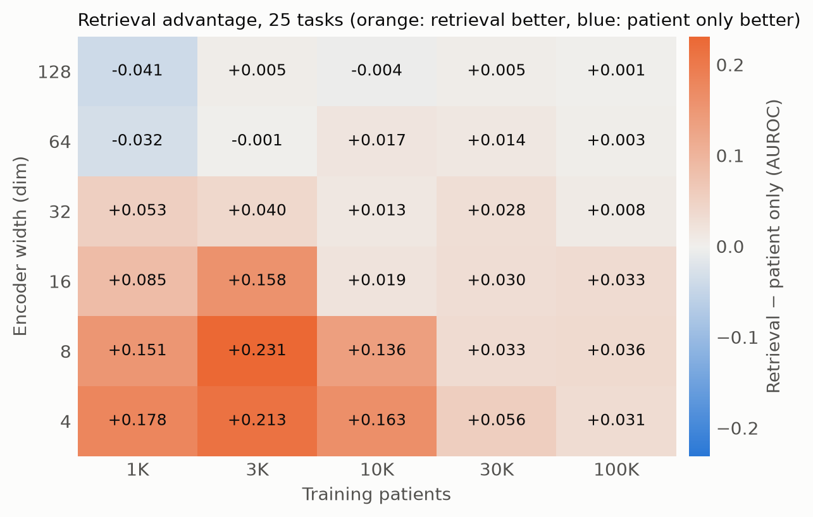

### Raw AUROC

Mean test AUROC over 5 draws:

| Width | Arm | 1K | 3K | 10K | 30K | 100K |
|---|---|---|---|---|---|---|
| dim 4 | patient_only | 0.521 | 0.535 | 0.614 | 0.740 | 0.794 |
|  | retrieval | 0.699 | 0.747 | 0.777 | 0.796 | 0.825 |
| dim 8 | patient_only | 0.518 | 0.534 | 0.645 | 0.768 | 0.796 |
|  | retrieval | 0.669 | 0.765 | 0.781 | 0.801 | 0.831 |
| dim 16 | patient_only | 0.561 | 0.595 | 0.765 | 0.783 | 0.809 |
|  | retrieval | 0.646 | 0.753 | 0.784 | 0.813 | 0.843 |
| dim 32 | patient_only | 0.628 | 0.726 | 0.779 | 0.788 | 0.835 |
|  | retrieval | 0.681 | 0.765 | 0.791 | 0.816 | 0.843 |
| dim 64 | patient_only | 0.717 | 0.770 | 0.774 | 0.808 | 0.847 |
|  | retrieval | 0.685 | 0.769 | 0.791 | 0.822 | 0.851 |
| dim 128 | patient_only | 0.760 | 0.777 | 0.798 | 0.824 | 0.859 |
|  | retrieval | 0.719 | 0.783 | 0.793 | 0.829 | 0.861 |

Two things stand out:

- **`patient_only` improves cleanly with both width and data**, from 0.52 to 0.86.
- **`retrieval` barely changes with width at a fixed data size**, for example 0.65–0.72 at
  1K patients. The retrieval path is the same size in every cell, so it carries the small
  models, and the encoder's width matters little.

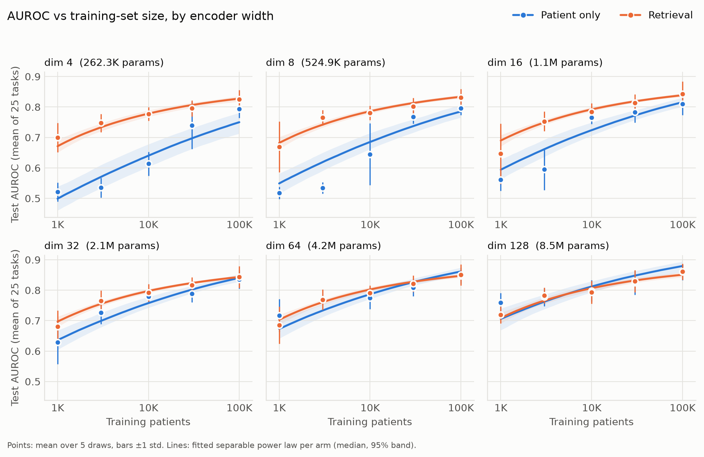

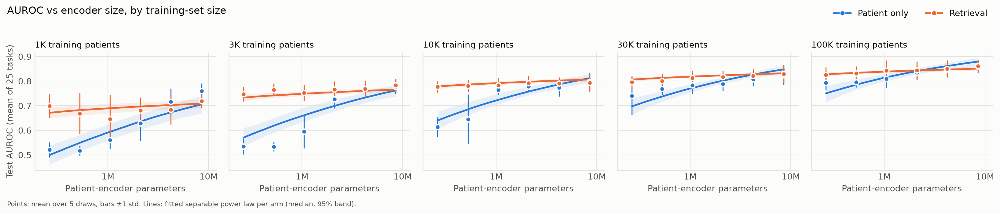

### Fitted scaling law

We fit `AUROC ≈ E + A·N^-α + B·D^-β` per arm on the logit scale with
[`simple-scaling-laws`](https://github.com/mmcdermott/simple-scaling-laws). `N` is the
patient-encoder parameter count and `D` the number of training patients.

| Arm | α (width) | β (data) | R² |
|---|---|---|---|
| `patient_only` | 0.0067 (95% CI 0.002–0.52) | 0.004 | 0.80 |
| `retrieval` | 0.0005 (95% CI 0.0003–1.38) | 0.239 | 0.69 |

⚠️ **Treat these as descriptive only.** Both fits put the asymptote `E` on its constraint
bound, and the width exponent's CI spans 2–3 orders of magnitude. The library flags
`weakly_identified_exponent` for both arms. Within 1K–100K patients, AUROC keeps rising about
linearly in log(D), so there is no plateau for a power law to anchor to. The fitted curves
interpolate the grid well (the lines in the figures above), but the exponents can't support
extrapolation.

## Results: test loss (25 tasks, round 1)

Both arms log the **same** test loss: binary cross-entropy of their final predicted
probability, averaged over (patient, task) pairs. For `retrieval`, that probability is the
marginal over its 4 documents, Σₖ P(docₖ | x)·σ(logitₖ). Lower is better, so here a
**negative** value means retrieval is better. The format matches the AUROC table:
<sub>[95% CI] · draws retrieval won</sub>, and **bold** = significant.

| Width ↓ / patients → | 1K | 3K | 10K | 30K | 100K |
|---|---|---|---|---|---|
| dim 4 | **-0.2694** <sub>[-0.3452, -0.1935] · 5/5</sub> | **-0.0743** <sub>[-0.0990, -0.0496] · 5/5</sub> | **-0.0177** <sub>[-0.0278, -0.0077] · 5/5</sub> | **-0.0055** <sub>[-0.0089, -0.0022] · 5/5</sub> | **-0.0016** <sub>[-0.0028, -0.0003] · 5/5</sub> |
| dim 8 | **-0.1000** <sub>[-0.1124, -0.0877] · 5/5</sub> | **-0.0278** <sub>[-0.0349, -0.0207] · 5/5</sub> | **-0.0103** <sub>[-0.0134, -0.0073] · 5/5</sub> | **-0.0036** <sub>[-0.0056, -0.0017] · 5/5</sub> | **-0.0011** <sub>[-0.0022, -0.0000] · 5/5</sub> |
| dim 16 | **-0.0350** <sub>[-0.0421, -0.0279] · 5/5</sub> | **-0.0150** <sub>[-0.0239, -0.0062] · 5/5</sub> | **-0.0055** <sub>[-0.0069, -0.0040] · 5/5</sub> | **-0.0026** <sub>[-0.0040, -0.0012] · 5/5</sub> | -0.0009 <sub>[-0.0020, +0.0001] · 5/5</sub> |
| dim 32 | **-0.0137** <sub>[-0.0199, -0.0075] · 5/5</sub> | **-0.0077** <sub>[-0.0095, -0.0060] · 5/5</sub> | **-0.0027** <sub>[-0.0037, -0.0017] · 5/5</sub> | -0.0017 <sub>[-0.0037, +0.0003] · 4/5</sub> | -0.0003 <sub>[-0.0006, +0.0001] · 4/5</sub> |
| dim 64 | **-0.0059** <sub>[-0.0081, -0.0036] · 5/5</sub> | **-0.0026** <sub>[-0.0037, -0.0016] · 5/5</sub> | -0.0010 <sub>[-0.0020, +0.0001] · 4/5</sub> | -0.0005 <sub>[-0.0010, +0.0001] · 5/5</sub> | +0.0003 <sub>[-0.0002, +0.0007] · 1/5</sub> |
| dim 128 | **-0.0019** <sub>[-0.0037, -0.0001] · 5/5</sub> | -0.0002 <sub>[-0.0009, +0.0005] · 3/5</sub> | +0.0003 <sub>[-0.0009, +0.0014] · 3/5</sub> | +0.0003 <sub>[-0.0001, +0.0006] · 1/5</sub> | +0.0003 <sub>[-0.0006, +0.0013] · 1/5</sub> |

- **Retrieval's loss is significantly lower in 20 of 30 cells and never significantly
  higher.** The pattern matches AUROC: the gap is largest for small encoders on little data,
  and it closes toward dim 64–128 and 100K patients.
- **Retrieval's loss is nearly flat** at ~0.03–0.04 across the whole grid. `patient_only`
  starts far higher (0.31 at dim 4, 1K patients) and falls until the two meet.
- **⚠️ The large small-model loss gaps are mostly an optimization artifact, not knowledge.**
  Labels are ~1.1% positive. At dim 4 with 1K patients, `patient_only` still predicts a
  **mean probability of 0.246** (mean logit −1.2), while every well-trained model predicts
  ~0.011 (logit ≈ −6 to −8). A constant 0.246 prediction alone gives BCE ≈ 0.29, which
  matches the logged 0.308. The model hasn't learned the base rate. The likely cause: the
  linear head's bias starts at ~0 (p ≈ 0.5), and Adam moves each weight by about `lr` per
  step. A head with `in_dim = 4` can't shift its logits by −5 in ~320 steps, but retrieval's
  `in_dim = 256` head can. AUROC is rank-based per task, so this constant offset doesn't
  affect the AUROC results directly (but see the v2 pilot: it slowed training enough to cost
  AUROC too). Confirmed and fixed in [Bias check](#bias-check-the-loss-gap-was-an-unlearned-base-rate).
  Where both arms are well trained, the losses agree (0.0267 vs
  0.0270 at dim 128, 100K patients), so the loss is computed consistently.
- **The power law fits loss poorly** (R² 0.50 for `patient_only`, 0.06 for `retrieval`).
  The loss figures therefore show the measured means, on a log y-axis, without fitted curves.

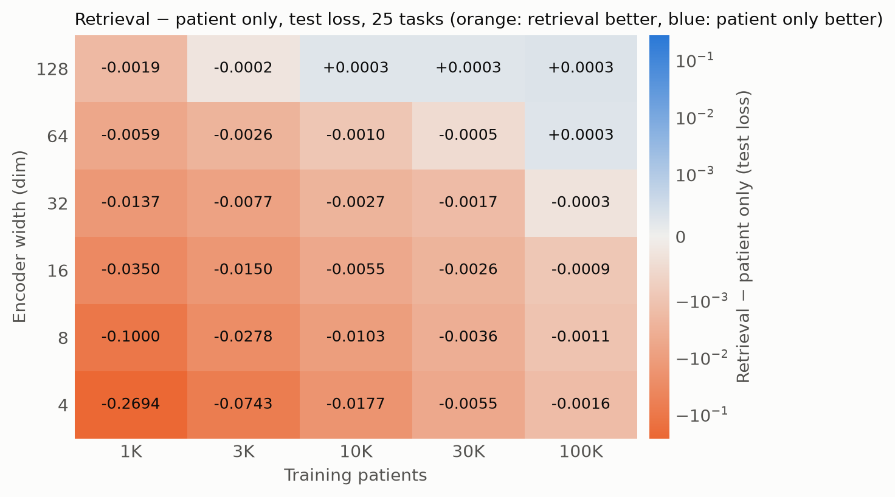

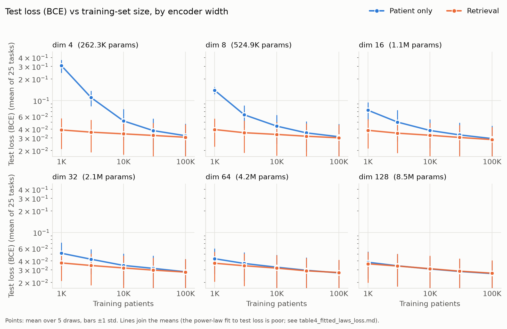

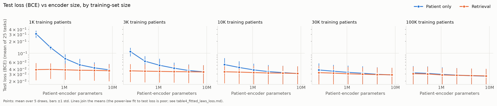

## Results: task-count ablation (width 32, round 1)

Each task count draws its own random codes. Table format as above: retrieval −
`patient_only`, paired, <sub>[95% CI] · draws won</sub>, **bold** = significant.

| Tasks ↓ / patients → | 1K | 3K | 10K | 30K | 100K |
|---|---|---|---|---|---|
| 5 tasks | **-0.047** <sub>[-0.093, -0.002] · 0/5</sub> | -0.013 <sub>[-0.067, +0.042] · 1/5</sub> | -0.007 <sub>[-0.109, +0.095] · 2/5</sub> | +0.032 <sub>[-0.024, +0.089] · 4/5</sub> | +0.003 <sub>[-0.026, +0.033] · 2/5</sub> |
| 25 tasks | +0.053 <sub>[-0.038, +0.143] · 4/5</sub> | **+0.040** <sub>[+0.020, +0.059] · 5/5</sub> | +0.013 <sub>[-0.002, +0.027] · 4/5</sub> | **+0.028** <sub>[+0.010, +0.045] · 5/5</sub> | +0.008 <sub>[-0.004, +0.020] · 5/5</sub> |
| 125 tasks | **+0.088** <sub>[+0.016, +0.161] · 5/5</sub> | **+0.155** <sub>[+0.110, +0.201] · 5/5</sub> | **+0.022** <sub>[+0.011, +0.033] · 5/5</sub> | **+0.027** <sub>[+0.020, +0.034] · 5/5</sub> | **+0.023** <sub>[+0.012, +0.034] · 5/5</sub> |
| 625 tasks | **+0.053** <sub>[+0.014, +0.091] · 5/5</sub> | **+0.173** <sub>[+0.142, +0.204] · 5/5</sub> | **+0.029** <sub>[+0.016, +0.042] · 5/5</sub> | **+0.028** <sub>[+0.017, +0.038] · 5/5</sub> | **+0.039** <sub>[+0.028, +0.050] · 5/5</sub> |
| 2,500 tasks | **+0.032** <sub>[+0.010, +0.055] · 5/5</sub> | **+0.172** <sub>[+0.144, +0.200] · 5/5</sub> | **+0.025** <sub>[+0.020, +0.030] · 5/5</sub> | **+0.023** <sub>[+0.019, +0.028] · 5/5</sub> | **+0.035** <sub>[+0.023, +0.047] · 5/5</sub> |

**More tasks mostly means less noise, not a bigger effect.** `patient_only`'s spread (std)
across draws at width 32 shrinks sharply as the task count grows:

| Tasks | 1K | 3K | 10K | 30K | 100K |
|---|---|---|---|---|---|
| 5 | 0.104 | 0.137 | 0.137 | 0.087 | 0.092 |
| 25 | 0.071 | 0.037 | 0.019 | 0.027 | 0.030 |
| 125 | 0.022 | 0.049 | 0.016 | 0.014 | 0.013 |
| 625 | 0.012 | 0.023 | 0.012 | 0.008 | 0.006 |
| 2,500 | 0.011 | 0.021 | 0.005 | 0.005 | 0.005 |

- **At 125 or more tasks, the gain is stable.** Retrieval shows a steady +0.02–0.04 from
  10K patients up, winning 5/5 draws everywhere. At 25 tasks the same effect is mostly
  hidden by task-sampling noise, which is why round 2 reruns the main grid at 625 tasks.
- **The 3K spike (+0.16 to +0.17) is mostly a `patient_only` artifact.** With 125 or more
  tasks, `patient_only` stalls at about 0.58 with 3K patients, then jumps to 0.75 at 10K.
  This likely comes from the small-data training schedule (7 epochs, warmup 100) rather
  than from retrieval, and is still under investigation.
- **The 5-task row is mostly noise.** The across-draw std is ~0.1, so five random, mostly
  rare tasks are too small a sample to read. The −0.047 at 1K is just inside significance.

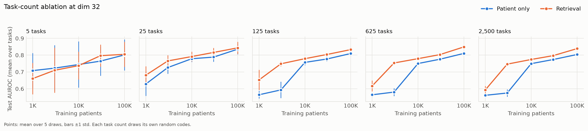

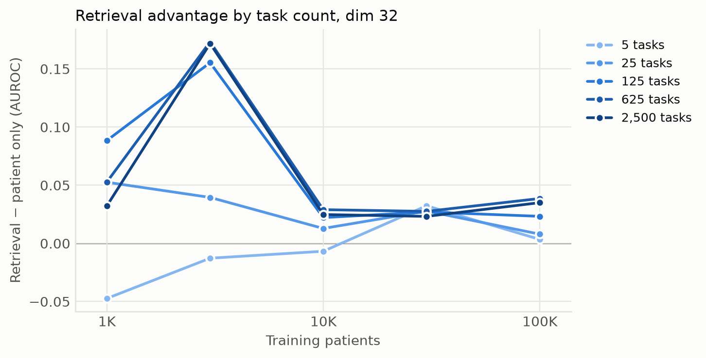

## Results: main grid, 625 tasks (round 1, superseded by v2)

Same grid and table format as the 25-task grid: retrieval − `patient_only` test AUROC, paired
over 5 draws. With 625 tasks per draw, task-sampling noise is much smaller.

| Width ↓ / patients → | 1K | 3K | 10K | 30K | 100K |
|---|---|---|---|---|---|
| dim 4 | **+0.107** <sub>[+0.032, +0.183] · 5/5</sub> | **+0.217** <sub>[+0.183, +0.251] · 5/5</sub> | **+0.204** <sub>[+0.121, +0.287] · 5/5</sub> | **+0.086** <sub>[+0.010, +0.162] · 5/5</sub> | **+0.042** <sub>[+0.034, +0.049] · 5/5</sub> |
| dim 8 | **+0.057** <sub>[+0.027, +0.087] · 5/5</sub> | **+0.228** <sub>[+0.212, +0.243] · 5/5</sub> | **+0.204** <sub>[+0.106, +0.303] · 5/5</sub> | +0.078 <sub>[-0.000, +0.157] · 5/5</sub> | **+0.044** <sub>[+0.034, +0.054] · 5/5</sub> |
| dim 16 | **+0.085** <sub>[+0.033, +0.137] · 5/5</sub> | **+0.203** <sub>[+0.168, +0.238] · 5/5</sub> | **+0.142** <sub>[+0.031, +0.254] · 5/5</sub> | **+0.033** <sub>[+0.025, +0.040] · 5/5</sub> | **+0.041** <sub>[+0.033, +0.049] · 5/5</sub> |
| dim 32 | **+0.053** <sub>[+0.014, +0.091] · 5/5</sub> | **+0.173** <sub>[+0.142, +0.204] · 5/5</sub> | **+0.029** <sub>[+0.016, +0.042] · 5/5</sub> | **+0.028** <sub>[+0.017, +0.038] · 5/5</sub> | **+0.039** <sub>[+0.028, +0.050] · 5/5</sub> |
| dim 64 | +0.009 <sub>[-0.027, +0.044] · 3/5</sub> | +0.037 <sub>[-0.009, +0.083] · 5/5</sub> | **+0.015** <sub>[+0.004, +0.025] · 5/5</sub> | **+0.021** <sub>[+0.006, +0.035] · 5/5</sub> | **+0.023** <sub>[+0.019, +0.026] · 5/5</sub> |
| dim 128 | **-0.108** <sub>[-0.131, -0.085] · 0/5</sub> | **+0.005** <sub>[+0.003, +0.007] · 5/5</sub> | +0.004 <sub>[-0.003, +0.010] · 4/5</sub> | **+0.008** <sub>[+0.005, +0.012] · 5/5</sub> | -0.000 <sub>[-0.006, +0.006] · 3/5</sub> |

- **24 of 30 cells favor retrieval significantly**, versus 15 at 25 tasks. One cell goes
  against it (dim 128, 1K patients, −0.108, 0/5 draws).
- The shape matches the 25-task grid: a large gain at small width and little data, fading to
  ≤ +0.02 at width 64–128. With less noise, a small positive gain now shows up almost
  everywhere at width ≤ 64.
- The next two sections show that most of this gain is not from the documents, and that part
  of it comes from `patient_only` training badly at small widths.

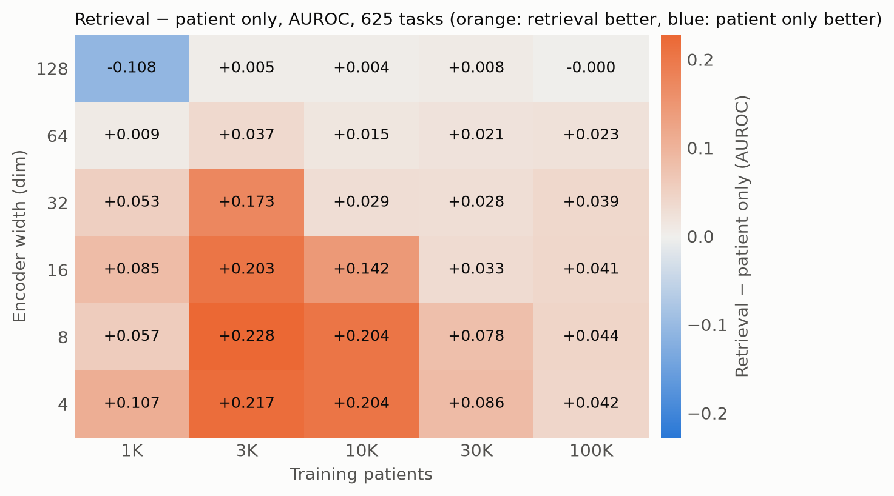

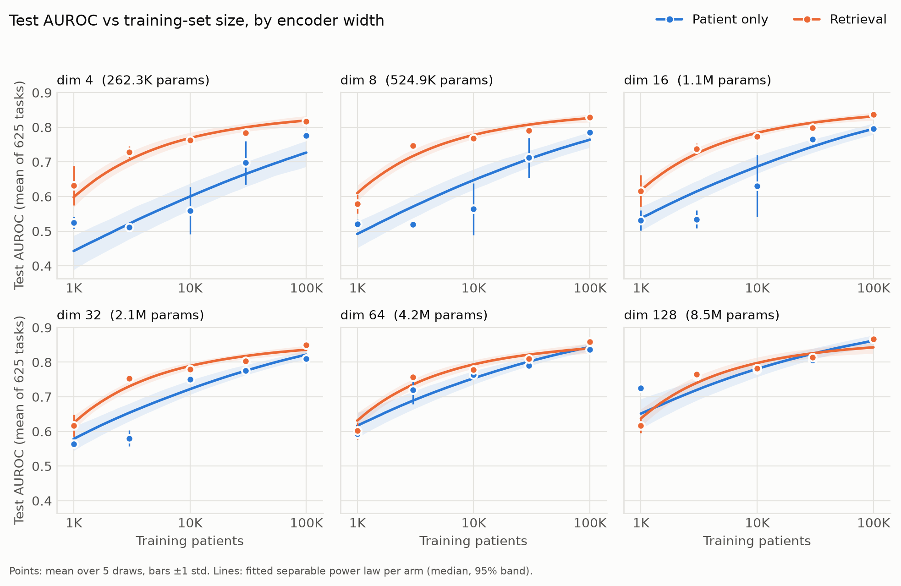

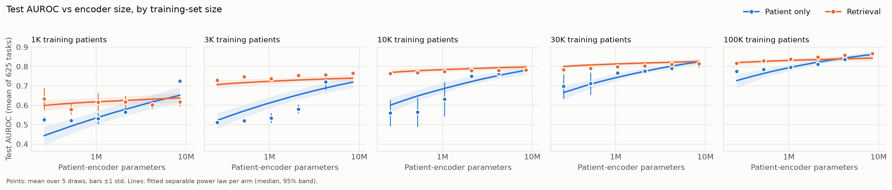

## Results: knowledge or capacity? (round 1 controls)

The control arms keep the full retrieval architecture but are trained *and* tested without
useful documents. Mean test AUROC, 625 tasks, 5 draws:

| Width | Arm | 1K | 10K | 100K |
|---|---|---|---|---|
| dim 4 | `patient_only` | 0.525 | 0.559 | 0.775 |
|  | `retrieval` | 0.632 | 0.763 | 0.817 |
|  | `retrieval_random_docs` | 0.604 | 0.758 | 0.811 |
|  | `retrieval_null_docs` | 0.568 | 0.761 | 0.819 |
|  | `retrieval_qwen3` | 0.657 | 0.766 | 0.829 |
| dim 16 | `patient_only` | 0.531 | 0.631 | 0.796 |
|  | `retrieval` | 0.616 | 0.773 | 0.837 |
|  | `retrieval_random_docs` | 0.595 | 0.769 | 0.832 |
|  | `retrieval_null_docs` | 0.604 | 0.772 | 0.846 |
|  | `retrieval_qwen3` | 0.594 | 0.775 | 0.843 |
| dim 64 | `patient_only` | 0.593 | 0.764 | 0.836 |
|  | `retrieval` | 0.602 | 0.779 | 0.858 |
|  | `retrieval_random_docs` | 0.607 | 0.773 | 0.851 |
|  | `retrieval_null_docs` | 0.613 | 0.775 | 0.866 |
|  | `retrieval_qwen3` | 0.596 | 0.780 | 0.867 |

**Architecture alone** (`retrieval_null_docs` − `patient_only`):

| Width ↓ / patients → | 1K | 10K | 100K |
|---|---|---|---|
| dim 4 | **+0.044** <sub>[+0.011, +0.077] · 5/5</sub> | **+0.202** <sub>[+0.116, +0.288] · 5/5</sub> | **+0.044** <sub>[+0.035, +0.053] · 5/5</sub> |
| dim 16 | **+0.073** <sub>[+0.031, +0.114] · 5/5</sub> | **+0.141** <sub>[+0.031, +0.251] · 5/5</sub> | **+0.050** <sub>[+0.043, +0.057] · 5/5</sub> |
| dim 64 | +0.020 <sub>[-0.033, +0.072] · 2/5</sub> | **+0.011** <sub>[+0.004, +0.017] · 5/5</sub> | **+0.030** <sub>[+0.024, +0.036] · 5/5</sub> |

**Value of the documents, learned-query retriever** (`retrieval` − `retrieval_null_docs`):

| Width ↓ / patients → | 1K | 10K | 100K |
|---|---|---|---|
| dim 4 | +0.064 <sub>[-0.005, +0.133] · 5/5</sub> | +0.002 <sub>[-0.002, +0.005] · 3/5</sub> | **-0.002** <sub>[-0.004, -0.000] · 0/5</sub> |
| dim 16 | +0.012 <sub>[-0.014, +0.038] · 3/5</sub> | +0.001 <sub>[-0.001, +0.003] · 3/5</sub> | -0.009 <sub>[-0.019, +0.001] · 0/5</sub> |
| dim 64 | -0.011 <sub>[-0.041, +0.019] · 2/5</sub> | +0.004 <sub>[-0.003, +0.011] · 4/5</sub> | **-0.007** <sub>[-0.013, -0.001] · 1/5</sub> |

**Value of the documents, frozen Qwen3 query** (`retrieval_qwen3` − `retrieval_null_docs`):

| Width ↓ / patients → | 1K | 10K | 100K |
|---|---|---|---|
| dim 4 | **+0.089** <sub>[+0.035, +0.143] · 5/5</sub> | +0.005 <sub>[-0.001, +0.011] · 5/5</sub> | **+0.010** <sub>[+0.006, +0.013] · 5/5</sub> |
| dim 16 | -0.009 <sub>[-0.037, +0.019] · 1/5</sub> | +0.003 <sub>[-0.000, +0.007] · 4/5</sub> | -0.004 <sub>[-0.011, +0.004] · 1/5</sub> |
| dim 64 | -0.017 <sub>[-0.040, +0.005] · 1/5</sub> | **+0.005** <sub>[+0.000, +0.011] · 5/5</sub> | +0.002 <sub>[-0.003, +0.006] · 3/5</sub> |

- **Null docs reproduce nearly all of the retrieval gain.** At 10K–100K patients,
  `retrieval_null_docs` is within ±0.01 of `retrieval` at every width. The gain over
  `patient_only` comes from the fusion block and 256-d head, not from the text.
- **The learned-query retriever collapsed.** Across its predictions, the most common top-1
  document is shared by ~72% of patients and the unique-document ratio is ~0.11, so most
  patients see the same few documents. Random documents are slightly
  *worse* than null docs at 100K (−0.008 to −0.015), which is consistent with irrelevant text
  being noise.
- **A frozen query retrieves patient-specific documents** (top-1 mode share ~18%,
  unique-document ratio ~0.55), but in round 1 its value over null docs was significant only at width 4 (+0.089
  at 1K, +0.010 at 100K) and at width 64 with 10K patients (+0.005).

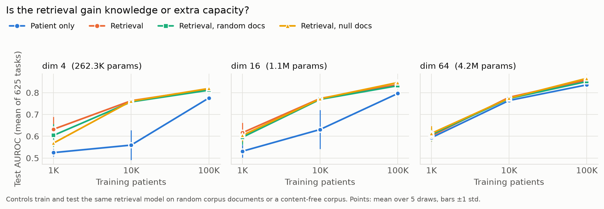

## Results: does headroom predict retrieval value? (round 1)

For every cell (width M, patients N) of `patient_only` at 625 tasks, `scripts/headroom.py` fits
`AUROC = A − B·x^-α` (A ≤ 1) along each axis using only what is available at that cell: sizes
≤ N at width M (data axis) or widths ≤ M at N patients (capacity axis), with ≥ 3 sizes per fit.
Headroom is `A − AUROC` at the cell, with a 95% interval from refitting on draws resampled with
replacement. It is compared across cells with how much retrieval adds there. `naive_gap`
(`1 − AUROC`, no fit) is the baseline any fitted headroom has to beat.

| Headroom | Total value: `retrieval` | Documents: `retrieval` | Total value: `retrieval_qwen3` | Documents: `retrieval_qwen3` |
|---|---|---|---|---|
| data-axis fit | **ρ = 0.85** (18 cells, p < 0.001) | 0.31 (6, p = 0.54) | **0.94** (6, p = 0.005) | 0.26 (6, p = 0.62) |
| capacity-axis fit | **0.55** (20, p = 0.012) | 0.31 (6, p = 0.54) | 0.14 (6, p = 0.79) | −0.49 (6, p = 0.33) |
| `naive_gap` (no fit) | **0.73** (30, p < 0.001) | 0.67 (9, p = 0.05) | 0.48 (9, p = 0.19) | 0.12 (9, p = 0.77) |

Values are Spearman ρ across cells. "Total value" is `arm − patient_only`; "documents" is
`arm − retrieval_null_docs`.

- **Fitted headroom tracks total retrieval value, but mostly because both track how weak the
  baseline is.** 13 of 18 data-axis fits and 18 of 20 capacity-axis fits put the asymptote on
  the A = 1 bound, where headroom is just `1 − AUROC`. The no-fit gap does almost as well.
- **Nothing tracks the value of the documents themselves.** Those correlations are small and
  based on only 6–9 cells.
- Round 1's `patient_only` was also handicapped by the bias problem below, which inflates
  both headroom and total value at small widths. The v2 grid (bias fixed, 6 data sizes, 8
  capacities, every task count) is the real test.

## Bias check: the loss gap was an unlearned base rate

Round 1's test-loss gap at small widths (−0.27 at width 4, 1K patients) looked too large to be
the documents. To check, `scripts/bias_check.py` takes the saved predictions of round-1 runs
(25 tasks, both arms), fits **one logit offset per task** on the tuning split with everything
else frozen, and recomputes held-out BCE.

| Width | Patients | `patient_only` mean prediction | retrieval − `patient_only` BCE, as trained | after the per-task offset |
|---|---|---|---|---|
| dim 4 | 1K | 0.246 (positive rate 0.011) | **-0.2694** <sub>[-0.3452, -0.1935] · 5/5</sub> | -0.0068 <sub>[-0.0157, +0.0020] · 5/5</sub> |
| dim 4 | 10K | 0.020 | **-0.0177** <sub>[-0.0278, -0.0077] · 5/5</sub> | **-0.0105** <sub>[-0.0206, -0.0005] · 5/5</sub> |
| dim 4 | 100K | 0.011 | **-0.0016** <sub>[-0.0028, -0.0003] · 5/5</sub> | **-0.0016** <sub>[-0.0028, -0.0003] · 5/5</sub> |
| dim 16 | 1K | 0.044 | **-0.0350** <sub>[-0.0421, -0.0279] · 5/5</sub> | -0.0071 <sub>[-0.0170, +0.0029] · 5/5</sub> |
| dim 16 | 10K | 0.013 | **-0.0055** <sub>[-0.0069, -0.0040] · 5/5</sub> | **-0.0042** <sub>[-0.0060, -0.0025] · 5/5</sub> |
| dim 16 | 100K | 0.011 | -0.0009 <sub>[-0.0020, +0.0001] · 5/5</sub> | -0.0010 <sub>[-0.0020, +0.0001] · 5/5</sub> |
| dim 128 | 1K | 0.012 | **-0.0019** <sub>[-0.0037, -0.0001] · 5/5</sub> | -0.0011 <sub>[-0.0026, +0.0003] · 5/5</sub> |
| dim 128 | 10K | 0.011 | +0.0003 <sub>[-0.0009, +0.0014] · 3/5</sub> | +0.0003 <sub>[-0.0009, +0.0014] · 3/5</sub> |
| dim 128 | 100K | 0.011 | +0.0003 <sub>[-0.0006, +0.0013] · 1/5</sub> | +0.0003 <sub>[-0.0007, +0.0012] · 1/5</sub> |

- **A single offset per task removes ~97% of the largest gap** (−0.2694 → −0.0068, no longer
  significant). The small-width `patient_only` models were predicting ~25% for ~1% events.
- **Cause:** the head bias starts at 0 (p = 0.5), Adam moves each parameter by about `lr` per
  step, and a head with `in_dim = 4` has too few weights to shift its logits by ~−5 in the
  available steps. Retrieval's `in_dim = 256` head can.
- **Fix:** `training.module.init_bias_from_base_rate=true` sets each task's head bias to the
  log-odds of its training positive rate before the first step
  ([MedRAP#119](https://github.com/McDermottHealthAI/MedRAP/pull/119)). All v2 runs use it.

## Results: v2 pilot (bias init, 625 tasks)

All arms with the head bias initialized from the base rate, on the control cells. First, what
the fix does to `patient_only` (same task draws as round 1):

| Width | Patients | Round 1 AUROC | v2 AUROC | v2 − round 1 | Round 1 loss | v2 loss |
|---|---|---|---|---|---|---|
| dim 4 | 1K | 0.525 | 0.534 | +0.009 <sub>[-0.012, +0.031] · 4/5</sub> | 0.3177 | 0.0333 |
| dim 4 | 10K | 0.559 | 0.704 | **+0.144** <sub>[+0.071, +0.217] · 5/5</sub> | 0.0404 | 0.0276 |
| dim 4 | 100K | 0.775 | 0.795 | **+0.019** <sub>[+0.006, +0.032] · 5/5</sub> | 0.0265 | 0.0257 |
| dim 64 | 1K | 0.593 | 0.736 | **+0.143** <sub>[+0.131, +0.155] · 5/5</sub> | 0.0356 | 0.0277 |
| dim 64 | 10K | 0.764 | 0.801 | **+0.037** <sub>[+0.020, +0.055] · 5/5</sub> | 0.0269 | 0.0254 |
| dim 64 | 100K | 0.836 | 0.882 | **+0.046** <sub>[+0.038, +0.054] · 5/5</sub> | 0.0239 | 0.0225 |

The unlearned base rate hurt **AUROC** too, not only loss. AUROC itself ignores a constant
offset, so the damage is to training: a likely explanation is that while the head is still
predicting ~p = 0.5, most of the early gradient goes into lowering every prediction rather than
learning to rank patients. Width 4 with 1K patients barely changes, probably because 1K
patients with ~1% positives is too little signal either way.

Mean test AUROC, all arms with bias init:

| Width | Arm | 1K | 10K | 100K |
|---|---|---|---|---|
| dim 4 | `patient_only` | 0.534 | 0.704 | 0.795 |
|  | `retrieval_null_docs` | 0.727 | 0.759 | 0.837 |
|  | `retrieval` | 0.724 | 0.762 | 0.840 |
|  | `retrieval_qwen3` | 0.715 | 0.772 | 0.843 |
| dim 64 | `patient_only` | 0.736 | 0.801 | 0.882 |
|  | `retrieval_null_docs` | 0.724 | 0.792 | 0.879 |
|  | `retrieval` | 0.734 | 0.804 | 0.888 |
|  | `retrieval_qwen3` | 0.737 | 0.807 | 0.888 |

**Architecture alone** (`retrieval_null_docs` − `patient_only`):

| Width ↓ / patients → | 1K | 10K | 100K |
|---|---|---|---|
| dim 4 | **+0.193** <sub>[+0.181, +0.206] · 5/5</sub> | **+0.055** <sub>[+0.037, +0.072] · 5/5</sub> | **+0.042** <sub>[+0.036, +0.048] · 5/5</sub> |
| dim 64 | -0.012 <sub>[-0.033, +0.008] · 1/5</sub> | **-0.009** <sub>[-0.014, -0.003] · 0/5</sub> | -0.003 <sub>[-0.009, +0.003] · 1/5</sub> |

**Value of the documents, learned query** (`retrieval` − `retrieval_null_docs`):

| Width ↓ / patients → | 1K | 10K | 100K |
|---|---|---|---|
| dim 4 | -0.003 <sub>[-0.008, +0.002] · 2/5</sub> | **+0.004** <sub>[+0.001, +0.007] · 5/5</sub> | +0.003 <sub>[-0.007, +0.012] · 2/5</sub> |
| dim 64 | +0.009 <sub>[-0.013, +0.032] · 3/5</sub> | **+0.012** <sub>[+0.007, +0.016] · 5/5</sub> | **+0.009** <sub>[+0.003, +0.016] · 5/5</sub> |

**Value of the documents, frozen Qwen3 query** (`retrieval_qwen3` − `retrieval_null_docs`):

| Width ↓ / patients → | 1K | 10K | 100K |
|---|---|---|---|
| dim 4 | **-0.012** <sub>[-0.022, -0.002] · 0/5</sub> | **+0.014** <sub>[+0.008, +0.020] · 5/5</sub> | +0.006 <sub>[-0.003, +0.015] · 4/5</sub> |
| dim 64 | +0.013 <sub>[-0.006, +0.031] · 4/5</sub> | **+0.015** <sub>[+0.010, +0.021] · 5/5</sub> | **+0.010** <sub>[+0.005, +0.014] · 5/5</sub> |

- **At width 64, the architecture alone no longer helps** (null docs is 0.003–0.012 *below*
  `patient_only`). The round-1 architecture gain at width 64 was the bias problem.
- **At width 4, the architecture still dominates** (+0.04 to +0.19). The 256-d fusion block
  is much more capacity than a 4-wide encoder.
- **The documents now add a consistent small gain at width 64:** +0.010 to +0.015 with
  `retrieval_qwen3` and +0.009 to +0.012 with the learned query at 10K–100K patients, 5/5
  draws. This is the clean "retrieval value" the v2 grid measures. `retrieval_qwen3` is the v2
  retrieval arm because it is at least as good and its retriever can't collapse.

## v2 grid (running)

Everything above motivates a rerun with the bias fix, more points per scaling fit, larger
encoders and every task count:

- **Main grid, 625 tasks:** 8 capacities (widths 4–128, plus 128 wide × 2 layers × 4 heads and
  256 × 4 × 8, up to 18.9M encoder parameters) × 6 data sizes (1K–100K plus all 153,220 training
  patients) × {`patient_only`, `retrieval_null_docs`, `retrieval_qwen3`} × 5 draws.
- **Task-count axis:** the same arms and data sizes at 5, 25, 125 and 2,500 tasks, on 5
  capacities (4, 16, 64, 128x2x4, 256x4x8), 5 draws each.
- **Analysis:** per task count, the restricted headroom fits above, correlated with both total
  value (`retrieval_qwen3` − `patient_only`) and document value (`retrieval_qwen3` −
  `retrieval_null_docs`).

Results will be added here as the runs complete.

## Caveats

- **Capacity confound.** The retrieval arms add a fixed 256-d fusion block and head, which is
  far more capacity than a width-4 encoder. The null-docs control answers this: compare
  document value (`retrieval_*` − `retrieval_null_docs`), not just `retrieval` − `patient_only`.
  Earlier MIMIC ablations only swapped documents at eval time on checkpoints trained with real
  documents, which can't separate the two.
- **Round 1 predates the bias fix.** Every round-1 `patient_only` number at small widths, and
  every round-1 retrieval − `patient_only` difference, is affected. The v2 grid replaces them.
- **Draws mix noise sources.** Each draw changes the task codes, the training-patient
  subsample and the training seed together, so task-choice noise and optimization noise
  aren't separated.
- **Rare tasks.** Uniform random codes are mostly rare lab-value bins, with median positive
  rates around 0.5–1.7%. The smallest cells train on very few positives per task.
- **Model size counts only the encoder, and mostly its embedding table.** The table has
  65,536 × dim rows while the cohort uses ~10K codes, so `N` overstates the effective
  encoder size. The two arms also aren't parameter-matched.
- **The schedule scales with data size.** Larger training sets also get more optimizer
  steps, so the data axis isn't compute-matched.

## Reproduce

```bash
cd mimic_iv_scaling_laws && uv sync
ln -s <path>/mimic_iv_sweep/data/retrieval_db data/retrieval_db
.venv/bin/python scripts/make_null_retrieval_db.py     # null corpus for the control arm
scripts/submit_tasks.sh                                  # rebuild cohort from raw MEDS, then tasks; prints afterok:<ids>
scripts/submit_sweep.sh afterok:<ids>                    # round 1: every cell; reruns only fill in missing draws
(cd v2env && uv sync)                                    # v2: MedRAP with init_bias_from_base_rate
scripts/submit_v2_grid.sh && scripts/submit_v2_grid.sh tasks   # v2 main grid, then the task-count axis
.venv/bin/python scripts/headroom.py --outputs outputs_v2 --retrieval retrieval_qwen3   # headroom vs value
.venv/bin/python scripts/aggregate_results.py            # fits + parquet summaries
.venv/bin/python scripts/plot_results.py --out .         # figures/ + tables/ (add --out t625 --main-tasks 625 for the 625-task grid)
.venv/bin/python scripts/make_report.py                  # report.html: self-contained overview of all of the above
```
