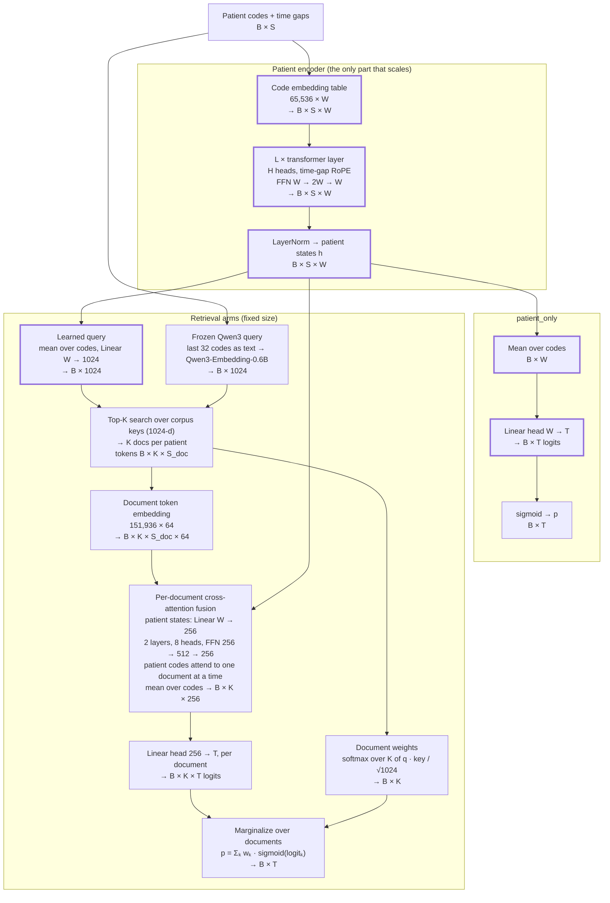

# Model design: MIMIC-IV scaling laws

The models behind the [results](README.md), layer by layer. For why the experiment is set up
this way, see the code's [`DESIGN.md`](../../mimic_iv_scaling_laws/DESIGN.md).

## Principle: keep things simple and clean

- One model, five arms. Each arm changes **one** thing (the query, or what the documents
  contain), so every difference between arms has a single cause.
- Only the patient encoder grows across the grid. The retrieval machinery is a fixed size in
  every cell.
- No extra structure until a result needs it.

## Variables

| Symbol | Meaning | Value |
|---|---|---|
| `B` | batch size | 32 |
| `S` | codes per patient (the most recent ones) | 256 |
| `W` | encoder width | 4 … 256 (**varies**) |
| `L` | encoder layers | 1, 2 or 4 (**varies**) |
| `H` | encoder attention heads | 1, 4 or 8 (**varies**) |
| `T` | tasks (one binary label each) | 5 … 2,500 (**varies**; 625 in the main grid) |
| `K` | documents retrieved per patient | 4 |
| `S_doc` | tokens per document | 256 |

## Architecture

Shapes are written as `B × …`. Bold boxes change size across the grid.

Both heads start with each task's bias at its training base rate (log-odds) in v2 runs
([bias check](README.md#bias-check-the-loss-gap-was-an-unlearned-base-rate)). The loss is
binary cross-entropy on `p`, per task.

## The arms

Every retrieval arm uses the same right-hand branch above. Each one changes only the query or
what the corpus holds:

| Arm | Query | Documents the fusion sees | Document weights | What it tests |
|---|---|---|---|---|
| `patient_only` | none | none (left branch only) | none | the baseline |
| `retrieval` | **learned**: mean of `h`, Linear W → 1024 | top 4 of 125K medical-textbook passages | learned, follow the query | full retrieval, end to end |
| `retrieval_qwen3` | **frozen**: Qwen3 embedding of the last 32 codes as text | top 4 textbook passages | fixed per patient, not trained | retrieval with a query that can't collapse onto a few documents |
| `retrieval_random_docs` | learned (as `retrieval`) | 4 **random** passages, redrawn every step | from the query, but the docs are unrelated | does *relevant* text matter, or is any text enough? |
| `retrieval_null_docs` | learned (as `retrieval`) | one **empty** document (a single pad token), repeated | all equal (every key is zero) | the architecture alone: the fusion block and 256-d head, with no knowledge |

How the arms are compared:

- **Architecture value** = `retrieval_null_docs` − `patient_only`: what the extra layers add.
- **Document value** = `retrieval*` − `retrieval_null_docs`: what the text itself adds.
- **Total value** = `retrieval*` − `patient_only` = architecture + documents.

The v2 grid runs `patient_only`, `retrieval_null_docs` and `retrieval_qwen3`.

## Encoder sizes

`W`, or `W×L×H` for the multi-layer encoders. FFN width is always 2W. The code embedding table
(65,536 × W) holds most of the parameters.

| Capacity | W | L | H | Encoder parameters |
|---|---|---|---|---|
| 4 | 4 | 1 | 1 | 262K |
| 8 | 8 | 1 | 1 | 525K |
| 16 | 16 | 1 | 1 | 1.05M |
| 32 | 32 | 1 | 1 | 2.11M |
| 64 | 64 | 1 | 1 | 4.23M |
| 128 | 128 | 1 | 1 | 8.52M |
| 128x2x4 | 128 | 2 | 4 | 8.65M |
| 256x4x8 | 256 | 4 | 8 | 18.9M |

The retrieval branch adds about **10.6M fixed parameters** in every cell: 9.72M of them are
the document token table (151,936 × 64), plus ~0.9M of fusion, a small query projection and
the 256 → T head. The `retrieval_qwen3` query model (0.6B) is frozen and not counted.
