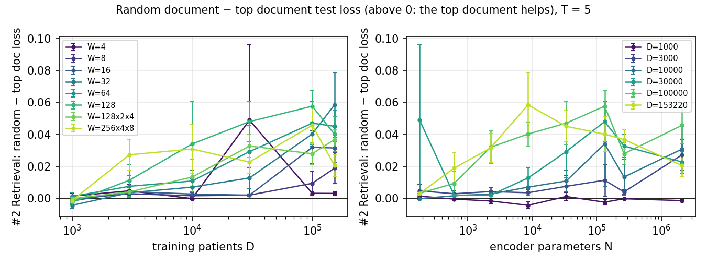
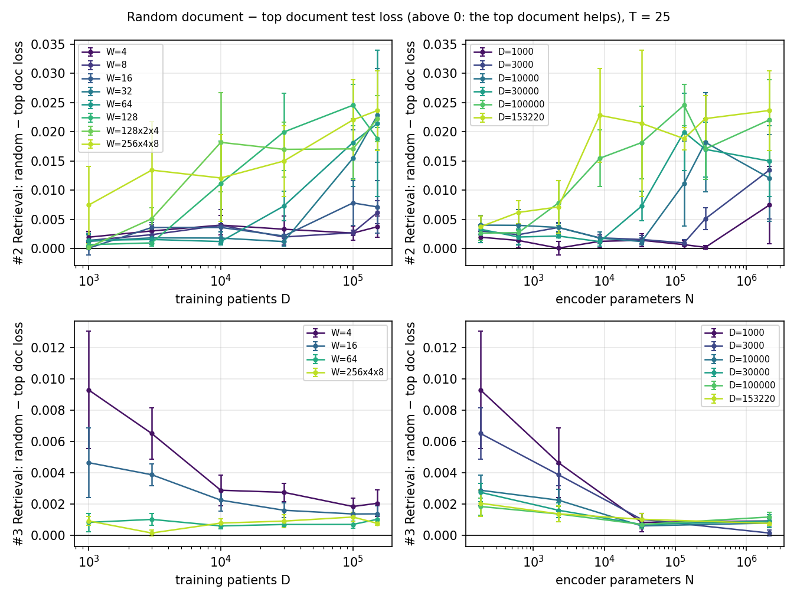
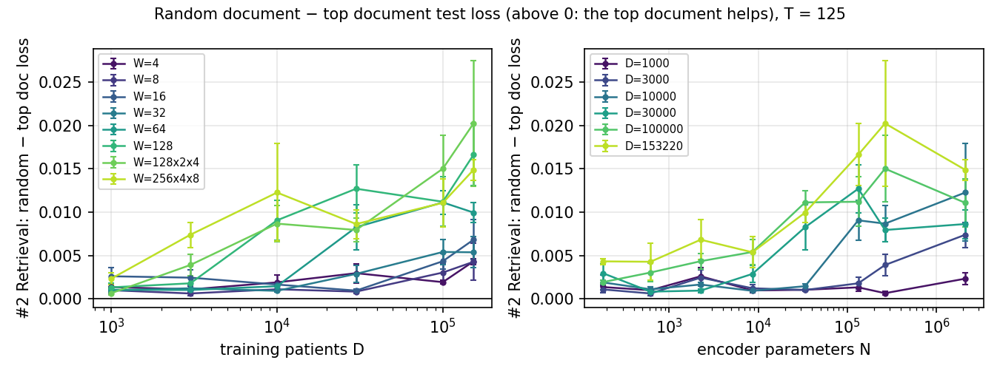
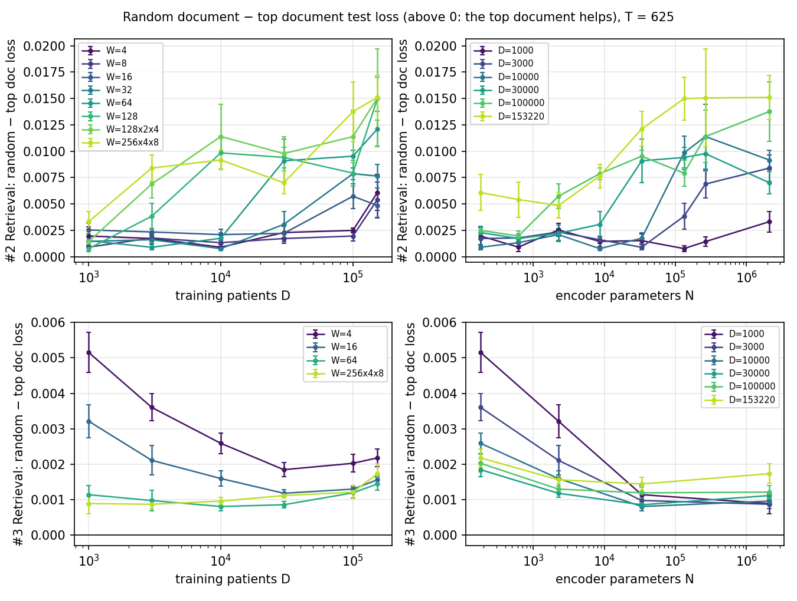
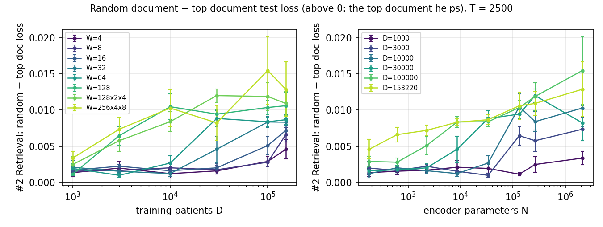

# Scaling laws

Code: [`scaling_laws/`](../../scaling_laws/) ([`run.sh`](../../scaling_laws/run.sh),
[`submit.sh`](../../scaling_laws/submit.sh), [`analyze.py`](../../scaling_laws/analyze.py)).

## 1. Design

### Variables

| Symbol | Meaning | Value |
|---|---|---|
| `B` | patients per batch | 32 |
| `S` | codes per patient | 256 |
| `W` | patient-encoder width | 4 to 256 (varies) |
| `D` | training patients | 1K to 153K (varies) |
| `T` | tasks | 5 to 2,500 (varies) |
| `K` | documents per patient, plus the null document | 4 + 1 in training, 1 + 1 at test |
| `S_doc` | tokens per document | 256 |

### Architecture

| Component | What it is | Output |
|---|---|---|
| Patient Encoder | code embedding table + transformer (L layers, H heads, time-gap position encoding) | B × S × W |
| Mean Over Codes | average over the patient's codes | B × W |
| Head | one linear layer: one logit per task | B × T, or B × K × T per document |
| Query | mean over codes, then linear W → 1024 (#2, #4), or a frozen Qwen3 text embedding (#3) | B × 1024 |
| External Document Database | textbook passages + one null document, each with a fixed 1024-d key; top K by query · key | B × K × S_doc |
| Retrieval Encoder | frozen Qwen3 token embeddings (151,669 × 1,024) | B × K × S_doc × 1024 |
| Fusion | patient codes cross-attend to one document at a time (keys and values 1024 → 256), then mean over codes | B × K × 256 |
| Combine Documents | weighted average of the per-document predictions; weights from query · key | B × T |

### Configurations

| # | Configuration | Query | Documents |
|---|---|---|---|
| 1 | Patient only | none | none |
| 2 | Retrieval, learned query | learned from the patient encoder | top K + null |
| 3 | Retrieval, Qwen3 query | patient's last 32 codes as text, frozen Qwen3 embedding | top K + null |
| 4 | Retrieval, random documents (control) | as #2 | random passages + null, in training and at test |

#2 − #4 measures the documents' knowledge; #4 − #1 the extra architecture.

### Loss

Patient $i$, task $t$, label $y_{it}$, $\sigma$ = sigmoid, $V$ = labelled (patient, task) pairs.

#1 (`MultiTaskBCELoss`):

$$
\mathcal{L} = \frac{1}{|V|} \sum_{(i,t) \in V} -\Big[\, y_{it} \log \sigma(z_{it}) + (1 - y_{it}) \log\big(1 - \sigma(z_{it})\big) \Big]
$$

#2, #3, #4 (`MultiTaskBCEMarginalizedLoss`):

$$
w_{ik} = \operatorname{softmax}_k\!\left( \frac{q_i \cdot \kappa_{ik}}{\sqrt{1024}} \right),
\qquad
p_{it} = \sum_{k=1}^{K} w_{ik}\, \sigma(z_{ikt}),
\qquad
\mathcal{L} = \frac{1}{|V|} \sum_{(i,t) \in V} -\Big[\, y_{it} \log p_{it} + (1 - y_{it}) \log(1 - p_{it}) \Big]
$$

### Training

| Setting | Value |
|---|---|
| Optimizer | AdamW, lr 1e-3, weight decay 0.01 |
| Schedule | linear warmup, cosine decay to 0 |
| Batch size | 32 |
| Gradient clipping | 1.0 |
| Dropout | 0 in the patient encoder, 0.1 in the fusion |
| Head bias at start | each task's training base rate (log-odds) |
| Validation | every 0.2 epoch, up to 200 batches |
| Checkpoint tested | last |
| Seed | draw number (1–5) |

| `D` | Epochs | Warmup steps |
|---|---|---|
| 1K | 10 | 60 |
| 3K | 7 | 100 |
| 10K | 5 | 200 |
| 30K | 4 | 200 |
| 100K | 3 | 200 |
| 153K | 3 | 200 |

### Testing

| Evaluation | Documents | Configs |
|---|---|---|
| Test (reported) | top document + null | #1 (no documents), #2, #3; #4 with a random document |
| Random document | one random passage + null | #2, #3 |

Metric: test loss, mean over (patient, task) pairs. AUROC also reported.

### Plots

| # | Plot |
|---|---|
| P1 | Loss vs `D`, one line per `W`, one panel per configuration |
| P2 | Loss vs `N`, one line per `D`, one panel per configuration |
| P3 | P1 and P2 with the fitted law (dashed) |
| P4 | Retrieval − Patient-only loss vs `D` and `N`; control: #2 − #4 and #4 − #1 |
| P5 | IsoFLOP curves: loss vs `N` at fixed compute (fitted law) |
| P6 | Best loss vs training compute |
| P7 | Random-document − top-document test loss vs `D` and `N`, for #2 and #3 |

Fitted law, per configuration and `T`:

$$
L(N, D) = E + \frac{A}{N^{\alpha}} + \frac{B}{D^{\beta}}
$$

Compute: $C = 6 \cdot N_{\text{compute}} \cdot D \cdot \text{epochs} \cdot S$.

- `N`: patient-encoder parameters without the code embedding table.
- $N_{\text{compute}}$: trainable parameters without embedding tables (encoder, query projector,
  fusion, head).

## 2. Runs

| Config | `W` | `D` | `T` | Draws | Runs |
|---|---|---|---|---|---|
| #1 Patient only | 4, 8, 16, 32, 64, 128, 128x2x4, 256x4x8 | 1K, 3K, 10K, 30K, 100K, 153K | 5, 25, 125, 625, 2,500 | 5 | 1,200 |
| #2 Retrieval, learned query | 4, 8, 16, 32, 64, 128, 128x2x4, 256x4x8 | 1K, 3K, 10K, 30K, 100K, 153K | 5, 25, 125, 625, 2,500 | 5 | 1,200 |
| #3 Retrieval, Qwen3 query | 4, 16, 64, 256x4x8 | 1K, 3K, 10K, 30K, 100K, 153K | 25, 625 | 5 | 240 |
| #4 Random documents | 4, 16, 64 | 1K, 10K, 100K | 625 | 5 | 45 |
| **Total** | | | | | **2,685** |

`WxLxH` = width, layers, heads; otherwise 1 layer, 1 head. All runs finished.

## 3. Results

### Best cell per task count

| T | Config | Loss | AUROC | At |
|---|---|---|---|---|
| 5 | #1 | 0.0299 | 0.872 | W 128x2x4, D 153,220 |
| 5 | #2 | 0.0370 | 0.845 | W 128x2x4, D 153,220 |
| 25 | #1 | 0.0252 | 0.897 | W 128x2x4, D 153,220 |
| 25 | #2 | 0.0309 | 0.844 | W 64, D 153,220 |
| 25 | #3 | 0.0298 | 0.845 | W 256x4x8, D 153,220 |
| 125 | #1 | 0.0168 | 0.894 | W 128x2x4, D 153,220 |
| 125 | #2 | 0.0198 | 0.831 | W 64, D 153,220 |
| 625 | #1 | 0.0209 | 0.909 | W 128x2x4, D 153,220 |
| 625 | #2 | 0.0251 | 0.846 | W 32, D 153,220 |
| 625 | #3 | 0.0255 | 0.844 | W 16, D 153,220 |
| 625 | #4 | 0.0256 | 0.827 | W 64, D 100,000 |
| 2500 | #1 | 0.0206 | 0.907 | W 128x2x4, D 153,220 |
| 2500 | #2 | 0.0241 | 0.840 | W 16, D 153,220 |

### Fitted law

| Config | T | E | A | α | B | β |
|---|---|---|---|---|---|---|
| #1 | 5 | 0.0167 | 1.71 | 1.29 | 0.145 | 0.30 |
| #1 | 25 | 0.0195 | 0.0836 | 0.55 | 0.0984 | 0.26 |
| #1 | 125 | 0.0136 | 0.0178 | 0.34 | 0.0381 | 0.22 |
| #1 | 625 | 0.0113 | 0.0152 | 0.22 | 0.0317 | 0.10 |
| #1 | 2500 | 0.0105 | 0.0184 | 0.31 | 0.0289 | 0.09 |
| #2 | 5 | 0.0243 | 0.591 | 1.26 | 0.359 | 0.52 |
| #2 | 25 | 0.0285 | 0.0149 | 0.31 | 0.352 | 0.57 |
| #2 | 125 | 0.0195 | 0.0305 | 0.63 | 0.0882 | 0.47 |
| #2 | 625 | 0.0248 | 0.035 | 0.66 | 0.0424 | 0.34 |
| #2 | 2500 | 0.0235 | 0.088 | 0.82 | 0.0288 | 0.28 |
| #3 | 25 | 0.0270 | 0.0202 | 0.32 | 1.08 | 0.63 |
| #3 | 625 | 0.0248 | 0.015 | 0.46 | 0.123 | 0.45 |
| #4 | 625 | 0.0226 | 0.00622 | 0.28 | 0.0207 | 0.18 |

## 4. Plots

### P1

#### T = 5

#### T = 25

#### T = 125

#### T = 625

#### T = 2500

### P2

#### T = 5

#### T = 25

#### T = 125

#### T = 625

#### T = 2500

### P3

#### T = 5

#### T = 25

#### T = 125

#### T = 625

#### T = 2500

### P4

#### T = 5

#### T = 25

#### T = 125

#### T = 625

#### T = 2500

### P5

#### T = 5

#### T = 25

#### T = 125

#### T = 625

#### T = 2500

### P6

#### T = 5

#### T = 25

#### T = 125

#### T = 625

#### T = 2500

### P7

#### T = 5

#### T = 25

#### T = 125

#### T = 625

#### T = 2500

## Files

`runs.csv` (one row per test evaluation), `cells.csv` (means per cell), `fits.csv`, `params.csv`.
