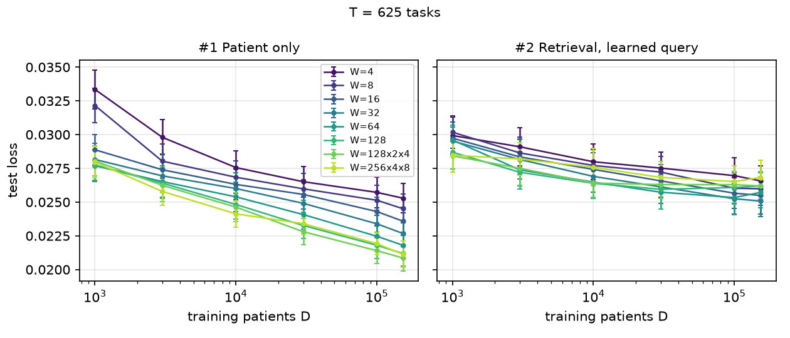
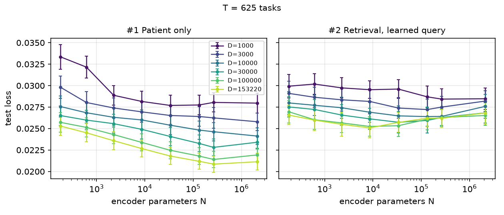
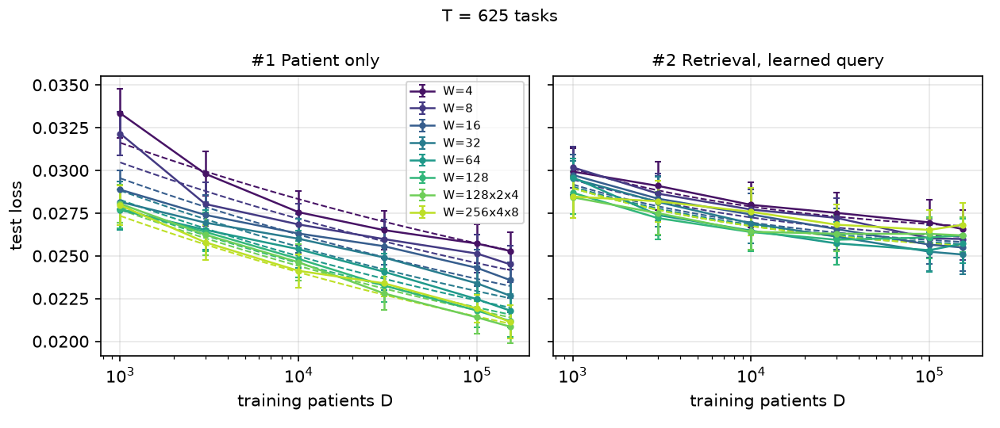
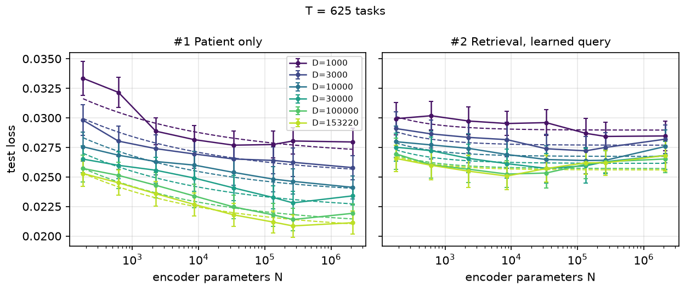
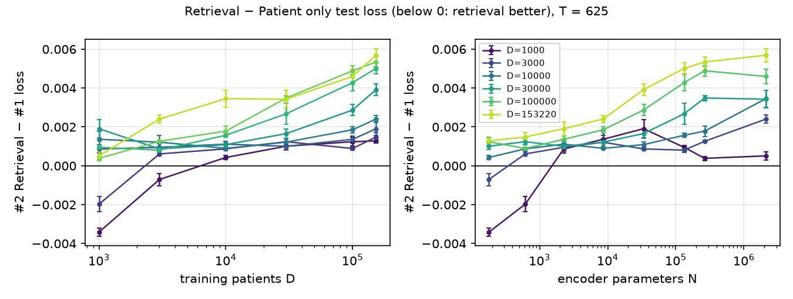
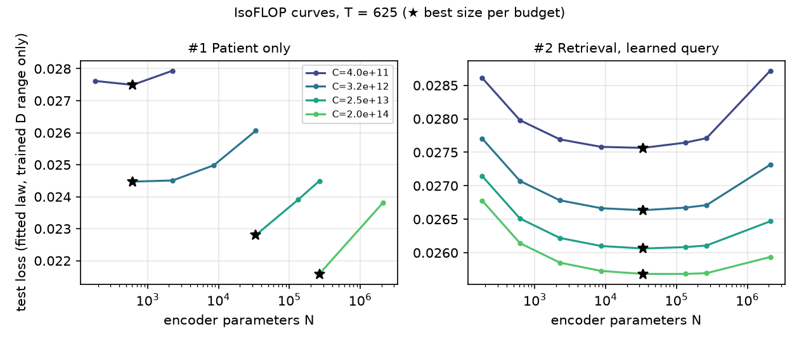
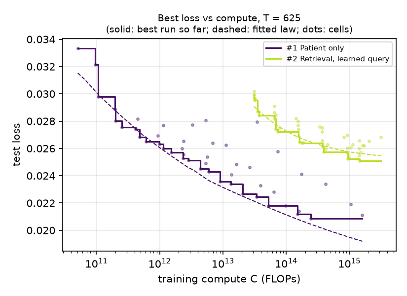

# Scaling laws: results

Main grid of [`scaling_laws/design.md`](../../scaling_laws/design.md): #1 Patient only and #2 Retrieval
with learned query, 8 encoder sizes × 6 patient counts × 5 task counts × 5 draws.
2,399 of 2,400 runs (missing: #2, W 128, D 153,220, T 2,500, draw 5). #3 Qwen3 query and #4 random
documents are not included yet.

Metric: test loss (lower is better), mean over draws; error bars are standard errors over draws.

## Findings

- Patient only beats retrieval at every task count. Retrieval has lower loss in 27 of 240 cells,
  all at D ≤ 10K.
- The gap grows with data and model size: at D = 153K retrieval is worse in all 40 cells, by 0.001–0.009.
- Retrieval barely improves with encoder size (P2): its fitted floor E is 0.019–0.029 vs
  0.011–0.020 for Patient only. The patient representation reaches the head only through the
  fusion, which looks like the bottleneck.

## Best cell per task count

| T | #1 loss | #1 AUROC | #1 at | #2 loss | #2 AUROC | #2 at | #2 better (cells) |
|---|---|---|---|---|---|---|---|
| 5 | 0.0299 | 0.872 | W 128x2x4, D 153,220 | 0.0370 | 0.845 | W 128x2x4, D 153,220 | 10/48 |
| 25 | 0.0252 | 0.897 | W 128x2x4, D 153,220 | 0.0309 | 0.844 | W 64, D 153,220 | 7/48 |
| 125 | 0.0168 | 0.894 | W 128x2x4, D 153,220 | 0.0198 | 0.831 | W 64, D 153,220 | 4/48 |
| 625 | 0.0209 | 0.909 | W 128x2x4, D 153,220 | 0.0251 | 0.846 | W 32, D 153,220 | 3/48 |
| 2500 | 0.0206 | 0.907 | W 128x2x4, D 153,220 | 0.0241 | 0.840 | W 16, D 153,220 | 3/48 |

## Fitted law

$L(N, D) = E + A / N^{\alpha} + B / D^{\beta}$, fitted on all runs of each configuration and T.

| Config | T | E | A | α | B | β |
|---|---|---|---|---|---|---|
| #1 | 5 | 0.0167 | 1.71 | 1.29 | 0.145 | 0.30 |
| #1 | 25 | 0.0195 | 0.0836 | 0.55 | 0.0984 | 0.26 |
| #1 | 125 | 0.0136 | 0.0178 | 0.34 | 0.0381 | 0.22 |
| #1 | 625 | 0.0113 | 0.0152 | 0.22 | 0.0317 | 0.10 |
| #1 | 2500 | 0.0105 | 0.0184 | 0.31 | 0.0289 | 0.09 |
| #2 | 5 | 0.0243 | 0.59 | 1.26 | 0.359 | 0.52 |
| #2 | 25 | 0.0285 | 0.0149 | 0.31 | 0.352 | 0.57 |
| #2 | 125 | 0.0195 | 0.0305 | 0.63 | 0.0882 | 0.47 |
| #2 | 625 | 0.0248 | 0.035 | 0.66 | 0.0424 | 0.34 |
| #2 | 2500 | 0.0235 | 0.0879 | 0.82 | 0.0288 | 0.28 |

## Plots (T = 625)

Other task counts: [T 5](T5/), [T 25](T25/), [T 125](T125/), [T 2500](T2500/).

**P1.** Loss vs training patients D, one line per encoder size.

**P2.** Loss vs encoder parameters N, one line per D.

**P3.** Fitted law (dashed) through P1 and P2.

**P4.** Retrieval − Patient only loss, matched on (W, D, draw). Below 0: retrieval better.
The knowledge/architecture split needs #4.

**P5.** IsoFLOP curves from the fitted law; ★ is the best encoder size per budget.

**P6.** Best loss vs training compute.

## Definitions

- N: patient-encoder parameters without the code embedding table.
- C = 6 · N_compute · D · epochs · 256, with N_compute = trainable parameters without embedding
  tables (encoder, query projector, fusion, head).
- P5 and P6 curves are read off the fitted law, using only D within the trained range.

## Files

`runs.csv` (one row per test evaluation), `cells.csv` (means per cell), `fits.csv`, `params.csv`.
Made by [`scaling_laws/analyze.py`](../../scaling_laws/analyze.py).
