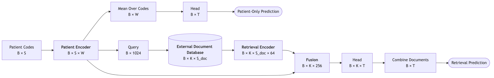

# Scaling laws: model design

## Variables

| Symbol | Meaning | Value |
|---|---|---|
| `B` | patients per batch | 32 |
| `S` | codes per patient | 256 |
| `W` | patient-encoder width | 4 to 256 (**varies**) |
| `T` | tasks | 5 to 2,500 (**varies**) |
| `K` | documents retrieved per patient | 4 in training, 1 at test |
| `S_doc` | tokens per document | 256 |

## Architecture

Each box shows the shape of its output.

Source: [`architecture.mmd`](architecture.mmd) (Mermaid). After editing it, re-render with
`npx -y @mermaid-js/mermaid-cli -i architecture.mmd -o architecture.png -w 1800 -s 2 -b white`.

The top path is the **patient-only** model. The bottom path adds **retrieval**: the patient
encoder's output becomes a query, the query looks up K documents in an external database,
and the fusion combines the patient with each document before the head predicts.

### Components

| Component | What it is | Output |
|---|---|---|
| Patient Encoder | code embedding table + transformer (L layers, H heads, time-gap position encoding) | B × S × W |
| Mean Over Codes | average over the patient's codes | B × W |
| Head | one linear layer: one logit per task | B × T, or B × K × T per document |
| Query | mean over codes, then linear W → 1024 (#2), or a frozen Qwen3 text embedding (#3) | B × 1024 |
| External Document Database | textbook passages + one null document, each with a fixed 1024-d key; returns the top K by query · key | B × K × S_doc |
| Retrieval Encoder | token embedding of each retrieved document | B × K × S_doc × 64 |
| Fusion | patient codes attend to one document at a time (cross-attention), then mean over codes | B × K × 256 |
| Combine Documents | weighted average of the per-document predictions; weights from query · key | B × T |

## Model Architectures Configurations

| # | Configuration | Query |
|---|---|---|
| 1 | Patient only | none (top path) |
| 2 | Retrieval, learned query | learned from the patient encoder |
| 3 | Retrieval, Qwen3 query | patient's last 32 codes as text, embedded by a frozen Qwen3 model |

**Database.** The external database always holds the medical-textbook passages **plus a null
(empty) document**, so the model can retrieve "nothing" when no passage helps. There is no
separate null-docs configuration.

## Loss

Notation: patient $i$, task $t$, label $y_{it} \in \{0, 1\}$, $\sigma$ = sigmoid. $V$ is the
set of (patient, task) pairs with a label; missing labels are skipped.

**#1 Patient only** (`MultiTaskBCELoss`): binary cross-entropy on the head's logit $z_{it}$.

$$
\mathcal{L} = \frac{1}{|V|} \sum_{(i,t) \in V} -\Big[\, y_{it} \log \sigma(z_{it}) + (1 - y_{it}) \log\big(1 - \sigma(z_{it})\big) \Big]
$$

**#2, #3 Retrieval** (`MultiTaskBCEMarginalizedLoss`): each of the K documents gets its own
logit $z_{ikt}$ and a weight $w_{ik}$ from its query · key score; the prediction is the weighted
average probability.

$$
w_{ik} = \operatorname{softmax}_k\!\left( \frac{q_i \cdot \kappa_{ik}}{\sqrt{1024}} \right),
\qquad
p_{it} = \sum_{k=1}^{K} w_{ik}\, \sigma(z_{ikt})
$$

$$
\mathcal{L} = \frac{1}{|V|} \sum_{(i,t) \in V} -\Big[\, y_{it} \log p_{it} + (1 - y_{it}) \log(1 - p_{it}) \Big]
$$

$q_i$ is the query, $\kappa_{ik}$ the document's key in the database. The code computes both
logs in log space (`logsumexp`) for stability. The weights get gradients, so the learned query
(#2) is trained through this loss; the Qwen3 query (#3) is frozen.

**At test** K = 1, so $w_{i1} = 1$ and the retrieval loss is the Patient-only formula applied
to the top document's logit. The test loss is the same formula on the test patients.

## Training runs (for approval)

Every axis below multiplies the run count. Nothing new is trained until this is approved.

| Axis | Values | Count |
|---|---|---|
| Configuration | #1 Patient only, #2 Retrieval with learned query, #3 Retrieval with Qwen3 query | 3 |
| Encoder size `W` | 4, 8, 16, 32, 64, 128 (1 layer, 1 head); 128 (2 layers, 4 heads); 256 (4 layers, 8 heads) | 8 |
| Training patients `D` | 1K, 3K, 10K, 30K, 100K, 153K (all) | 6 |
| Tasks `T` | 5, 25, 125, 625, 2,500 | 5 |
| Draws | 5 (each draw: new tasks, new patient subsample, new seed) | 5 |
| **Runs** | 3 × 8 × 6 × 5 × 5 | **3,600** |

## Training settings

The values used so far (round 1 and v2), the same for every configuration and size.

| Setting | Value |
|---|---|
| Optimizer | AdamW |
| Learning rate | 1e-3 (peak) |
| Schedule | linear warmup, then cosine decay to 0 over the whole run |
| Weight decay | 0.01 (not on biases or LayerNorm weights) |
| Batch size | 32 patients |
| Gradient clipping | 1.0 (global norm) |
| Dropout | 0 in the patient encoder, 0.1 in the fusion |
| Documents in training | K = 4 |
| Head bias at start | each task's training base rate (log-odds) |
| Validation | every 0.2 epoch, on up to 200 batches |
| Checkpoint tested | the last one |
| Seed | the draw number (1–5) |

**Epochs and warmup per training-set size.** Smaller sets get more epochs so they still get
enough optimizer steps.

| Training patients `D` | Epochs | Warmup steps | Optimizer steps (≈ D / 32 × epochs) |
|---|---|---|---|
| 1K | 10 | 60 | 310 |
| 3K | 7 | 100 | 660 |
| 10K | 5 | 200 | 1,560 |
| 30K | 4 | 200 | 3,750 |
| 100K | 3 | 200 | 9,380 |
| 153K | 3 | 200 | 14,360 |

## Testing

Each trained model is evaluated once on the held-out test patients. Retrieval models get one
extra evaluation with a random document, using the same model (no extra training):

| Evaluation | Documents | Used for |
|---|---|---|
| Top document | the single top document its query retrieves (K = 1) | the reported result |
| Random document | 1 random document from the database | reliance on the retrieved document |

The reported number is the **test loss** (below), averaged over all (patient, task) pairs;
AUROC is logged too.

## Plots

Scaling laws on **test loss** for now.

| # | Plot | Shows |
|---|---|---|
| P1 | Loss vs training patients `D`, one line per encoder size, one panel per configuration | data scaling |
| P2 | Loss vs encoder parameters `N`, one line per `D`, one panel per configuration | model scaling |
| P3 | Fitted law per configuration, drawn through P1 and P2, with its parameters in a table | the law itself |
| P4 | Retrieval − Patient-only loss vs `D` and vs `N` | where retrieval helps |
| P5 | IsoFLOP curves: loss vs `N` at fixed training compute, one curve per budget | compute-optimal model size |
| P6 | Best loss vs training compute (the frontier of P5), Patient only and retrieval on one plot | whether retrieval is worth its compute |

**Fitted law** (Chinchilla form), one fit per configuration and task count:

$$
L(N, D) = E + \frac{A}{N^{\alpha}} + \frac{B}{D^{\beta}}
$$

$E$ is the loss floor; $A, \alpha$ and $B, \beta$ describe how fast loss falls with model size
and data.

**IsoFLOP curves.** Training compute per run is about

$$
C \approx 6 \cdot N_{\text{compute}} \cdot D \cdot \text{epochs} \cdot S
$$

(6 FLOPs per parameter per token, forward + backward). For each compute budget $C$, plot loss
against model size among runs (or fitted-law points) with that budget. Each curve is U-shaped:
too small a model underfits, too large a model sees too little data. Its minimum is the best
model size for that budget, and the minima across budgets give how the optimal size grows with
compute.

**To decide for the plots:**

- `N`: all encoder parameters, or without the code embedding table? The table is a lookup, not
  compute, and is most of the parameters (65,536 × W). Compute ($N_{\text{compute}}$) should
  exclude it either way.
- Retrieval compute: count the fusion and retrieval encoder in $C$. They are fixed in size but
  can cost more than a small patient encoder, which is exactly what P6 should show.
- IsoFLOP points: our grid isn't laid out on equal-compute lines (epochs change with `D`), so
  either read them off the fitted law, or train a small extra grid where each size gets the
  same compute (needs approval).

