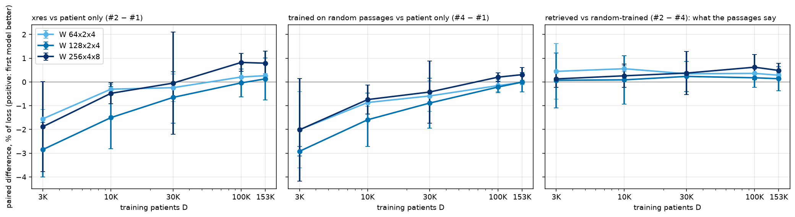
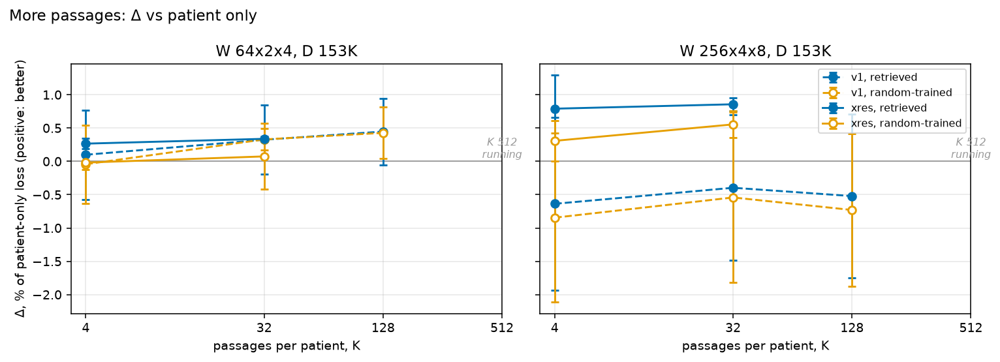
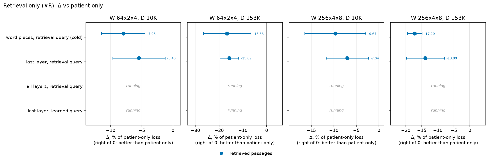
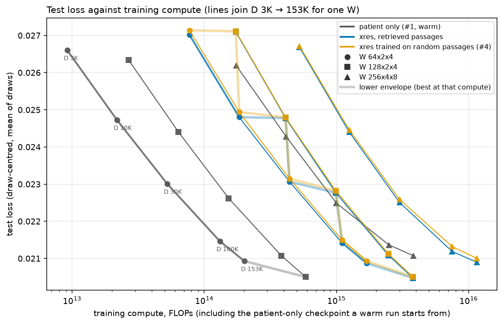
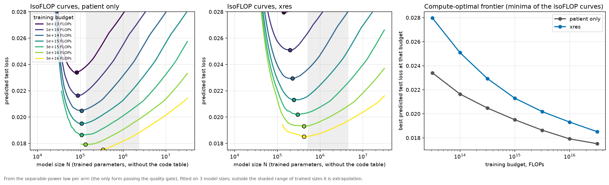

# scaling_laws_v2: results

The full log of every round is in [`EXPERIMENTS.md`](EXPERIMENTS.md); the design is in
[`design.md`](design.md). Figures are made by [`figures.py`](figures.py) and
[`curves.py`](curves.py).

## What we are doing

**Question.** Does a patient model predict better if it also retrieves and reads medical textbook
passages for each patient? And how does the answer change with model size and the amount of
training data?

**Data.**
- **Patients:** MEDS records. Each patient is a sequence of up to 256 medical codes.
- **Tasks:** 1,000 binary tasks, each "does code X occur in the next 30 days?", with X drawn at
  random. One model predicts all 1,000 at once.
- **Corpus:** 125,848 medical textbook passages of 256 tokens each.

**The models.**

- **#1 patient only.** A transformer encoder reads the patient's codes. The mean of its output
  states, `h`, goes to a linear head with 1,000 outputs.
- **#2 retrieval.** The same encoder, plus four steps:
  1. **Query.** `h` is projected to a 1,024-dimensional query.
  2. **Search.** An exact inner-product search over the passages' Qwen3-Embedding vectors returns
     the top K passages. An empty "null" passage is always added, so the model can rely on the
     patient alone for a given patient.
  3. **Read.** A *reader* combines the patient's encoder states with each passage's token vectors
     and makes one prediction per passage. Which reader to use is the main architectural question
     (see "The readers").
  4. **Combine.** The K + 1 predictions are averaged, weighted by the softmax of the search scores
     (REALM-style marginalization). The query gets its gradient through these weights, so the
     search learns which passages help.
- **#4 random passages.** #2 trained and tested with K random passages instead of the retrieved
  ones. This is the control: #2 − #4 is the value of what the passages *say*, and #4 − #1 is the
  value of the extra layers alone.
- **#R retrieval only.** The patient reaches the head *only* through the passages it retrieved.
- **#3** (a frozen Qwen query from the last 32 codes) was dropped, as requested.

**Settings varied.**
- `W` is the encoder size, written width × layers × heads: 64x2x4, 128x2x4 or 256x4x8.
- `D` is the number of training patients, from 3K to 153K.
- `K` is the number of passages per patient, from 4 to 512. K is the same in training and at test.

**How results are reported.**
- Each result is a **paired** test-set difference, Δ = L(#1) − L(#2), as a % of #1's test loss.
  **Positive means retrieval is better.**
- A *draw* is one random set of tasks, patients and training seed, shared by every model.
- Each number is the mean over 3 draws (6 where noted), with a 95% t-interval (the error bars in
  every figure). "3/3" means retrieval was better in all three draws.
- *Cold* models train from scratch and are compared with patient only. *Warm* models start their
  encoder from the trained patient-only model, and are compared with patient only continued from
  the same checkpoint for the same extra epochs.

## Bottom line

1. **Retrieval helps with enough data.** At 100K–153K training patients it beats patient only by
   **+0.3% to +0.9%**, for every model size, and the gain replicated on fresh draws.
2. **The passages themselves carry part of that gain.** The same model trained on *random* passages
   gains less. Passage knowledge accounts for about +0.2% to +0.5%; the rest is extra capacity.
3. **It hurts with little data:** −0.3% to −3% below about 30K patients.
4. **At equal training compute, patient only wins.** Retrieval needs about 6.5× the compute to
   reach the same loss, and the fitted laws put patient only ahead at every budget.
5. **Two changes made it work, both added during the experiments (neither is from the design
   review):**
   - *Warm start:* the encoder starts from the trained patient-only model. This removed v1's
     4–18% harm.
   - *The `xres` reader* (next section).
   - Neither is a gate: every model always reads its passages.

*Left: `xres` vs patient only. Middle: the model trained on random passages vs patient only.
Right: retrieved vs random passages, the part of the gain that comes from what the passages say.*

---

## The readers

v1's retrieval was 4–18% worse than patient only, so most of the work went into finding out why
and changing the reader. Three readers were compared, all with the same encoder, search and
marginalization. **Only v1's reader came with the original design. `residual` and `xres` were
designed during these experiments, each to fix a problem found in the one before. Neither was
suggested in the design review.**

| Reader | What it does | Problem it addresses | Origin |
|---|---|---|---|
| **v1 per-passage cross-attention** | Projects the encoder states to width 256. Two cross-attention layers let every patient code attend to the passage's tokens, then a LayerNorm and the head. | – | v1 design |
| **residual** | The head reads `h + c_k`, where `c_k` is one query vector's reading of passage k. With no passage content, this is exactly #1's input. | v1 starts away from #1: its head sees the patient only through new, untrained layers. | added (Round 7) |
| **`xres`** | v1's reader applied in place to the encoder's own states: each patient code cross-attends to the passage and adds the result to its own state, with no new projection or LayerNorm. The head then reads the patient-only input plus the passage updates. | `residual` reads each passage with a single query, which is too weak a reader. | added (Round 8) |

| Reader | Encoder start | Passages | 64x2x4, 10K | 64x2x4, 153K | 256x4x8, 10K | 256x4x8, 153K |
|---|---|---|---|---|---|---|
| v1 | cold | word pieces | −4.5% | −13.4% | −5.6% | −18.1% |
| v1 | warm | word pieces | −0.25% | +0.14% | −1.0% | −0.61% |
| v1 | warm | Qwen, last layer | – | +0.10% | – | −0.64% |
| v1 | warm | Qwen, all layers | −0.36% | **+0.36%** | −2.2% | −0.54% |
| residual | warm | Qwen, last layer | −0.22% | **+0.14%** | −0.35% | −0.12% |
| **`xres`** | warm | Qwen, last layer | −0.30% (6 draws) | **+0.27%** (6/6) | −0.48% (6 draws) | **+0.79%** (6/6) |

- **Warm start removes most of the harm.** v1 becomes about even with patient only, but its
  random-passage model (#4) does just as well, so the passages add nothing with v1.
- **`xres` is the only reader that is ahead at 153K for both sizes**, and it beats its own #4
  control, so part of its gain comes from what the passages say.
- **Caveat on choosing it:** `xres` was chosen after seeing draws 1–3. Draws 4–6 were then run
  fresh, with nothing chosen on them, and gave the same result (+0.3% and +0.8% at 153K).

**Warm start** is also our addition. The review asked for the good patient-only *configuration*
to be used as the seed for retrieval. We went further and start the retrieval model's encoder from
the trained patient-only *weights*.

---

## The review's points

### Reduce runs: drop #3, fewer `W`, ~1,000 tasks, 3 draws

- **#3** (frozen Qwen query on the last 32 codes) is dropped.
- **Model sizes:** three, 64x2x4, 128x2x4 and 256x4x8. The single-layer sizes are gone.
- **Tasks:** T = 1,000 everywhere.
- **Draws:** 3 everywhere. The key cells have 6: draws 4–6 were added later as a fresh
  replication, and nothing was chosen on them.

### Minimal patient-only sweep, then seed retrieval from the good configuration

Patient only at D 153K: 3 sizes × 3 learning rates × 2 dropouts, 3 draws each.

| `W` | Best lr | Test loss |
|---|---|---|
| 64x2x4 | 3e-3 | 0.02127 |
| 128x2x4 | 1e-3 | 0.02122 |
| 256x4x8 | 3e-4 | 0.02077 |

- Dropout matters little, and the last checkpoint is always the best one.
- Retrieval at each size's tuned lr was *worse* than at 1e-3 (−1.6% and −0.74% with v1), so all
  runs use lr 1e-3, and the baseline gets the same lr.
- Retrieval is seeded from this configuration, and in addition from the trained patient-only
  weights (warm start, above).

### More documents (128, 512)

| D 153K | K 4 | K 32 | K 128 | K 512 |
|---|---|---|---|---|
| v1, 64x2x4 (random-trained) | +0.10 (−0.05) | +0.32 (+0.33) | +0.45 (+0.43) | |
| v1, 256x4x8 (random-trained) | −0.64 (−0.85) | −0.40 (−0.39) | −0.52 (−0.73) | |
| `xres`, 64x2x4 (random-trained) | +0.27 (−0.02) | **+0.34** (+0.07) | | running |
| `xres`, 256x4x8 (random-trained) | **+0.79** (+0.31) | **+0.86** (+0.55) | | running |

- **Performance rises a little with K, but the random-passage control (#4) rises about as much.**
  More passages add capacity, not knowledge.
- With `xres`, K 32 beats K 4 by only +0.07% / +0.10% (intervals include 0). It mainly makes the
  gain steadier: ±0.04% and ±0.10%, the tightest intervals of any setting.
- **K 512** (`xres` and its #4 control, both sizes, 3 draws) is running, about 14 h per run at
  64x2x4.
- **Annealing K** during training is not done. No K beats its random control, so there is no
  number to anneal towards yet.

### Choose random K instead of top K in training

**What it is.** In training, the search returns the top 4K candidates, and K of them are drawn at
random, in proportion to softmax(score / √1024) (Gumbel-top-K). At test, the top K are used as
usual. The query then also gets a learning signal from passages it would not have ranked first.
Uniformly random passages are #4, already in every figure.

**Status:** running. `xres` with K 4 drawn from the top 16, at D 10K and 153K, both sizes, 3 draws.
MedRAP: `HFDatasetRetriever(sample_pool=16)`.

### Retrieval-only models, at the same settings and with richer encodings

| Δ vs patient only | 64x2x4, 10K | 64x2x4, 153K | 256x4x8, 10K | 256x4x8, 153K |
|---|---|---|---|---|
| word pieces, retrieval query (cold) | −8.0% | −16.7% | −9.7% | −17.2% |
| Qwen last layer, retrieval query | −5.5% | −15.7% | −7.0% | −13.9% |
| Qwen all layers, retrieval query | running | running | running | running |
| Qwen last layer, **learned query** | running | running | running | running |

- **Retrieval only is 5–17% worse than patient only, and the gap grows with D.** The passages work
  only as an *addition* to the patient record; on their own they describe the patient poorly.
- **Learned query** (requested). The passages were read with a query computed from the patient.
  Now one learned query vector, the same for every patient, reads every passage. The patient then
  affects the prediction *only* through which passages are retrieved and how they are weighted.
  MedRAP: `GatedDocFusion(mode="learned")`.

**Does it get there with less training?** Validation loss against patients seen in training.
- **Training length:** a cold run sees D × epochs patients, which is 50K at D 10K and 460K at
  153K.
- **Warm runs:** they start from a patient-only checkpoint, so their curves begin where that run
  ended. Everything is compared at the same total training.
- **The jump at the start of each warm curve:** only the encoder is copied, so the head and reader
  start fresh.

| D 153K (64x2x4 / 256x4x8) | Patients seen at the end | Final validation loss vs #1's final | Patients seen until it first reaches #1's final loss |
|---|---|---|---|
| #1 patient only | 460K | 0 | 460K |
| #R, word pieces (cold) | 460K | +16.3% / +17.3% | never |
| #R, last layer (warm) | 919K | +12.9% / +11.0% | never |
| #1 continued (warm) | 919K | −2.2% / −2.4% | 613K / 674K |
| `xres`, last layer | 919K | −2.3% / −3.2% | 644K / 674K |
| `xres`, all layers | 919K | −2.4% / −3.0% | 674K / 674K |

- **Retrieval only never reaches patient only**, even with twice the training.
- **Inside `xres`, richer encodings don't get there sooner.** `xres` with either encoding reaches
  #1's loss after about the same amount of training as #1 continued.

### Richer encodings: run Qwen over the passages, take all layers, attend through them

**What we ran.**
- **Word pieces (v1):** Qwen's input embeddings of the passage tokens, without context.
- **All layers:** a frozen Qwen3-Embedding-0.6B runs over each retrieved passage, and the reader
  attends over all 256 tokens × 29 layers, with a learned layer embedding. This is computed on the
  fly in every step.
- **Last layer:** the last-layer states of all 256 tokens, computed once for the whole corpus
  (66 GB) and looked up.

- **Context is what matters.** Contextual passages gave the first gains with either reader.
- **All layers add nothing over the last layer** (`xres`, paired: +0.05 ± 0.19% and −0.25 ± 0.38%),
  at about 18× the run time. The precomputed last layer is the encoding we kept.

### Count compute cost and number of parameters accurately

**Method:**
- **FLOPs:** measured, not estimated. One real training batch per configuration goes through
  forward and backward under PyTorch's `FlopCounterMode`.
- **Search:** the FAISS search runs outside torch, so it is added analytically (2.6 × 10⁸ FLOPs
  per patient).
- **Parameters:** `N` counts trained parameters without the code embedding table. Frozen
  parameters are listed separately.
- **Script:** [`count_compute.py`](count_compute.py).

| Per patient per step (fwd + bwd) | 64x2x4 | × #1 | 256x4x8 | × #1 | `N` (64 / 256) | frozen |
|---|---|---|---|---|---|---|
| #1 patient only | 2.2 × 10⁸ | 1 | 4.2 × 10⁹ | 1 | 136K / 2.4M | 0 |
| v1 reader, word pieces or last layer | 1.7 × 10¹⁰ | 78 | 2.1 × 10¹⁰ | 5.1 | 2.3M / 4.5M | 155M / 0 |
| v1 reader, all layers on the fly | 1.5 × 10¹² | 6,900 | 1.5 × 10¹² | 364 | 2.3M / 4.6M | 596M |
| **`xres`, last layer** | 3.5 × 10⁹ | 16 | 2.1 × 10¹⁰ | 5.0 | 515K / 4.5M | 0 |

- **Each line is one model size,** going from D 3K to 153K. Training compute for a warm run
  includes the patient-only checkpoint it starts from.
- **The faint thick line is the lower envelope:** the best loss reached at that compute.
- **Patient only's envelope is left of `xres`'s everywhere.** Its best model reaches 0.02073 at
  5.9 × 10¹⁴ FLOPs, while `xres` reaches 0.02071 at 3.8 × 10¹⁵ (6.5×).
- **Encoding the corpus once** costs 3.9 × 10¹⁶ FLOPs. It is shared by all runs and not included
  above.

### Scaling laws: other law forms, loss scale only, drop poor fits

**Grid:** 3 sizes × D {3K, 10K, 30K, 100K, 153K} × 3–6 draws, with four models per cell: #1 (cold,
then warm), `xres`, and `xres` trained on random passages (#4).

| Δ vs patient only | 64x2x4 | 128x2x4 | 256x4x8 |
|---|---|---|---|
| D 3K | −1.55 ± 0.40 | −2.85 ± 1.15 | −1.88 ± 1.89 |
| D 10K | −0.30 ± 0.20 | −1.50 ± 1.32 | −0.48 ± 0.44 |
| D 30K | −0.24 ± 0.58 | −0.65 ± 1.09 | −0.05 ± 2.15 |
| D 100K | **+0.21 ± 0.23** (3/3) | −0.04 ± 0.58 | **+0.82 ± 0.37** (3/3) |
| D 153K | **+0.27 ± 0.08** (6/6) | +0.13 ± 0.89 | **+0.79 ± 0.50** (6/6) |

**Law fits** (script: [`grid.py`](grid.py); fits: [`grid_fits.csv`](grid_fits.csv)):
- **Five forms tried,** all fitted on loss: separable power, shifted separable, Kaplan joint,
  Skaling joint, bounded rational.
- **Quality gate:** a fit is kept only if all three hold:
  - R² over the cell means ≥ 0.9;
  - leave-one-cell-out RMSE below the run-to-run SD;
  - no ill-conditioning or non-convergence warning.
- **Result:** only separable power, `L = E + A·N^−α + B·D^−β`, passes. It passes for patient only
  (R² 0.994) and `xres` (0.996), and narrowly fails for #4. The other four forms fail on
  ill-conditioning or optimizer warnings.

- **How the isoFLOP curves are made:** for each training budget, loss against model size N, where
  each N gets the D that the budget allows. They come from each model's fitted law and its
  measured compute per patient.
- **Compute-optimal frontier (right):** patient only is below `xres` at every budget. The gap
  narrows as the budget grows, but the curves don't cross within the range shown.
- **Caveat:** the laws are fitted on 3 model sizes, so the curves are extrapolation outside the
  shaded range.
- **Comparing the models through their laws is inconclusive** (P(`xres` better) 0.5–0.6). Laws
  fitted separately per model can't resolve a 0.3–0.8% difference, and an additive law can't
  represent a gain that grows with D. The paired table above is the evidence.

---

## Analysis: paired differences

- **Every number here is one paired difference per draw** (same split, tasks, patients and seed),
  averaged over draws with a t-interval.
- **Why this matters:** the draw-to-draw spread in loss (SD about 5%) is much larger than the
  effects (under 1%), so unpaired comparisons would show nothing.
- **For the law fits,** each draw's loss is centred on its own mean, for the same reason.

## Requested plots

| Plot | Figure |
|---|---|
| Test loss vs training compute | [`figures/compute.png`](figures/compute.png) |
| IsoFLOP curves | [`figures/isoflop.png`](figures/isoflop.png) |
| Difference between models | [`figures/delta.png`](figures/delta.png), [`figures/readers.png`](figures/readers.png) |

## Still running

| What | Runs | Expected |
|---|---|---|
| K 512: `xres` and its #4 control, D 153K, both sizes | 12 | ~14 h (64x2x4) to ~1 day (256x4x8) each |
| Sampled K (K 4 drawn from the top 16): `xres`, D 10K and 153K, both sizes | 12 | ~0.5 h each |
| Retrieval only with a learned query, D 10K and 153K, both sizes | 12 | ~0.5–2 h each |
| Retrieval only with all Qwen layers, D 10K and 153K, both sizes | 12 | 1–9 h each |

## Next

- **Positive control.** Give the model a synthetic passage that states some of the patient's
  labels. If it can't exploit even that, the reader is the limit; if it can, the corpus is.
- **Rare tasks.** Break the existing results down by task frequency. Retrieval should help most
  where the patient data is thin.
- **Code-aligned passages.** One definition per diagnosis or drug code, retrieved for the
  patient's own codes, instead of generic textbook chunks.
