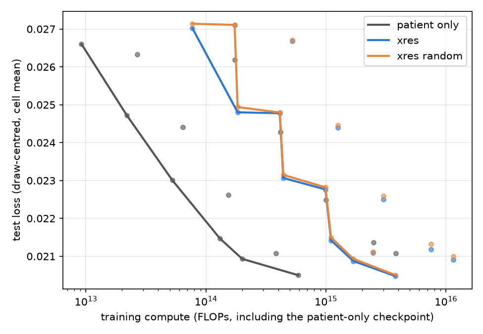

# scaling_laws_v2: results

The full log of every round is in [`EXPERIMENTS.md`](EXPERIMENTS.md); the design is in
[`design.md`](design.md).

## What we are doing

**Question.** Does a patient model predict better if it also retrieves and reads medical textbook
passages for each patient? And how does the answer change with model size and the amount of
training data?

**Data.**
- **Patients:** MEDS records. Each patient is a sequence of up to 256 medical codes.
- **Tasks:** 1,000 binary tasks, each "does code X occur in the next 30 days?", with X drawn at
  random. One model predicts all 1,000 at once.
- **Corpus:** 125,848 medical textbook passages of 256 tokens each.

**The models.**

- **#1 patient only.** A transformer encoder reads the patient's codes. The mean of its output
  states, `h`, goes to a linear head with 1,000 outputs.
- **#2 retrieval.** The same encoder, plus four steps:
  1. **Query.** `h` is projected to a 1,024-dimensional query.
  2. **Search.** An exact inner-product search over the passages' Qwen3-Embedding vectors returns
     the top K passages. An empty "null" passage is always added, so the model can rely on the
     patient alone for a given patient.
  3. **Read.** A *reader* combines the patient's encoder states with each passage's token vectors
     and makes one prediction per passage. Which reader to use is the main architectural question
     (next section).
  4. **Combine.** The K + 1 predictions are averaged, weighted by the softmax of the search scores
     (REALM-style marginalization). The query gets its gradient through these weights, so the
     search learns which passages help.
- **#4 random passages.** #2 trained and tested with K random passages instead of the retrieved
  ones. This is the control: #2 − #4 is the value of what the passages *say*, and #4 − #1 is the
  value of the extra layers alone.
- **#R retrieval only.** The patient reaches the head *only* through the passages it retrieved.
- **#3** (a frozen Qwen query from the last 32 codes) was dropped, as requested.

**Settings varied.**
- `W` is the encoder size, written width × layers × heads: 64x2x4, 128x2x4 or 256x4x8.
- `D` is the number of training patients, from 3K to 153K.
- `K` is the number of passages per patient, from 4 to 512. K is the same in training and at test.

**How results are reported.**
- Each result is a **paired** test-set difference, Δ = L(#1) − L(#2), as a % of #1's test loss.
  **Positive means retrieval is better.**
- A *draw* is one random set of tasks, patients and training seed, shared by every model.
- Each number is the mean over 3 draws (6 where noted), with a 95% t-interval. "3/3" means
  retrieval was better in all three draws.

## Bottom line

1. **Retrieval now helps with enough data.** At 100K–153K training patients it beats patient only
   by **+0.3% to +0.9%**, for every model size, and the gain replicated on fresh draws.
2. **The passages themselves carry part of that gain.** The same model trained on *random* passages
   gains less. Passage knowledge accounts for about +0.2% to +0.5%; the rest is extra capacity.
3. **It hurts with little data:** −0.3% to −3% below about 30K patients.
4. **At equal training compute, patient only wins.** Retrieval needs about 6.5× the compute to
   reach the same loss.
5. **Two changes made this possible, both added during the experiments (neither is from the design
   review):**
   - *Warm start:* the encoder starts from the trained patient-only model. This removed v1's
     12–18% harm.
   - *The `xres` reader* (next section).
   - Neither is a gate: every model always reads its passages.

---

## The readers we tried

v1's retrieval was 12–18% worse than patient only, so most of the work went into finding out why
and changing the reader. Four readers were tried, all with the same encoder, search and
marginalization. **Only v1's reader came with the original design. The gated reader is from our v2 design, and
the other two were designed during these experiments, each to fix a problem found in the one before.** None of them was
suggested in the design review.

| Reader | What it does | Problem it addresses | Origin |
|---|---|---|---|
| **v1 per-passage cross-attention** | Projects the encoder states to width 256. Two cross-attention layers let every patient code attend to the passage's tokens, then a LayerNorm and the head. | – | v1 design |
| **gated** | The head reads `h + tanh(g)·c_k`, where `c_k` is one query's reading of passage k, and `g` is a learned scalar starting at 0. Training starts exactly at #1. | v1 starts away from #1 and can't ignore passages | our v2 design, written before these runs |
| **residual** | The same without the gate: `h + c_k`. | The gate closed (tanh(g) ≈ 0.001–0.02), switching retrieval off. That counts as cheating here. | added (Round 7) |
| **`xres`** | v1's reader applied in place to the encoder's own states: each patient code cross-attends to the passage and adds the result to its own state, with no new projection or LayerNorm. The head then reads the patient-only input plus the passage updates. | `residual` reads each passage with a single query, which is too weak a reader. v1 reads with every code but starts away from #1. | added (Round 8) |

**Results** (Δ vs patient only. From the warm-start rows on, the baseline is patient only
continued for the same extra epochs.)

| Reader | Encoder start | Passages | 64x2x4, 10K | 64x2x4, 153K | 256x4x8, 10K | 256x4x8, 153K |
|---|---|---|---|---|---|---|
| v1 | cold | word pieces | −3.4% | −12.1% | −6.5% | −18.1% |
| gated | cold | word pieces | −0.45% | −0.16% | +1.3% | −0.3% |
| v1 | warm | word pieces | −0.25% | +0.1% | −1.0% | −0.6% |
| v1 | warm | Qwen, all layers | −0.36% | **+0.36%** | −2.2% | −0.54% |
| v1 | warm | Qwen, last layer | | +0.10% | | −0.64% |
| residual | warm | Qwen, last layer | −0.22% | **+0.14%** | −0.35% | −0.12% |
| **`xres`** | warm | Qwen, last layer | −0.30% (6 draws) | **+0.27%** (6/6) | −0.48% (6 draws) | **+0.79%** (6/6) |

- **The gated reader looks fine but doesn't use the passages.** Its gate closes, so the
  retrieved-passage, top-1 and random-passage tests all give the same loss.
- **v1 becomes even with patient only once warm-started**, but #4 does just as well. So the
  passages add nothing with v1.
- **`xres` is the only reader that is ahead at 153K for both sizes**, and it beats its own #4
  control, so part of its gain comes from what the passages say.
- **Caveat on choosing it:** `xres` was chosen after seeing draws 1–3. Draws 4–6 were then run
  fresh, with nothing chosen on them, and gave the same result (+0.3% and +0.8% at 153K).

**Warm start** is also our addition. The review asked for the good patient-only *configuration*
to be used as the seed for retrieval. We went further and start the retrieval model's encoder from
the trained patient-only *weights*. That is what removed the 12–18% harm. The fair baseline is
then patient only continued from the same checkpoint for the same extra epochs.

---

## The review's points, one by one

## Reduce runs / increase speed

### Drop setting #3 (static frozen query from Qwen on the last 32 codes)

Dropped.

### Fewer `W` settings, at sensible points

Three sizes: **64x2x4, 128x2x4, 256x4x8**. The single-layer sizes (W 4–128) are gone.

### Minimal patient-only sweep first, then seed retrieval from the good configuration

**Sweep:** patient only at D 153K, over 3 sizes × 3 learning rates × 2 dropouts, 3 draws each.

| `W` | Best lr | Test loss |
|---|---|---|
| 64x2x4 | 3e-3 | 0.02127 |
| 128x2x4 | 1e-3 | 0.02122 |
| 256x4x8 | 3e-4 | 0.02077 |

- Dropout changes the loss by less than 1%, and the last checkpoint is always the best one.
- Retrieval at each size's tuned lr was *worse* than at 1e-3, so all runs use lr 1e-3. The
  baseline always gets the same lr.

**Seeding retrieval:** retrieval uses the same configuration, and in addition its encoder starts
from the trained patient-only weights (see Warm start above).
- That removes the harm.
- Measured against patient only continued for the same extra epochs, so that extra training isn't
  counted as a retrieval gain. Without that fair baseline, warm start looks like +2%.

| D 153K, Δ vs patient only | 64x2x4 | 256x4x8 |
|---|---|---|
| v1 (cold start) | −12.1% | −18.1% |
| warm start, vs patient only trained for the same extra epochs | +0.1% | −0.6% |

### One task setting (~1,000 tasks)

T = 1,000 everywhere.

### 3 draws instead of 5

3 draws everywhere. The key cells have 6: draws 4–6 were added later as a fresh replication,
and nothing was chosen on them.

---

## Scientific validity

### More documents (128, 512)

K = 4, 32, 128 at D 153K, each with a control trained on random passages (bracketed).

**v1 reader:**

| K | 64x2x4 | 256x4x8 |
|---|---|---|
| 4 | +0.10 (−0.05) | −0.64 (−0.85) |
| 32 | +0.32 (+0.33) | −0.40 (−0.39) |
| 128 | +0.45 (+0.43) | −0.52 (−0.73) |

**`xres`, the final reader:**

| K | 64x2x4 | 256x4x8 |
|---|---|---|
| 4 (6 draws) | +0.27 ± 0.08 | +0.79 ± 0.50 |
| 32 | **+0.34 ± 0.04** (3/3) | **+0.86 ± 0.10** (3/3) |
| 32, trained on random passages | +0.07 ± 0.50 | +0.55 ± 0.20 |

- **Performance rises with K, but the random-passage control rises just as much.** More passages
  add capacity, not knowledge.
- With `xres`, K 32 beats K 4 by only +0.07% / +0.10% (intervals include 0). It mainly makes the
  gain steadier.
- **K 512 (`xres`, with its random-passage control) is running now.** It needs gradient
  accumulation over 8 smaller batches to fit on the GPU.
- Annealing K during training is not done. With no number of passages that beats the random
  control, there is no target to anneal towards yet.

### Retrieval-only models, at the same settings and with richer encodings

**Retrieval only:** the patient record reaches the prediction *only* through the retrieved passages.

| Δ vs patient only | 64x2x4, 10K | 64x2x4, 153K | 256x4x8, 10K | 256x4x8, 153K |
|---|---|---|---|---|
| word-piece passages (v1 encoding) | −8.0% | −16.7% | −9.7% | −17.2% |
| contextual passages (Qwen last layer) | −5.5% | −15.7% | −7.0% | −13.9% |
| all Qwen layers | *running* | *running* | *running* | *running* |

**Does it get there with less training?** Validation loss against the number of patients seen in
training.
- **Training length:** a cold run sees D × epochs patients, which is 50K at D 10K and 460K at
  153K.
- **Warm runs:** they start from a patient-only checkpoint, so their curves begin where that run
  ended. Everything is compared at the same total training.
- **The jump at the start of each warm curve:** only the encoder is copied, so the head and reader
  start fresh.

| D 153K (64x2x4 / 256x4x8) | Patients seen at the end | Final validation loss vs #1's final | Patients seen until it first reaches #1's final loss |
|---|---|---|---|
| #1 patient only | 460K | 0 | 460K |
| #R, word pieces (cold) | 460K | +16.3% / +17.3% | never |
| #R, last layer (warm) | 919K | +12.9% / +11.0% | never |
| #1 continued (warm) | 919K | −2.2% / −2.4% | 613K / 674K |
| `xres`, last layer | 919K | −2.3% / −3.2% | 644K / 674K |
| `xres`, all layers | 919K | −2.4% / −3.0% | 674K / 674K |

- **Retrieval only never reaches patient only**, even with twice the training. The gap is about
  5% at D 10K and 11–13% at 153K, so it grows with data. The passages work only as an *addition*
  to the patient record; on their own they describe the patient poorly.
- **Word pieces vs last layer in #R:** the last-layer runs are 3–6 points better, but they also
  trained twice as long (warm). The all-layer #R runs now running are warm too, so they give the
  clean comparison against last layer.
- **Inside `xres`, richer encodings don't get there sooner.** `xres` with either encoding reaches
  #1's loss after about the same amount of training as #1 continued. All layers are slightly
  lower at the first evaluations, then the curves meet.

### Richer document value encodings (all Qwen tokens; run Qwen over the documents, take all layers)

**Three encodings were tried:**
- **v1:** context-free word-piece embeddings.
- **All layers:** a frozen Qwen3-Embedding-0.6B runs over each retrieved passage, and the reader
  attends over all 256 tokens × 29 layers (on the fly).
- **Last layer:** the last-layer states of all 256 tokens, precomputed once for the whole corpus
  (66 GB).

| D 153K, Δ vs patient only | 64x2x4 | 256x4x8 | GPU-h per run |
|---|---|---|---|
| v1 reader, word pieces | +0.1% | −0.6% | ~0.5 |
| v1 reader, all layers | **+0.36%** | −0.54% | 8–16 |
| `xres`, last layer | **+0.27%** | **+0.75%** | ~0.5 |
| `xres`, all layers | +0.32% | +0.51% | 6–9 |
| `xres`, all layers − last layer (paired) | +0.05 ± 0.19% | −0.25 ± 0.38% | |

- **Context is what matters.** Contextual passages gave the first gains, and all layers add
  nothing over the last layer, at 12–18× the run time.
- **The last layer, precomputed, is the encoding we kept.**

### Count compute cost and number of parameters accurately

**Method:**
- **FLOPs:** measured, not estimated. One real training batch per configuration goes through
  forward and backward under PyTorch's `FlopCounterMode`.
- **Search:** the FAISS search runs outside torch, so it is added analytically (2.6 × 10⁸ FLOPs
  per patient).
- **Parameters:** `N` counts trained parameters without the code embedding table. Frozen
  parameters are listed separately.
- **Script:** [`count_compute.py`](count_compute.py).

| Per patient per step (fwd + bwd) | 64x2x4 | × patient only | 256x4x8 | × patient only | `N` (64 / 256) | frozen |
|---|---|---|---|---|---|---|
| patient only | 2.2 × 10⁸ | 1 | 4.2 × 10⁹ | 1 | 136K / 2.4M | 0 |
| v1 reader, word pieces or last layer | 1.7 × 10¹⁰ | 78 | 2.1 × 10¹⁰ | 5.1 | 2.3M / 4.5M | 155M / 0 |
| v1 reader, all layers on the fly | 1.5 × 10¹² | 6,900 | 1.5 × 10¹² | 364 | 2.3M / 4.6M | 596M |
| **`xres`, last layer** | 3.5 × 10⁹ | 16 | 2.1 × 10¹⁰ | 5.0 | 515K / 4.5M | 0 |

- Training compute for a warm-started run includes its patient-only checkpoint.
- Encoding the corpus once costs 3.9 × 10¹⁶ FLOPs, shared by all runs and reported separately.
- **At equal training compute, patient only wins:** its best model reaches test loss 0.02073 at
  5.9 × 10¹⁴ FLOPs, while `xres` reaches 0.02071 at 3.8 × 10¹⁵ (6.5×).

### Scaling laws: other law forms, loss scale only, drop poor fits

**Grid:** 3 sizes × D {3K, 10K, 30K, 100K, 153K} × 3–6 draws. Each cell has four arms: patient
only, patient only warm, `xres`, and `xres` trained on random passages.

| Δ vs patient only | 64x2x4 | 128x2x4 | 256x4x8 |
|---|---|---|---|
| D 3K | −1.55 ± 0.40 | −2.85 ± 1.15 | −1.88 ± 1.89 |
| D 10K | −0.30 ± 0.20 | −1.50 ± 1.32 | −0.48 ± 0.44 |
| D 30K | −0.24 ± 0.58 | −0.65 ± 1.09 | −0.05 ± 2.15 |
| D 100K | **+0.21 ± 0.23** (3/3) | −0.04 ± 0.58 | **+0.82 ± 0.37** (3/3) |
| D 153K | **+0.27 ± 0.08** (6/6) | +0.13 ± 0.89 | **+0.79 ± 0.50** (6/6) |

**Law fits:**
- **Five forms tried,** all fitted on loss: separable power, shifted separable, Kaplan joint,
  Skaling joint, bounded rational.
- **Quality gate:** a fit is kept only if all three hold:
  - R² over the cell means ≥ 0.9;
  - leave-one-cell-out RMSE below the run-to-run SD;
  - no ill-conditioning or non-convergence warning.
- **Result:** only separable power, `L = E + A·N^−α + B·D^−β`, passes. It passes for patient only
  (R² 0.994) and `xres` (0.996), and narrowly fails for the random-passage arm. The other four
  forms fail on ill-conditioning or optimizer warnings.
- **Comparing arms through the laws is inconclusive** (P(`xres` better) 0.5–0.6). Laws fitted
  separately per arm can't resolve a 0.3–0.8% difference, and an additive law can't represent a
  gain that grows with D. As the design rules say, we don't lean on the law comparison: **the paired
  table above is the evidence.**
- **Script:** [`grid.py`](grid.py). Fits are in [`grid_fits.csv`](grid_fits.csv).

---

## Analysis

### All runs paired; analyses on paired differences

Done throughout. Every reported number is one paired difference per draw (same split, tasks,
patients and seed), averaged over draws with a t-interval. The draw-to-draw spread in loss
(SD about 5%) is much larger than the effects (under 1%), so unpaired comparisons would have shown
nothing. For the law fits, each draw's loss is centred on its own mean for the same reason.

---

## Still running

| What | Runs | Expected |
|---|---|---|
| K 512, `xres` + random-passage control, D 153K, both sizes | 12 | ~1–2 days each |
| Retrieval only with all Qwen layers, D 10K and 153K, both sizes | 12 | 1–9 h each |

## What we think is next

- **Positive control.** Give the model a synthetic passage that states some of the patient's
  labels. If it can't exploit even that, the reader is the limit; if it can, the corpus is.
- **Rare tasks.** Break the existing results down by task frequency. Retrieval should help most
  where the patient data is thin.
- **Code-aligned passages.** One definition per diagnosis or drug code, retrieved for the
  patient's own codes, instead of generic textbook chunks.
