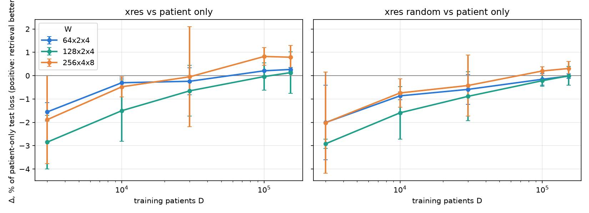

# scaling_laws_v2: results

One section per point of the experimental-design review. The full log of every round is in
[`EXPERIMENTS.md`](EXPERIMENTS.md), and the working notes are in [`README.md`](README.md).

**Setup.**
- **Task:** 1,000 random 30-day prediction tasks from MEDS patient records.
- **Corpus:** textbook passages (125,848 passages of 256 tokens).
- **Model:** a patient transformer of size `W` (width × layers × heads) that retrieves K passages,
  reads them, and marginalizes over them (REALM-style).

**Metric.** Every number is a **paired** difference on the test set: Δ = L(patient only) − L(retrieval),
as a % of patient only's test loss. **Positive means retrieval is better.** Values are means over 3
draws (6 where noted), each draw sharing tasks, patients and seed, with a 95% t-interval. "3/3" means
retrieval was better in all three draws.

## Bottom line

1. **Retrieval now helps with enough data.** At 100K–153K training patients it beats patient only
   by **+0.3% to +0.9%**, for every model size, and the gain replicated on fresh draws.
2. **The passages themselves carry part of that gain.** The same model trained on *random* passages
   gains less. Passage knowledge accounts for about +0.2% to +0.5%; the rest is extra capacity.
3. **It hurts with little data:** −0.3% to −3% below about 30K patients.
4. **At equal training compute, patient only wins.** Retrieval needs about 6.5× the compute to
   reach the same loss.
5. **Two architectural fixes made this possible:**
   - *Warm start:* the encoder starts from the trained patient-only model. This removed v1's
     12–18% harm.
   - *Residual per-code reader (`xres`):* each patient code adds what it reads from the passages
     to its own state, so training starts at the patient-only model and the passages can only
     add to it.
   - Neither is a gate: every model always reads its passages.

---

## Reduce runs / increase speed

### Drop setting #3 (static frozen query from Qwen on the last 32 codes)

Dropped.

### Fewer `W` settings, at sensible points

Three sizes: **64x2x4, 128x2x4, 256x4x8**. The single-layer sizes (W 4–128) are gone.

### Minimal patient-only sweep first, then seed retrieval from the good configuration

**Sweep:** patient only at D 153K, over 3 sizes × 3 learning rates × 2 dropouts, 3 draws each.

| `W` | Best lr | Test loss |
|---|---|---|
| 64x2x4 | 3e-3 | 0.02127 |
| 128x2x4 | 1e-3 | 0.02122 |
| 256x4x8 | 3e-4 | 0.02077 |

- Dropout changes the loss by less than 1%, and the last checkpoint is always the best one.
- Retrieval at each size's tuned lr was *worse* than at 1e-3, so all runs use lr 1e-3. The
  baseline always gets the same lr.

**Seeding retrieval from that configuration was the single most important fix.**
- v1 trained the patient encoder and the passage reader together from scratch, and retrieval
  ended up 12–18% worse than patient only.
- Starting the encoder from the patient-only checkpoint removes the harm.
- The fair baseline is patient only continued from the same checkpoint for the same extra
  epochs. Without it, warm start looks like +2%, but that is just more training.

| D 153K, Δ vs patient only | 64x2x4 | 256x4x8 |
|---|---|---|
| v1 (cold start) | −12.1% | −18.1% |
| warm start, vs patient only trained for the same extra epochs | +0.1% | −0.6% |

### One task setting (~1,000 tasks)

T = 1,000 everywhere.

### 3 draws instead of 5

3 draws everywhere. The key cells have 6: draws 4–6 were added later as a fresh replication,
and nothing was chosen on them.

---

## Scientific validity

### More documents (128, 512)

K = 4, 32, 128 at D 153K, each with a control trained on random passages (bracketed).

**v1 reader:**

| K | 64x2x4 | 256x4x8 |
|---|---|---|
| 4 | +0.10 (−0.05) | −0.64 (−0.85) |
| 32 | +0.32 (+0.33) | −0.40 (−0.39) |
| 128 | +0.45 (+0.43) | −0.52 (−0.73) |

**`xres`, the final reader:**

| K | 64x2x4 | 256x4x8 |
|---|---|---|
| 4 (6 draws) | +0.27 ± 0.08 | +0.79 ± 0.50 |
| 32 | **+0.34 ± 0.04** (3/3) | **+0.86 ± 0.10** (3/3) |
| 32, trained on random passages | +0.07 ± 0.50 | +0.55 ± 0.20 |

- **Performance rises with K, but the random-passage control rises just as much.** More passages
  add capacity, not knowledge.
- With `xres`, K 32 beats K 4 by only +0.07% / +0.10% (intervals include 0). It mainly makes the
  gain steadier.
- **K 512 (`xres`, with its random-passage control) is running now.** It needs gradient
  accumulation over 8 smaller batches to fit on the GPU.
- Annealing K during training is not done. With no number of passages that beats the random
  control, there is no target to anneal towards yet.

### Retrieval-only models, at the same settings and with richer encodings

**Retrieval only:** the patient record reaches the prediction *only* through the retrieved passages.

| Δ vs patient only | 64x2x4, 10K | 64x2x4, 153K | 256x4x8, 10K | 256x4x8, 153K |
|---|---|---|---|---|
| word-piece passages (v1 encoding) | −8.0% | −16.7% | −9.7% | −17.2% |
| contextual passages (Qwen last layer) | −5.5% | −15.7% | −7.0% | −13.9% |
| all Qwen layers | *running* | *running* | *running* | *running* |

**Earlier in training?** The curves below show validation loss over training, for each passage
encoding.

| Validation loss above patient only's final loss | at ¼ of training | at ½ | at the end |
|---|---|---|---|
| retrieval only, word pieces (64x2x4 / 256x4x8, D 153K) | +23.5% / +25.8% | +19.9% / +21.0% | +16.3% / +17.3% |
| retrieval only, last layer | +17.6% / +18.6% | +16.3% / +14.6% | +12.9% / +11.0% |
| `xres`, last layer | +1.6% / +2.1% | −1.1% / −0.8% | −2.3% / −3.2% |
| `xres`, all layers | +0.9% / +1.8% | −1.0% / −1.1% | −2.4% / −3.0% |

- **Richer encodings lower the retrieval-only curve at every point in training**, by about 3–7
  points, but it never comes near patient only. The gap even *grows* with D: about 5% at 10K and
  11–13% at 153K.
  - Caveat: the word-piece retrieval-only runs start cold, while the last-layer runs start from
    the patient-only checkpoint. Warm start affects only the query here, since the head reads
    passages alone.
- **All layers vs last layer, inside `xres`:** all layers are slightly ahead in the first quarter
  of training, then the curves meet.
- **Takeaway:** the passages work only as an *addition* to the patient record. On their own they
  are a lossy description of the patient. Richer encodings speed up learning a little but don't
  change where it ends.

### Richer document value encodings (all Qwen tokens; run Qwen over the documents, take all layers)

**Three encodings were tried:**
- **v1:** context-free word-piece embeddings.
- **All layers:** a frozen Qwen3-Embedding-0.6B runs over each retrieved passage, and the reader
  attends over all 256 tokens × 29 layers (on the fly).
- **Last layer:** the last-layer states of all 256 tokens, precomputed once for the whole corpus
  (66 GB).

| D 153K, Δ vs patient only | 64x2x4 | 256x4x8 | GPU-h per run |
|---|---|---|---|
| v1 reader, word pieces | +0.1% | −0.6% | ~0.5 |
| v1 reader, all layers | **+0.36%** | −0.54% | 8–16 |
| `xres`, last layer | **+0.27%** | **+0.75%** | ~0.5 |
| `xres`, all layers | +0.32% | +0.51% | 6–9 |
| `xres`, all layers − last layer (paired) | +0.05 ± 0.19% | −0.25 ± 0.38% | |

- **Context is what matters.** Contextual passages gave the first gains, and all layers add
  nothing over the last layer, at 12–18× the run time.
- **The last layer, precomputed, is the encoding we kept.**

### Count compute cost and number of parameters accurately

**Method:**
- **FLOPs:** measured, not estimated. One real training batch per configuration goes through
  forward and backward under PyTorch's `FlopCounterMode`.
- **Search:** the FAISS search runs outside torch, so it is added analytically (2.6 × 10⁸ FLOPs
  per patient).
- **Parameters:** `N` counts trained parameters without the code embedding table. Frozen
  parameters are listed separately.
- **Script:** [`count_compute.py`](count_compute.py).

| Per patient per step (fwd + bwd) | 64x2x4 | × patient only | 256x4x8 | × patient only | `N` (64 / 256) | frozen |
|---|---|---|---|---|---|---|
| patient only | 2.2 × 10⁸ | 1 | 4.2 × 10⁹ | 1 | 136K / 2.4M | 0 |
| v1 reader, word pieces or last layer | 1.7 × 10¹⁰ | 78 | 2.1 × 10¹⁰ | 5.1 | 2.3M / 4.5M | 155M / 0 |
| v1 reader, all layers on the fly | 1.5 × 10¹² | 6,900 | 1.5 × 10¹² | 364 | 2.3M / 4.6M | 596M |
| **`xres`, last layer** | 3.5 × 10⁹ | 16 | 2.1 × 10¹⁰ | 5.0 | 515K / 4.5M | 0 |

- Training compute for a warm-started run includes its patient-only checkpoint.
- Encoding the corpus once costs 3.9 × 10¹⁶ FLOPs, shared by all runs and reported separately.
- **At equal training compute, patient only wins:** its best model reaches test loss 0.02073 at
  5.9 × 10¹⁴ FLOPs, while `xres` reaches 0.02071 at 3.8 × 10¹⁵ (6.5×).

### Scaling laws: other law forms, loss scale only, drop poor fits

**Grid:** 3 sizes × D {3K, 10K, 30K, 100K, 153K} × 3–6 draws. Each cell has four arms: patient
only, patient only warm, `xres`, and `xres` trained on random passages.

| Δ vs patient only | 64x2x4 | 128x2x4 | 256x4x8 |
|---|---|---|---|
| D 3K | −1.55 ± 0.40 | −2.85 ± 1.15 | −1.88 ± 1.89 |
| D 10K | −0.30 ± 0.20 | −1.50 ± 1.32 | −0.48 ± 0.44 |
| D 30K | −0.24 ± 0.58 | −0.65 ± 1.09 | −0.05 ± 2.15 |
| D 100K | **+0.21 ± 0.23** (3/3) | −0.04 ± 0.58 | **+0.82 ± 0.37** (3/3) |
| D 153K | **+0.27 ± 0.08** (6/6) | +0.13 ± 0.89 | **+0.79 ± 0.50** (6/6) |

**Law fits:**
- **Five forms tried,** all fitted on loss: separable power, shifted separable, Kaplan joint,
  Skaling joint, bounded rational.
- **Quality gate:** a fit is kept only if all three hold:
  - R² over the cell means ≥ 0.9;
  - leave-one-cell-out RMSE below the run-to-run SD;
  - no ill-conditioning or non-convergence warning.
- **Result:** only separable power, `L = E + A·N^−α + B·D^−β`, passes. It passes for patient only
  (R² 0.994) and `xres` (0.996), and narrowly fails for the random-passage arm. The other four
  forms fail on ill-conditioning or optimizer warnings.
- **Comparing arms through the laws is inconclusive** (P(`xres` better) 0.5–0.6). Laws fitted
  separately per arm can't resolve a 0.3–0.8% difference, and an additive law can't represent a
  gain that grows with D. As the design rules say, we don't lean on the law comparison: **the paired
  table above is the evidence.**
- **Script:** [`grid.py`](grid.py). Fits are in [`grid_fits.csv`](grid_fits.csv).

---

## Analysis

### All runs paired; analyses on paired differences

Done throughout. Every reported number is one paired difference per draw (same split, tasks,
patients and seed), averaged over draws with a t-interval. The draw-to-draw spread in loss
(SD about 5%) is much larger than the effects (under 1%), so unpaired comparisons would have shown
nothing. For the law fits, each draw's loss is centred on its own mean for the same reason.

---

## Still running

| What | Runs | Expected |
|---|---|---|
| K 512, `xres` + random-passage control, D 153K, both sizes | 12 | ~1–2 days each |
| Retrieval only with all Qwen layers, D 10K and 153K, both sizes | 12 | 1–9 h each |

## What we think is next

- **Positive control.** Give the model a synthetic passage that states some of the patient's
  labels. If it can't exploit even that, the reader is the limit; if it can, the corpus is.
- **Rare tasks.** Break the existing results down by task frequency. Retrieval should help most
  where the patient data is thin.
- **Code-aligned passages.** One definition per diagnosis or drug code, retrieved for the
  patient's own codes, instead of generic textbook chunks.
