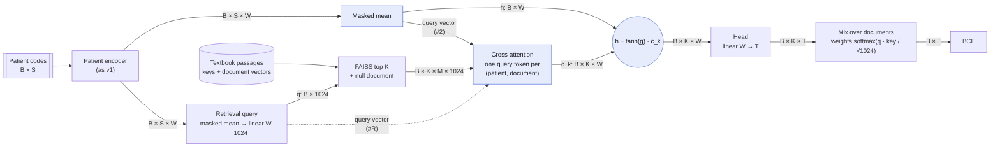

# Scaling laws v2: design

Why v1's retrieval did worse than patient only, and the evidence: [`README.md`](README.md). This
page is the v2 design. It fixes the architecture and takes in the advisor's comments. EveryQuery
is separate ([`everyquery/`](../everyquery/)).

## 1. Variables

| Symbol | Meaning | Value |
|---|---|---|
| `B` | patients per batch | 32 |
| `S` | codes per patient | 256 |
| `W` | patient-encoder size, `WIDTHxLAYERSxHEADS` | 64x2x4, 128x2x4, 256x4x8 (Stages 0–3); wider in Stage 4 |
| `D` | training patients | 10K, 30K, 153K (Stages 1–3); Stage 4 grid |
| `T` | tasks (random 30-day codes) | **1,000**, one setting |
| `K` | documents per patient, plus the null document | 4 to 512 (Stage 2 sweep); **the same in training and at test** |
| `M` | vectors per document | 256 token embeddings (E0) or 16 chunks (E1, E2) |
| Draws | new tasks, patient subsample and seed | **3** |

## 2. Architecture

Blue: what changes from v1.

- **`h`** is the masked mean of the encoder states: exactly #1's input to the head (fixes C1).
- **`c_k`** is what document k contributes. One query token per (patient, document) cross-attends to
  the document's M vectors: query `W_q·h` for #2, `W_r·q` for retrieval only (#R). The
  keys and values are the document vectors projected 1024 → `W`. Then a feed-forward layer, with
  no residual from the query, so `c_k` holds only document content read for this patient.
- **Gate `g`**, one learned scalar, starts at 0 (Flamingo). At the start every document gives
  `head(h)`, which is #1, so #2 starts as #1 and moves away only if documents lower the loss
  (fixes C2). The head reads a `W`-wide vector for every configuration, with the same dropout (C4).
- **#R** drops `h`: the prediction for document k is `head(c_k)`. The patient reaches the
  prediction only through the query: which documents it retrieves and what it reads from them.
- **Mix over documents**: as v1, `p = Σ_k w_k σ(z_k)` with `w = softmax(q · key / √1024)` over the K
  retrieved documents and the null document. The query is trained through `w`.
- **Cost**: one query token per document, so cross-attention is `O(B · K · M · W)`. That is what lets
  K reach 512 (v1 attended from all 256 patient codes to all 256 document tokens of every document).

At the start the gate is 0, so all K predictions are equal and the mixing weights get no gradient.
The query starts training once the gate opens. If that turns out slow, set the first `g` to a small
value (open decision, §10).

## 3. Configurations

| # | Configuration | Head reads | Documents |
|---|---|---|---|
| 1 | Patient only | `h` | none |
| 2 | Retrieval + patient | `h + tanh(g) · c_k` | top K + null |
| R | Retrieval only (new) | `c_k`, read with the retrieval query | top K + null |
| 4 | Random documents (control, small slice) | as #2 | random K + null, in training and at test |

**Dropped:** #3 (frozen Qwen3 query on the last 32 codes): slow (10× per run) and not clearly better than #2 in v1.

**#2 − #4** is the value of the documents' content; **#4 − #1** should now be about 0 (the gate
can stay shut), and is the check that the fix works. **#R** at the same settings tells what the
documents carry by themselves, and how that changes with the document encoding.

## 4. Documents

**Encodings** (precomputed once per passage, frozen, cached on the GPU):

| | Encoding | Vectors per passage | Size | Built by |
|---|---|---|---|---|
| E0 | Qwen3 token embeddings (v1) | 256 × 1024 | from the 151,669 × 1,024 table | (lookup) |
| E1 | Qwen3-Embedding-0.6B **last layer**, mean over 16 chunks of 16 tokens | 16 × 1024 | 4.1 GB | `everyquery/encode_docs.py` (built on the cluster) |
| E2 | the same, **layers 4, 8, …, 28** (7 layers), attended as 7 × 16 tokens with a learned layer embedding | 112 × 1024 | 29 GB | `encode_docs.py --layers` (to add) |

E2 is the advisor's "run Qwen over the documents, take all layers, attend over them". All 29
hidden states would be 120 GB, too large to cache, so every 4th layer is used. A learned weighted
mean of the 7 layers (ELMo) is the cheaper fallback: 16 vectors instead of 112.

**K.** The retrieval signal is "of the documents retrieved, which predicts best". With 4 documents,
mostly poor at the start, that estimate is noisy. Stage 2 sweeps K ∈ {4, 32, 128, 512}. Training and
test use the same K (fixes C3); "top 1 + null" stays as a second test.

**Sampled K** (advisor: "choose random K instead of top K"). In training, take the top `4K`
candidates and draw K of them without replacement, in proportion to `softmax(q · key / √1024)`
(Gumbel-top-K). At test, the top K. This lets the query learn from passages it would not have ranked
first. The uniformly random version is #4.

## 5. Loss

Unchanged from v1, with the same K in training and at test. Patient `i`, task `t`, documents `k` =
1..K plus the null document:

$$
p_{it} = \sum_{k} w_{ik}\, \sigma(z_{ikt}), \qquad
w_{ik} = \operatorname{softmax}_k\!\left(\frac{q_i \cdot \kappa_{ik}}{\sqrt{1024}}\right), \qquad
\mathcal{L} = \frac{1}{|V|} \sum_{(i,t) \in V} -\big[y_{it} \log p_{it} + (1 - y_{it}) \log(1 - p_{it})\big]
$$

with `z_ikt = head(h_i + tanh(g) · c_ik)_t` for #2 and `head(c_ik)_t` for #R. #1 is plain BCE on
`head(h_i)`.

## 6. Training settings

As v1 (AdamW, linear warmup + cosine, weight decay 0.01, batch 32, clipping 1.0, head bias from base
rates, the per-`D` epoch schedule) except what Stage 0 picks:

| Setting | v1 | v2 |
|---|---|---|
| Learning rate | 1e-3 | Stage 0: 3e-4, 1e-3 or 3e-3 |
| Dropout | 0 encoder, 0.1 fusion | Stage 0: 0 or 0.1, **the same everywhere** |
| Checkpoint tested | last | Stage 0: best by validation loss, or last (both are tested) |
| Checkpoints | deleted | **kept** (needed to re-test, measure retrieval, and warm-start) |
| Test | top 1 + null | top K + null (as trained); top 1 + null as a second test |

The new parameters (`W_q`, `W_r`, fusion, `g`) use the same learning rate as the rest.

## 7. Stages

Each stage picks settings for the next one. All runs use `T` = 1,000 and 3 draws.

| Stage | Purpose | Grid | Runs |
|---|---|---|---|
| 0 | patient-only configuration search | #1 × `W` {64x2x4, 128x2x4, 256x4x8} × lr {3e-4, 1e-3, 3e-3} × dropout {0, 0.1}, `D` 153K | 54 |
| 1 | find where retrieval loses (ladder below), K = 4, E0 | 6 rungs + v1 #4 reference × `W` {64x2x4, 256x4x8} × `D` {10K, 153K} | 84 |
| 2 | number of documents | {#2, #R} × K {4, 32, 128, 512}, E1, best `W`, `D` {30K, 153K}; + sampled K at K 128 | 60 |
| 3 | document encoding | {#2, #R} × {E0, E1, E2} at the best K, `D` {30K, 153K} (E1 from Stage 2) | 24 |
| 4 | scaling law | #1, best #2, best #R on isoFLOP curves (`isoflop_grid`: 4 budgets × ~6 sizes); #4 on 3 points | ~225 |
| | | | **~445** (v1: 2,685) |

**Stage 1 ladder.** Each rung changes one thing, so the step where the loss gap appears names the cause:

| Rung | Model | Isolates | Needs |
|---|---|---|---|
| A0 | #1 patient only | baseline | – |
| A1 | v1 #2, tested at K = 1 (v1) and at K = 4 (as trained) | C3: train/test mismatch | – |
| A2 | v1 #2 with a masked mean in the fusion | C1: padding | MedRAP M1 |
| A3 | fixed #2 (§2) | C2, C4: gate and head input | M2 |
| A4 | fixed #2, random documents (#4) | does the gate close on useless documents? (A4 ≈ A0) | M2 |
| A5 | fixed #R | what E0 documents carry alone | M2 |

A0, A1 and v1's #4 (as a reference) run on current MedRAP. **Pass:** A3 is not worse than A0
(paired 95% interval of A0 − A3 includes or exceeds 0) at every cell. If A3 still loses, the next
step is to start #2 from A0's checkpoint.

Logged for every retrieval run: the gate `tanh(g)` over training; the weight on the null document;
how many distinct passages the test patients retrieve and the entropy of how often each is
retrieved (from `medrap-retrieve`); and the random-document swap at test.

## 8. MedRAP changes

Small PRs to MedRAP, each with doctests; the pin in [`../scaling_laws/pyproject.toml`](../scaling_laws/pyproject.toml) moves
when they land.

| | Change | For |
|---|---|---|
| M1 | `PerDocCrossAttentionFusion`: masked mean over patient codes (bug fix; v1's fusion stays otherwise unchanged) | A2 |
| M2 | Gated fusion (§2): one query token per document, `mode: patient | query`, gate at 0; `FusionInput` gets the retrieval query | A3–A5, Stages 2–4 |
| M3 | Retrieval encoder that reads precomputed document vectors (E1, E2) by retrieved row, cached on the GPU | Stages 2–4 |
| M4 | Retriever: `sampling: gumbel` with `candidates: 4K` in training | Stage 2 |

Experiment-side (this directory): `flops.py` (§9), `encode_docs.py --layers` (E2), `analyze.py` (§10).

## 9. Compute and parameters

**Compute is measured, not estimated.** v1 used `6 · N · D · epochs · S`, which leaves out
attention, the fusion's cross-attention, and FAISS search.

| Part | How it is counted |
|---|---|
| Training step (forward + backward) | `torch.utils.flop_counter.FlopCounterMode` on one real batch, per configuration, `W`, K and encoding; × steps |
| Validation and test | the same, forward only, × batches |
| FAISS search | `2 · 125,847 · 1,024 ≈ 2.6 × 10⁸` FLOPs per query (exact inner-product search), added per patient per step; on the order of the encoder's own cost |
| Document encoding | once: `2 · 0.6B · 32M tokens ≈ 4 × 10¹⁶` FLOPs for E1/E2, reported separately (shared by all runs) |
| Wall-clock | GPU-hours from `sacct`, as a second cost |

**Parameters**, reported per run:

| Count | Contents | Used for |
|---|---|---|
| `N` | trained parameters except the code embedding table | the law's model size |
| `N_trained` | every trained parameter | the parameter table |
| `N_frozen` | frozen parameters used per step (Qwen3 token table for E0); the precomputed vectors are data, not parameters | the parameter table |

## 10. Analysis

**Paired differences are the unit.** For each cell (`W`, `D`, K, encoding) and draw (same tasks,
patients, seed and test set), `Δ = L(#1) − L(#X)` is one number (positive: retrieval helps).
Intervals: a paired bootstrap over test patients within each draw (per-patient predictions from
`medrap-predict-probabilities`), combined across the 3 draws. Laws are compared with
`simple_scaling_laws.compare`, fitted on the same cells with the same seed so its draws are paired.

**Loss only.** No AUROC fits; AUROC is reported as a number per cell.

**Several law forms.** Each configuration is fitted with `separable-power`, `shifted-separable-power`,
`kaplan-joint-power`, `skaling-joint-power` and `bounded-rational-power`, and the form with the lowest
leave-one-cell-out RMSE is kept.

**Quality gate.** A fit is reported only if R² over cell means ≥ 0.9, the leave-one-cell-out RMSE is
below the run-to-run SD, and it has no `lack_of_fit`, `ill_conditioned_fit` or
`optimizer_nonconvergence` warning. Otherwise that configuration is shown law-free: cell means
and isoFLOP profiles (`fit_isoflop`), with no fitted curve.

**Plots** (advisor's list first):

| # | Plot |
|---|---|
| Q1 | Test loss vs training compute (measured): every run as a dot, the lower envelope per configuration |
| Q2 | IsoFLOP profiles: loss vs `N` at each budget, law-free (`fit_isoflop`) and, if a law passes, the law |
| Q3 | Paired difference `Δ` vs `D`, vs `N` and vs compute, with intervals; #2 − #4 and #4 − #1 on the slice |
| Q4 | Loss and `Δ` vs K, for #2 and #R (Stage 2) |
| Q5 | Stage 1 ladder: `Δ` per rung |
| Q6 | Retrieval diagnostics: gate over training, null-document weight, distinct passages retrieved |

## 11. Open decisions

| Decision | Default here |
|---|---|
| Gate start | 0 (Flamingo); a small value if the query does not train |
| E0 at large K | Stage 1 only (256 vectors per passage is 16× E1) |
| Stage 4 budgets and sizes | from `isoflop_grid` with the cost model measured in Stages 0–2; `D` capped at 153K patients |
| K annealing (advisor: "can later be annealed") | after Stage 2, if loss keeps falling with K |
| PubMed | later |
